<p align="center">
  
</p>

<h3 align="center">The ultimate 3D file manager for makers and 3D printer owners</h3>

<p align="center">
  <a href="https://github.com/stellio-app/stellio/releases"></a>
  <a href="https://www.python.org/"></a>
  <a href="https://flask.palletsprojects.com/"></a>
  <a href="https://www.gnu.org/licenses/agpl-3.0"></a>
  <a href="https://github.com/stellio-app/stellio/blob/main"></a>
  <a href="https://github.com/stellio-app/stellio/blob/main"></a>
</p>

<p align="center">
  <a href="https://demo.stellio-app.com"><b>▶ Try the live demo (read-only)</b></a>
</p>

<p align="center">
  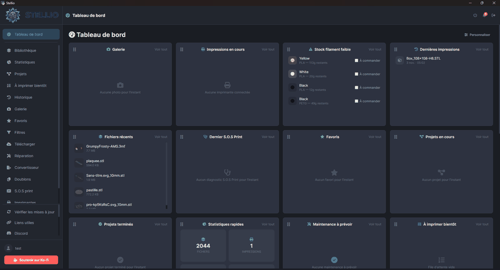
</p>

<table align="center">
  <tr>
    <td align="center"><a href="docs/screenshots/02-library.png">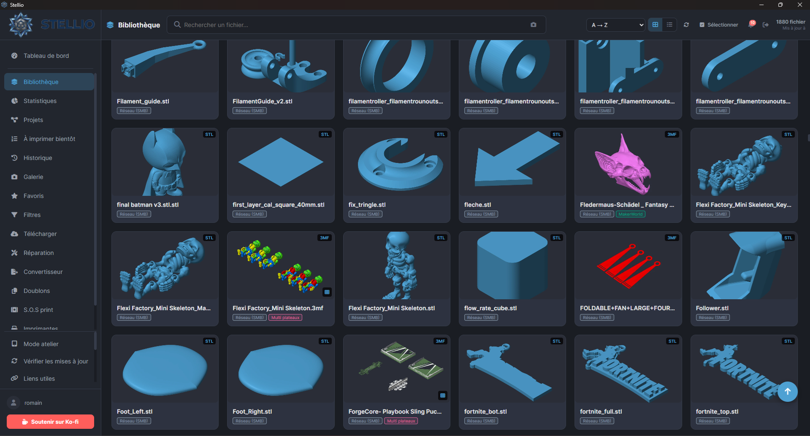<br>Library</a></td>
    <td align="center"><a href="docs/screenshots/03-viewer.png">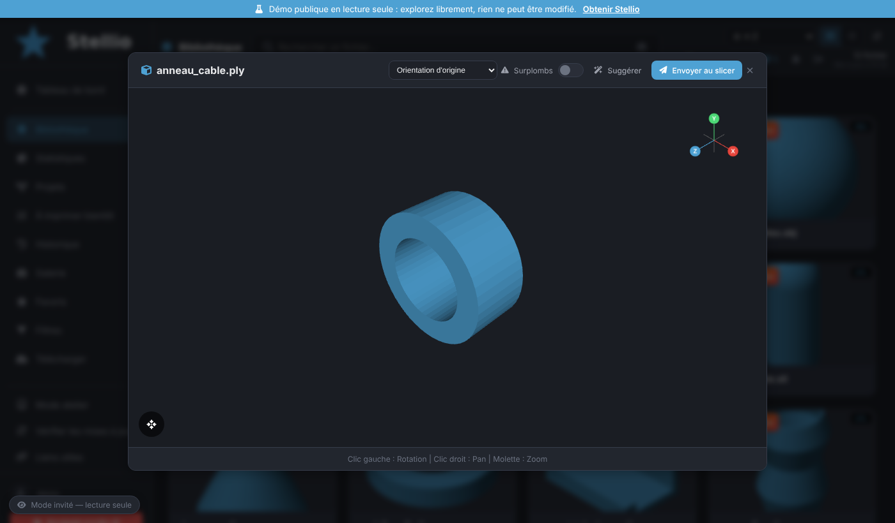<br>3D viewer</a></td>
    <td align="center"><a href="docs/screenshots/04-filters.png">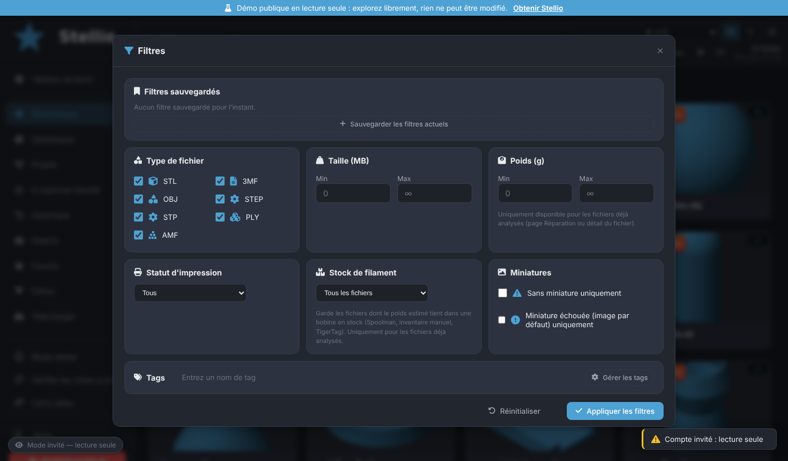<br>Filters</a></td>
    <td align="center"><a href="docs/screenshots/05-repair.png">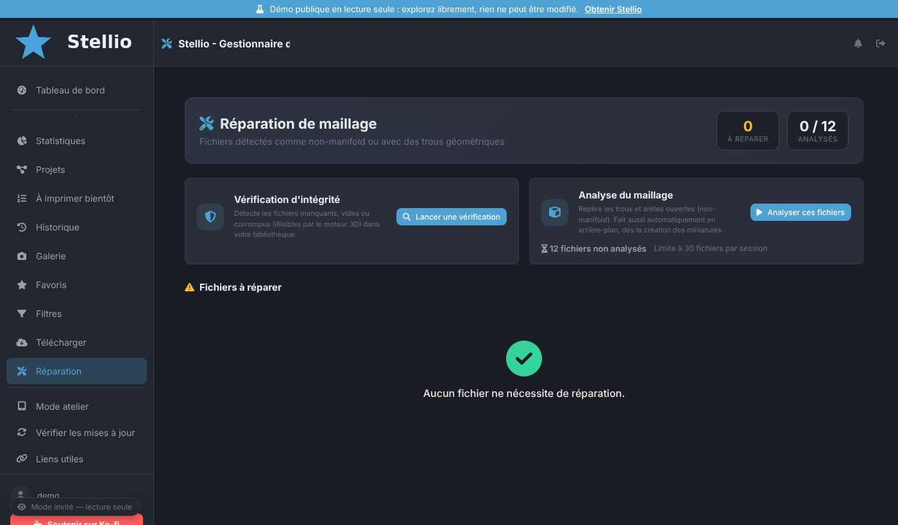<br>Repair</a></td>
    <td align="center"><a href="docs/screenshots/06-converter.png">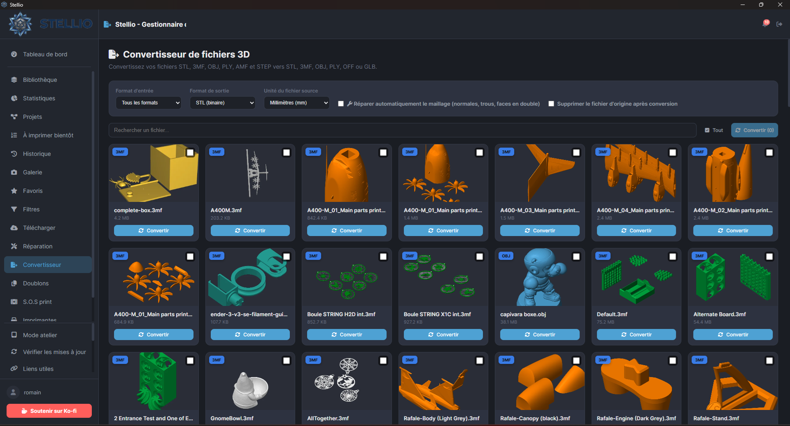<br>Converter</a></td>
  </tr>
</table>


<p align="center">
  🇬🇧 <strong>English</strong> |
  <a href="docs/readme/README_fr.md">🇫🇷 Français</a> |
  <a href="docs/readme/README_de.md">🇩🇪 Deutsch</a> |
  <a href="docs/readme/README_es.md">🇪🇸 Español</a> |
  <a href="docs/readme/README_it.md">🇮🇹 Italiano</a> |
  <a href="docs/readme/README_pt.md">🇵🇹 Português</a> |
  <a href="docs/readme/README_ja.md">🇯🇵 日本語</a> |
  <a href="docs/readme/README_zh.md">🇨🇳 中文</a>
</p>

<p align="center">
  <a href="#-installation">🚀 Installation</a> •
  <a href="#-features">✨ Features</a> •
  <a href="#-documentation">📖 Documentation</a> •
  <a href="#-contributing">🤝 Contributing</a> •
  <a href="#-license">📜 License</a>
</p>

---

## 🎯 Overview

**Stellio** is a modern desktop application that centralizes your entire 3D library (STL, 3MF, OBJ, STEP, PLY, AMF), automates repetitive tasks, and integrates seamlessly with your 3D printing workflow.

Whether you're a beginner maker or an experienced printer owner running multiple machines, Stellio saves you precious time thanks to **local AI** (Ollama), **smart printer management**, and an **interface built for productivity**.

> 💡 **Philosophy**: Your data stays with you. Everything runs locally. On Raspberry Pi / Linux you can optionally plug in an online AI with your own API key (see below); by default, nothing leaves your machine.

---

## ✨ Features

### 🏠 Dashboard & productivity
- 📊 **Dashboard on launch**: prints in progress, low filament stock, recent prints and recent files at a glance
- 🧱 **Fully customizable**: drag-and-drop reordering and hiding of widgets (20 available: current prints, low stock, latest S.O.S Print, suggestions, Stellio instances…)
- 🖼️ **More widgets**: “Completed projects”, “Gallery” (gallery photos scroll by, pause on hover, click to enlarge) and “Quotes” (the 5 latest quotes created); all widgets have the same size and their content scrolls inside
- ✅ **"Getting started" checklist** for new users
- 💡 **"Suggestions" widget**: spots files you reprint often but haven't touched in a while, and slicer profiles with a high failure rate
- ⌨️ **Command palette (`Ctrl+K`)**: navigate, run an action or instantly find a file, tag, filament spool or slicer profile
- 🔔 **Notification center (bell)**: print finished, failure, upcoming maintenance, low filament stock and spool drying reminders all in one place
- 📺 **Floating widget** showing the progress of the current print, visible on every page
- 🧭 **Interactive guided tour** to discover the main features, restartable from Settings
- ♿ **Accessibility**: high-contrast mode, reduced motion, visible keyboard focus indicators everywhere
- 🪟 **System tray icon (Windows)**: a Stellio icon next to the clock shows the app is still running (click to open, right-click for Open / Quit)

### 📚 Library management
- 🗂️ **Multiple sources**: local folders, single files, SMB/NFS shares — 3D folders detected on your computer are suggested and can be added in one click
- 🖼️ **Automatic 3D thumbnails** via PyRender (high-quality rendering) or a numpy CPU rasterizer (fallback), with loading-effect placeholders and an **enlarged preview on hover**
- 🌀 **Always smooth**: thumbnail generation pauses as soon as you use the app and resumes when you stop
- ⚙️ **Thumbnail performance setting** (Automatic / Eco / Normal / Fast) with a translated progress indicator; very detailed STL files and huge or multicolor 3MF files get clean 3D thumbnails, and PrusaSlicer 3MF files are rendered in 3D just like STL
- 🏷️ **Custom tags** with colors + AI auto-tagging, and **one-click tagging of several selected files** at once
- 🔍 **AI-assisted semantic search** ("I'm looking for a support for...") with **recent searches remembered**
- ⭐ **Favorites** and advanced filters (type, size, weight, print status), with a **restock warning** when filament stock is insufficient for your favorites
- 🧵 **"Filament stock" filter**: keeps only the files printable with the spools you actually have (Spoolman, manual inventory, [TigerTag](https://tigersystem.io)), by material
- 💾 **Saved filters**: save any combination of library filters and reuse it in one click
- 🔀 **Remembered sort and search**: the chosen sort order (A → Z, folder, size, date, tag…) is restored when the app reopens, and the search, active filters and AI search results stay in place when the library refreshes automatically; clearing the search field immediately stops the AI search in progress
- 🖨️ **Print status filters**: “Sent to slicer”, “Already printed (success or failed)”, “Already succeeded” and “Already failed”
- 📋 **"Print soon" queue**, separate from favorites, reorderable by drag-and-drop and sendable straight to the slicer
- 🖱️ **Fast selection**: range selection (`Shift+click`) and keyboard navigation (arrows + `Enter`)
- ✏️ **Bulk rename** (find/replace, prefix, suffix, numbering) with a preview before applying
- ↩️ **Undo deletions** (`Ctrl+Z`) thanks to a 5-minute temporary trash — deleting a tag, project or source is also undoable, with no blocking confirmation
- 🔗 **Model origin**: source link, author, license and notes on each file sheet, with the download date when applicable
- 🧩 **Projects/Assemblies**: group several files for a single object, with multi-plate 3MF support (plate navigation in the viewer)
- 🧱 **Multi-plate 3MF in projects**: adding a multi-plate 3MF to a project automatically splits it into one 3MF file per plate (6 plates = 6 files to print), stored in a hidden folder so the library stays tidy, with instant thumbnails and sending to the slicer from the project; the **“Split plates”** action (a file's ⋯ menu) creates a separate STL or 3MF per plate
- 🔎 **Project cards**: clicking a thumbnail opens the file in the 3D viewer; the “All / In progress / Completed” filter is remembered between sessions; rating a print “successful” adds the printed part to the projects containing the file and removes it from “Print soon”
- 💰 **Project cost**: a button on the project card calculates the cost of all its files with the same settings as the cost of a single part (precise slicer estimate, spool, electricity, wear, fixed fee, margin, quantities) and exports the PDF quote
- 🔁 **Duplicate detection** (exact and geometry-similar)
- 🗜️ **Archive support**: browse and extract models directly from archives
- 🖱️ **Drag & drop 3D files** from your file explorer — works on the desktop app and also through a browser (Raspberry Pi, mobile, remote access)
- 📊 **Detailed statistics** (formats, platforms, profile reliability)

### 🤖 Artificial Intelligence (local Ollama)
- 🏷️ Smart **auto-tagging** of files
- 📝 **Automatic description** of models
- 🔎 **Natural-language semantic search**
- 📐 **Printability analysis** (overhang detection) and **suggested orientations** (less overhang, bed contact shown)
- 🎯 **Slicer profile recommendation** based on geometry + success history
- ⏱️ **Print time estimation** before slicing
- 🩺 **S.O.S Print**: adaptive, step-by-step print-failure diagnosis — Stellio asks one question at a time, narrows down a live list of hypotheses as you answer (max 4 questions), then gives a final diagnosis; photo analysis supported throughout, with saved conversations you can reopen or mark as resolved

### 🖨️ Printer management
- 🔌 Support for **OctoPrint**, **Klipper/Moonraker**, **Bambu Lab** (MQTT), **Creality** (WebSocket), **FlashForge**, **Elegoo** (SDCP) and **PrusaLink**
- 📡 **Automatic network discovery**: Stellio scans your local network (SSDP for Bambu Lab, UDP broadcast for Elegoo/Centauri/FlashForge, targeted probing for Klipper/OctoPrint/PrusaLink/Creality) and lets you add detected printers with one click
- 📡 Real-time monitoring (temperatures, progress, camera)
- 🖼️ **Current print on the card**: thumbnail and name of the file being printed when it is in the library (G-code thumbnail for Klipper/Moonraker prints started outside Stellio); the build plate size (X, Y, Z) is set per printer and triggers a warning before sending if the part is too large
- 🔧 **Predictive maintenance** with brand-specific task tracking and recommendations (Bambu, Prusa, Creality, etc.)
- 🔩 **Wear parts & consumables**: stock of nozzles, plates, belts… with low-stock alerts, linked to maintenance tasks (each service deducts one part)
- ⏱️ Automatic print-hour counter
- 📤 Direct send to slicer, with a spool selector so you assign the right filament straight from the send dialog, or upload to the printer
- 👀 **Quick preview** (weight, estimated print time) directly in the send-to-slicer window before confirming
- 🛡️ **Smarter pre-print check**: warns if the assigned spool needs drying, if the filament is abrasive (hardened steel nozzle advised) or if no calibration exists for this printer
- 🔁 **Reprint like last time**: from the history, one click reopens the send window with the same printer, profile and spool
- 🎛️ **Calibrations**: save flow, pressure advance, temperatures… per filament and printer, recalled in the send-to-slicer window
- 👥 **Light collaborative mode**: see if another connected device is already viewing a file, and get warned before accidentally sending the same file to the slicer twice

### 🧵 Filament management
- 🔗 **Spoolman** integration (spool management server), with automatic detection on your network
- 🟠 **Bambu Lab AMS** support (slot reading)
- 🟢 **Creality CFS** support
- 🐯 [**TigerTag**](https://tigersystem.io) integration (NFC/RFID spool identification): sign in to see your TigerTag spools in the inventory, or let Stellio pick up an existing TigerTag Studio session automatically — read-only, never modifies your TigerTag inventory
- ⚪ Manual spools
- 📉 Automatic consumption tracking on send-to-slicer, with a compatibility check before printing (enough material left?)
- 🔔 **Low-stock alerts** on startup, with a quick link to buy more
- 🛒 **Buying a spool again**: Stellio first offers the manufacturer's own shop for the brand (Arianeplast, Bambu Lab, Polymaker, eSUN, Sunlu…), then general shops, with stock checked automatically when the site allows it
- 💨 **Spool drying**: drying log, status (dry / needs drying) based on the material, suggested temperature and duration, and reminders in notifications
- 📈 **Spool summary**: prints, grams, cost and untracked difference in each spool's sheet

### 📥 Download from platforms
- 🟠 **Printables** (GraphQL API)
- 🟢 **MakerWorld** (2-step Bambu Lab login)
- 🔵 **Thingiverse** (via API key)
- 🟣 **Nexprint** (Elegoo's model library; sign in with your account email and password, stored encrypted)
- 🔷 **Creality Cloud** and **Snapmaker Space** (sign in from Settings, credentials stored encrypted; Google sign-in is not supported)
- 📁 Direct download to your configured sources
- 🆕 **New version detection**: Stellio checks every day whether the models you downloaded (Printables, MakerWorld, Thingiverse) have been updated
- 🛒 **Useful links**: shops, printer manufacturers, 3D model sites and resources grouped in collapsible sections

### 🧩 Advanced tools
- 🎨 **Automatic bed nesting** (rectpack or real silhouette via shapely)
- 🔧 **Mesh repair** (trimesh + pymeshfix) with a **before/after comparison** (watertightness, triangles, vertices, size)
- 🔄 **Format converter** (STL ↔ 3MF ↔ OBJ)
- 🛡️ **Integrity check** (corrupted/missing files)
- 💰 **Print cost calculation**: material, electricity, machine wear (per hour), fixed fee, margin in % and quantity — unit price and total computed to the cent
- 🏷️ **Margin & sale price**: set your default margin (%) once in Settings → Print pricing; the history shows the sale price (cost + margin) next to the cost, while statistics keep using the real cost
- 🧾 **PDF quotes**: generated from the cost calculator with customizable client, item name and notes; configurable quote header (name/company, logo, address, phone, email, website, tax ID) and legal notices in the footer
- 🗃️ **Quote history**: every generated quote is kept (PDF copy) and can be browsed, re-downloaded and deleted from the “Quotes” widget on the dashboard
- 🌱 **Environmental estimate**: CO₂ footprint of your prints (material + electricity)
- 📸 **Print photo gallery** (successful/failed)
- 🕒 **History** with success/failure rating (feeds the AI), a **"View file"** and **"Reprint"** button on each row (with detection of moved/deleted files), and filters by platform, result (successful/failed/partial/unrated) and date range

### 📈 Reports & reliability
- 🧮 **Print reliability**: success rate and cost of failures ranked by slicer profile, material, printer or spool
- 🗓️ **Monthly report**: prints, success rate, filament, cost, failures and CO₂ for the month, compared with the previous one, exportable as PDF

### 🔔 Notifications
- 🪟 **Native Windows notifications**
- 🌐 **Browser notifications** you can enable for Raspberry Pi or mobile access
- 📣 **Push notifications** (ntfy, Telegram, Discord or webhook): print completion and failure detected even with the window closed, plus maintenance and stock alerts

### 🌐 Remote & mobile access
- 📱 **QR code** for mobile access to your library (installable PWA)
- 📲 **Android companion app**: a dedicated QR code lets you download and install the Stellio companion APK directly from the mobile access settings, with the ability to take photos straight from a print
- 🌍 **Remote access** via Cloudflare Tunnel (free, random or fixed URL), or a **custom address** (domain name, DynDNS, VPN, Tailscale…) to avoid Cloudflare, with one-click return to Cloudflare
- 🔗 Temporary **share links** (24h, one-time use)

### 👥 Accounts & multi-instance
- 🔐 **Local accounts** with a recovery code and a secret question: 100% local password reset, no email or internet needed
- 🙋 **Session confirmation**: when the app opens with a saved session, Stellio asks you to confirm the account (Yes / No); on a phone, coming back to the app does not ask for credentials again while the session is valid
- 👤 **Read-only guest accounts**: share your library, printers and stock with family or friends without any risk
- 🔄 **Stellio instances**: other installations on your local network are detected automatically and added in one click (you only need to enter their local key)
- 📨 **Send a file to another instance**: choose the destination folder on the target instance — the received file shows up in its library right away
- ✅ **Instance status widget** on the dashboard (green check or red cross for each saved instance)

### 🎨 Customization
- 🌓 Themes: Dark / Light / System
- 🎨 Brand themes: Stellio, Bambu, Prusa, Voron, Creality
- 🎯 Custom accent color
- 🌍 **8 languages**: FR, EN, DE, ES, IT, PT, JA, ZH
- 🧲 Drag & drop navigation reordering
- ↩️ **Settings undo**: revert the very last configuration change you made

### 💾 Backup & Updates
- 📦 Full backup export/import (.zip)
- 🔄 Automatic updates from GitHub (`.zip` patch — same mechanism on Windows and Raspberry Pi/Linux)
- 🧰 **Module check**: on the first launch of each version, missing modules (PDF quotes, spreadsheet import, notifications…) are downloaded automatically
- 🔁 Reliable restart after an update or after enabling debug mode, on Windows and Raspberry Pi/Linux
- 📋 Diagnostic log export (secrets masked)
- 💬 **Suggestions & bug reports from the app**: send a suggestion or a bug report without leaving Stellio — it is created as a GitHub issue (anonymously, through a dedicated GitHub App), with a link to the issue and a "New reply" badge when you get an answer

---

## 🖼️ Screenshots

| | |
|---|---|
| 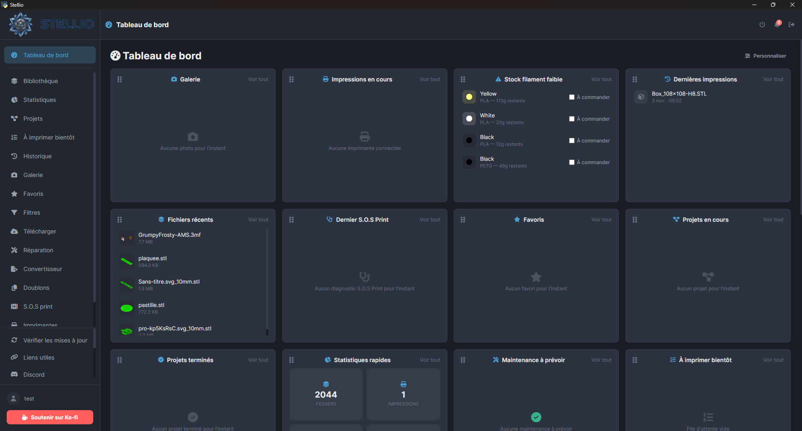 *Customizable dashboard* | 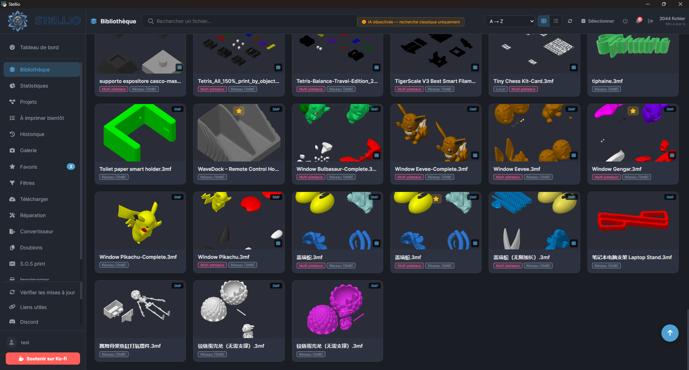 *Library with tags and favorites* |
| 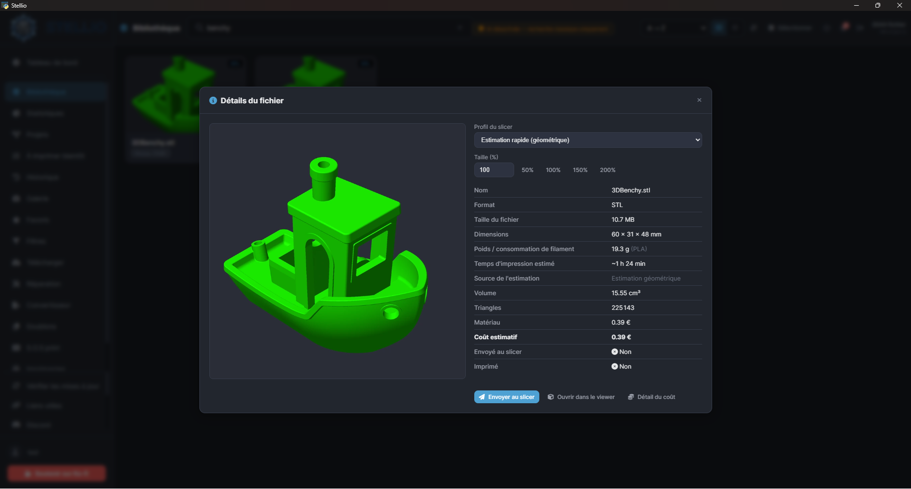 *File details: weight, print time and cost* | 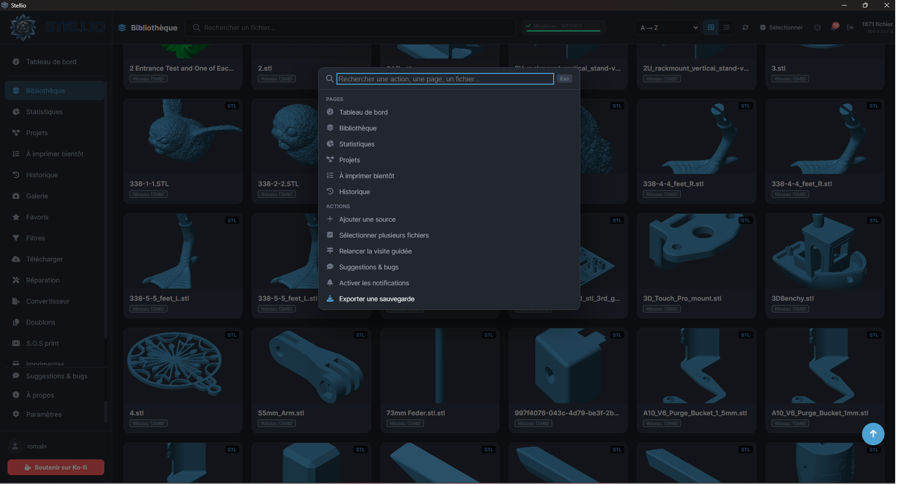 *Command palette (Ctrl+K)* |
| 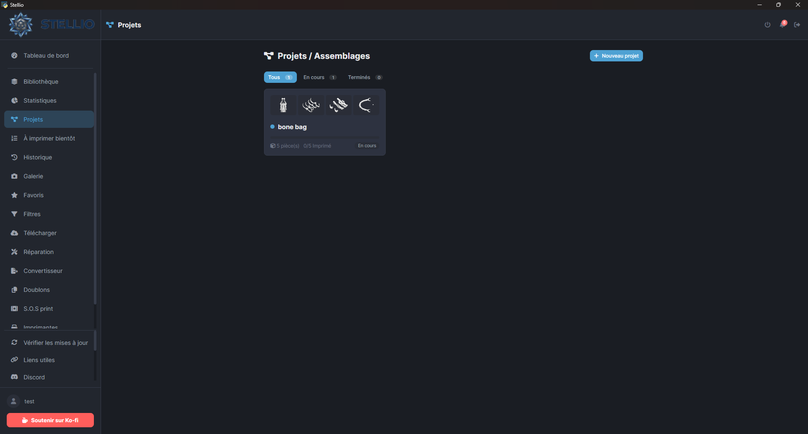 *Projects / assemblies* | 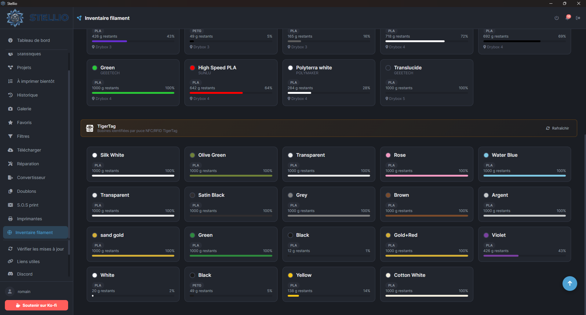 *Filament inventory* |
| 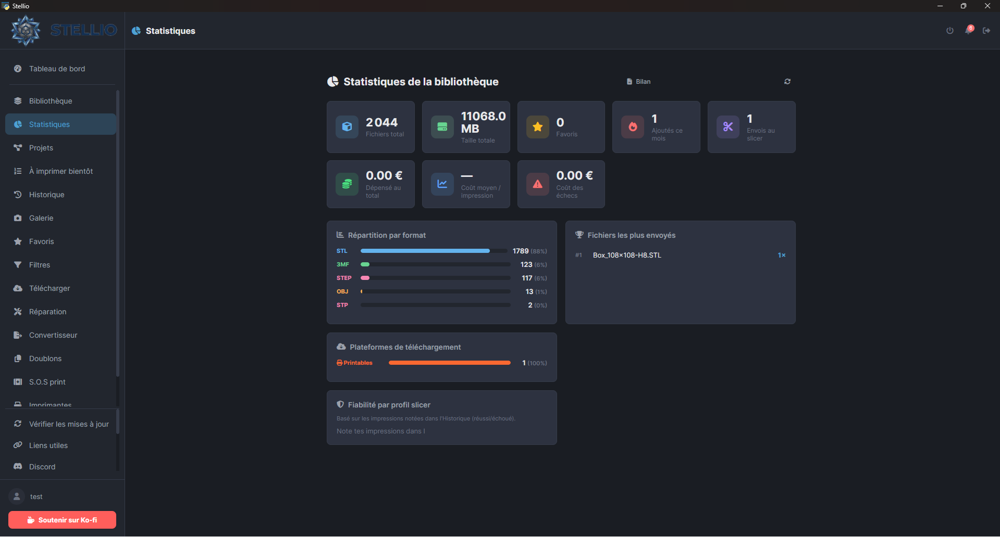 *Library statistics* | 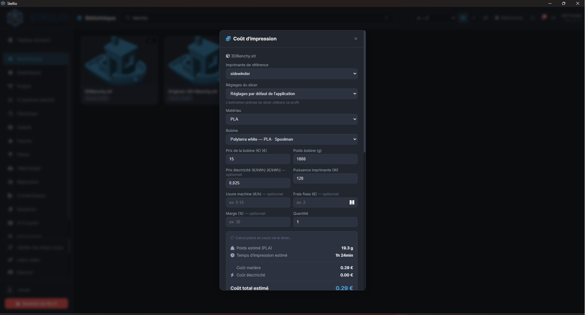 *Print pricing: electricity, wear, margin* |
| 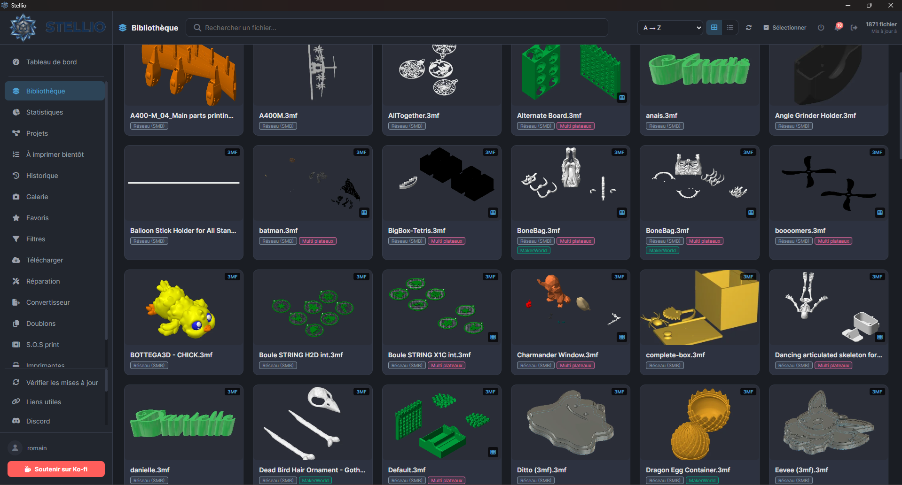 *Library with thumbnails* | 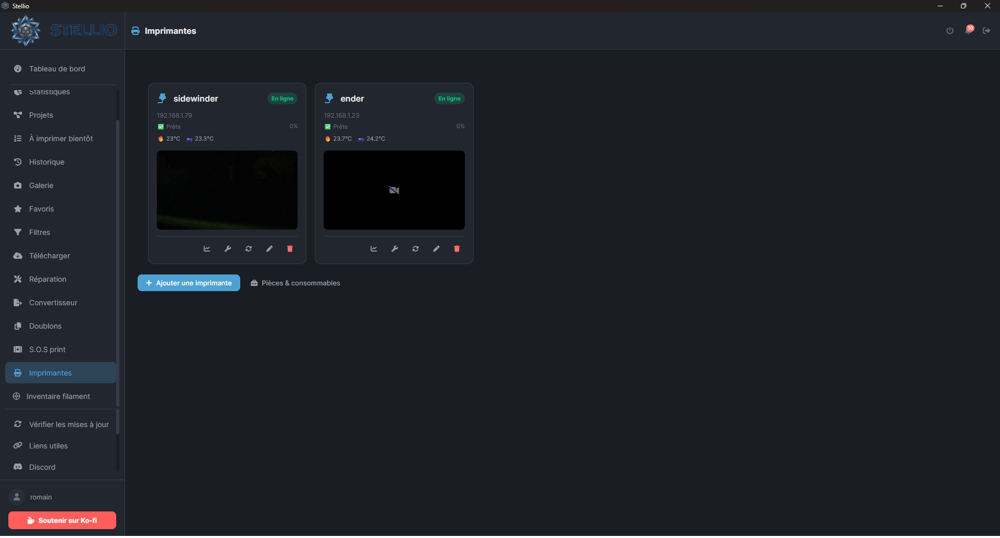 *Printer monitoring* |
| 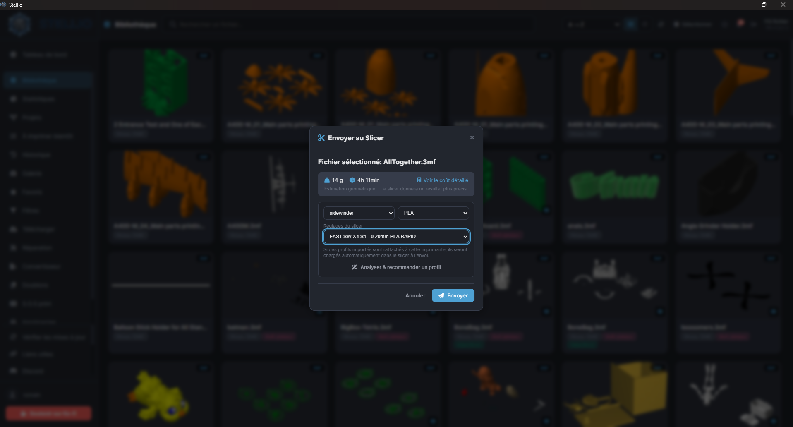 *AI profile recommendation* | 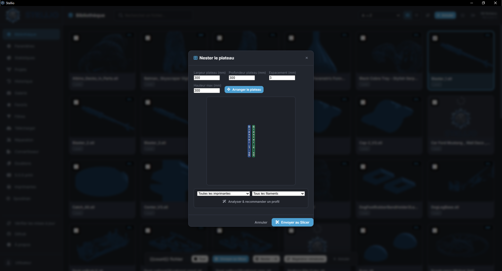 *Automatic nesting* |

---

## 🚀 Installation

### 🪟 Windows (recommended)

1. Download the latest installer from [Releases](https://github.com/stellio-app/stellio/releases)
2. Run `Stellio-Setup-<version>.exe`
3. That's it! 🎉

> 💼 **Portable version (no installation)**: download `Stellio-v<version>-portable-win64.zip` from the Releases, unzip it anywhere (disk, USB drive) and run `Stellio.exe`. Your data stays in the `data` folder next to the executable (keep the `portable.flag` file).

### 🐧 Raspberry Pi / Linux

Runs in **headless server mode** (no graphical interface): Stellio runs in the background and is accessed from a browser, either on the Pi itself or from any device on the local network.

**Requirements**: Raspberry Pi 4 or 5 recommended, **64-bit** Raspberry Pi OS.

```bash
curl -O https://raw.githubusercontent.com/stellio-app/stellio/main/install-pi.sh
chmod +x install-pi.sh
./install-pi.sh
```

The script automatically installs:
- system dependencies (`ffmpeg`, `unrar`, 3D rendering libraries)
- a dedicated Python virtual environment
- a **systemd service** (`stellio.service`) that starts Stellio at boot and automatically restarts it on crash

Once installed, Stellio is accessible at `http://<pi-ip>:5000`.

```bash
sudo systemctl status stellio     # Service status
sudo systemctl restart stellio    # Restart
sudo journalctl -u stellio -f     # Follow logs live
```

> 💡 **Same updates as on Windows**: the `.zip` patch published with each release is identical on both platforms (pure source code, nothing compiled). Stellio detects and applies it automatically, then restarts the service — no manual reinstall needed.
>
> 🎥 Same features as the Windows version, except for the native desktop window (replaced by browser access) and the local Ollama AI, which needs a reasonably capable model to run well on a Pi — point `ollama_url` to a remote Ollama server in Settings if needed.

### 🖥️ Proxmox VE (one-command LXC container)

On a **Proxmox VE** server, a script creates and configures the whole container for you. Open the **Proxmox host Shell** (Datacenter → your node → Shell) and paste:

```bash
bash -c "$(curl -fsSL https://raw.githubusercontent.com/stellio-app/stellio/main/stellio-lxc.sh)"
```

The script offers default or advanced settings (CTID, cores, RAM, disk, bridge, VLAN, DHCP or static IP, storage, host folder to mount), then:
- creates an **unprivileged Debian 12** container (2 cores, 2 GB RAM, 32 GB disk by default, start on boot);
- installs Stellio in it with `install-pi.sh` (dependencies, Python environment, **systemd service**);
- prints the access address `http://<container-ip>:5000` and the generated root password.

> 🔒 **Sources**: in this container, adding **local folders and files is hidden** in Stellio; only the **SMB** and **NFS** network sources are offered. If you mount a host folder with `var_mount=/host/path:/mnt/models`, “Local folder” is allowed as well. The setting lives in `/etc/systemd/system/stellio.service.d/sources.conf` (`STELLIO_ALLOWED_SOURCE_TYPES` variable).

```bash
pct exec <CTID> -- update-stellio                 # Update Stellio (from the Proxmox host)
pct exec <CTID> -- journalctl -u stellio -f       # Follow the logs
```

Non-interactive mode: every option can be set with environment variables, e.g. `var_mode=default var_cpu=4 var_ram=4096 var_disk=16 var_ip=192.168.1.50/24 var_gw=192.168.1.1` (full list at the top of the script).

💾 **Storage choice**: pick “Default settings + storage choice” in the first menu (or set `var_choose_storage=1`) to choose where the container disk (`var_storage`, e.g. `local-zfs`) and the templates (`var_template_storage`, e.g. `local`) are stored. The script checks that the storage exists and has enough free space.

🌍 **Language**: the script's texts follow the Proxmox language (fr, en, de, es, pt, it, zh, ja); force one with `var_lang=fr` (English by default).

### 🧰 Server edition specifics (Raspberry Pi / Linux)

> The Windows version is not affected: these features only appear on Raspberry Pi, VM, LXC, Docker and Linux.

- ☁️ **Online AI (optional)**: instead of Ollama, use Claude (Anthropic), ChatGPT (OpenAI) or Gemini (Google) with your own API key (Settings → Artificial Intelligence). The key is encrypted on the server and never sent back to the browser; Ollama remains the default, 100% local. Requests (file names, tags, descriptions, S.O.S Print photos) go to the provider you chose and are billed on your key.
- 📥 **Slicer profiles**: Stellio cannot see the slicers on your PC and does not connect to slicer clouds (Orca Cloud, Bambu Cloud…). Export your profiles from the slicer (OrcaSlicer: File → Export → Export Preset Bundle), then import them from Settings → My slicer profiles; for Orca Cloud you can also paste a profile's “Copy raw JSON”. A **watched profiles folder** that Stellio rereads automatically is also possible (Syncthing, network share, scp…).
- 🐯 [**TigerTag**](https://tigersystem.io): official sign-in with e-mail and password in Settings → Filament inventory → TigerTag (your password is not kept, only an encrypted session token is). Account created with Google? First set a password with “Forgot password” in the TigerTag app. Fallback: copy the TigerTag Studio data folder to the server (Windows: the “TigerTag…” folder in `%APPDATA%`, at least `Local Storage` and `IndexedDB`) and set its path.

### Supported slicers

Stellio automatically detects:
- ✅ OrcaSlicer
- ✅ Bambu Studio
- ✅ PrusaSlicer / SuperSlicer
- ✅ Ultimaker Cura
- ✅ Creality Print
- ✅ Elegoo Slicer
- ✅ Qidi Studio
- ✅ Anycubic Slicer Next
- ✅ Anycubic Slicer
- ✅ Simplify3D
- ✅ ideaMaker
- ✅ FlashPrint
- ✅ Lychee Slicer
- ✅ CraftWare
- ✅ MatterControl
- ✅ MakerBot Print
- ✅ Voxelizer
- ✅ Slic3r
- ✅ KISSlicer

### Supported printers

| Brand | Models | Connection & features |
|---|---|---|
| **Bambu Lab** | X1 / X1C / X1E · X2D · P1P / P1S · P2S · A1 / A1 mini · H2D / H2S / H2C | MQTT (LAN + cloud): real-time monitoring, AMS, camera, SSDP auto-discovery |
| **Prusa** | MK4 · MK3.9 · MK3.5 · MINI+ · XL · CORE One | PrusaLink (HTTP): monitoring, upload, camera |
| **Creality** | K1 / K2 series · Ender-3 V3 · Hi | WebSocket: monitoring, CFS, UDP auto-discovery |
| **Elegoo** | Centauri Carbon 1 & 2 · Saturn / Mars resin series | SDCP over WebSocket: monitoring, UDP auto-discovery |
| **FlashForge** | Adventurer 5M / 5M Pro · AD5X | Proprietary API: monitoring, UDP auto-discovery |
| **Klipper / Moonraker** | Any machine running Klipper (Voron…) | HTTP: monitoring, upload, camera, exact print hours |
| **OctoPrint** | Any printer driven by OctoPrint | HTTP: monitoring, upload, camera |

> The models listed are those offered in Stellio's “Add a printer” form. Other models that speak the same protocol usually work too, but have not all been tested — [tell us on GitHub](https://github.com/stellio-app/stellio/issues) if yours works or not.

---

## 🛠️ Technology

| Component | Technology |
|---|---|
| Backend | Python 3.8+, Flask, Waitress |
| Frontend | HTML5, CSS3, vanilla JavaScript |
| Database | SQLite (WAL mode) |
| Desktop | pywebview (Windows) / headless browser mode (Raspberry Pi, Linux) |
| 3D rendering | PyRender, numpy CPU rasterizer, Three.js |
| Mesh & nesting | trimesh, pymeshfix, shapely, rectpack |
| AI | Ollama (local) |
| Networking | paho-mqtt, smbclient, requests |
| Encryption | cryptography (AES, per-call random IVs) |
| Archives | zipfile, rarfile, py7zr, tarfile |

---

## 📖 Documentation

### Keyboard shortcuts

| Shortcut | Action |
|---|---|
| `Ctrl+K` | Command palette |
| `Ctrl+F` | Search |
| `Ctrl+N` | New download |
| `Ctrl+,` | Settings |
| `Ctrl+Z` | Undo the last deletion (5-minute trash) |
| `Alt+1-8` | Quick navigation |
| `Shift+Click` | Select a range of files |
| `↑ ↓ ← →` + `Enter` | Navigate and open files in the library |
| `F` | Toggle favorites |
| `T` | Tag manager |
| `?` | Shortcuts help |
| `Esc` | Close modal / clear search |

### Project structure

```
stellio/
├── main.py                 # Flask + Desktop backend
├── interface/              # index.html, script.js, style.css (UI)
├── packaging/              # launcher.py, installer (.iss), macOS entitlements
├── release-notes/          # notes_version_X.Y.Z.txt (release texts)
├── tests/  tools/          # pytest tests, maintenance tools (incl. stellio_manager.bat)
├── check_deps.py           # Self-healing dependency checker
├── modules/            # Modules split out of main.py (print_session, share_link, timelapse, mqtt_publisher, quote_portal, digest…)
├── worker.py               # Unused 3MF worker skeleton (placeholder, not wired in yet)
├── assets/                 # Logos, icons
├── languages/              # Translation files (JSON)
├── apk/                    # Android companion app package
├── docs/                   # Documentation, privacy policy, translated READMEs
├── requirements.txt        # Python dependencies
├── install-pi.sh           # Raspberry Pi / Linux install script (systemd service)
└── stellio-lxc.sh          # LXC install script for Proxmox VE
```

Got an idea? [Open an issue](https://github.com/stellio-app/stellio/issues)!

---

## 🤝 Contributing


Contributions are welcome! 🎉

1. **Fork** the project
2. Create your branch (`git checkout -b feature/AmazingFeature`)
3. Commit your changes (`git commit -m 'Add AmazingFeature'`)
4. Push to the branch (`git push origin feature/AmazingFeature`)
5. Open a **Pull Request**

### Guidelines
- Follow the existing code style
- Add comments in French or English
- Test your changes on Windows if possible
- Update the documentation if needed

### Reporting a bug

The easiest way is directly from the app: open **Suggestions & bugs** in the sidebar and describe the problem — it is sent as a GitHub issue for you. You can also open an issue on GitHub yourself.

Use the bug report template and include:
- Stellio version
- Operating system
- Steps to reproduce
- Error logs (exportable from Settings → Diagnostics)

---

## 📜 License

This project is licensed under the **GNU Affero General Public License v3.0** — see the [LICENSE](LICENSE) file for details.

> 💡 **In short**: You are free to copy, modify, and distribute this software. If you modify Stellio or use it to provide a network-hosted service, you must publish the full source code under the same AGPLv3 license.

---

## 🔒 Privacy

Stellio is local-first: your data stays on your machine, nothing is collected or sent to external servers by default. See our [Privacy Policy](docs/privacy/PRIVACY.md) for full details. The only exception, and only if you turn it on yourself: the server edition's online AI (Claude, ChatGPT, Gemini) sends your AI requests to the provider you chose.

---

## 🔏 Code Signing Policy

The Windows installer and the Linux AppImage published in [Releases](https://github.com/stellio-app/stellio/releases) are **not code-signed yet**, so Windows SmartScreen may show a warning. macOS builds are not notarized. Every release file comes with a SHA-256 checksum (`.sha256`) that you can verify, and the built-in updater checks it before installing. See [CODE_SIGNING_POLICY.md](CODE_SIGNING_POLICY.md) for the current status, how to verify a download, and our signing plans.

---

## 🤝 Partnership

<p align="center">
  <a href="https://tigersystem.io"></a>
</p>

Stellio is an official integration partner of [**TigerTag**](https://tigersystem.io), the NFC/RFID filament identification system: scan your spools and see them directly in Stellio's filament inventory.

- 🌐 [Official website](https://tigersystem.io) — [tigertag.io](https://tigertag.io)
- 🖥️ [Studio Manager (desktop app)](https://github.com/TigerTag-Project/TigerTag-Studio-Manager)
- 📘 [RFID guide & documentation](https://github.com/TigerTag-Project/TigerTag-RFID-Guide)
- 📱 [iOS app](https://apps.apple.com/fr/app/tigertag-rfid-connect/id6745437963)

---

## 🙏 Acknowledgments

- [Ollama](https://ollama.com/) for local AI
- [Flask](https://flask.palletsprojects.com/) for the backend
- [Three.js](https://threejs.org/) for web 3D rendering
- [trimesh](https://github.com/mikedh/trimesh) for mesh processing
- [Spoolman](https://github.com/Donkie/Spoolman) for filament spool management
- [TigerTag](https://tigersystem.io) for NFC/RFID filament identification
- The maker community for feedback and suggestions
- All contributors ❤️

---

## 📞 Contact & Support

- 🐛 **Bug report**: [GitHub Issues](https://github.com/stellio-app/stellio/issues) or directly from the app (**Suggestions & bugs**)
- 💡 **Feature request**: [GitHub Discussions](https://github.com/stellio-app/stellio/discussions)
- 📧 **Email**: contact@stellio-app.com
- 🌐 **Website**: [stellio-app.com](https://stellio-app.com)
- 💬 **Discord**: [Join the Discord community](https://discord.gg/ySxpHvS6bd)

---

## ⭐ Support the project

If Stellio is useful to you, consider:
- Giving it a **star** ⭐ on GitHub
- Sharing the project around you
- [Contributing code](#-contributing) or translations
- Reporting bugs to help improve the app
- Support the development with a small tip on Ko-fi ☕

<p align="center">
  <a href="https://ko-fi.com/E6J828RYVD">
    
  </a>
</p>

---

<p align="center"><strong>Made with ❤️ for the maker community</strong></p>

<p align="center">
  <a href="https://github.com/stellio-app/stellio">⭐ Star this repo</a> •
  <a href="https://github.com/stellio-app/stellio/issues">🐛 Report a bug</a> •
  <a href="https://github.com/stellio-app/stellio/discussions">💡 Request a feature</a> •
  <a href="https://discord.gg/ySxpHvS6bd">💬 Join the Discord</a>
</p>
