<p align="center">
  
</p>

<h3 align="center">El gestor de archivos 3D definitivo para makers y propietarios de impresoras 3D</h3>

<p align="center">
  <a href="https://github.com/stellio-app/stellio/releases"></a>
  <a href="https://www.python.org/"></a>
  <a href="https://flask.palletsprojects.com/"></a>
  <a href="https://www.gnu.org/licenses/agpl-3.0"></a>
  <a href="https://github.com/stellio-app/stellio/blob/main"></a>
  <a href="https://github.com/stellio-app/stellio/blob/main"></a>
</p>

<p align="center">
  <a href="https://demo.stellio-app.com"><b>▶ Probar la demo en línea (solo lectura)</b></a>
</p>

<p align="center">
  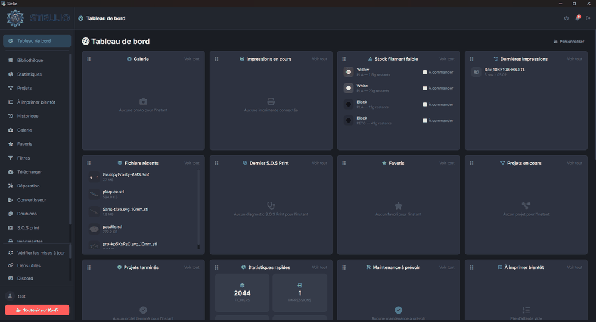
</p>

<table align="center">
  <tr>
    <td align="center"><a href="../screenshots/02-library.png">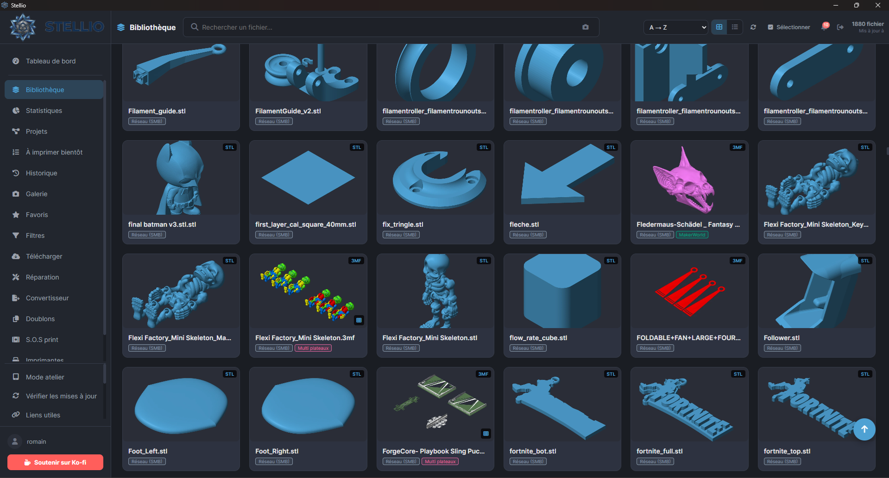<br>Biblioteca</a></td>
    <td align="center"><a href="../screenshots/03-viewer.png">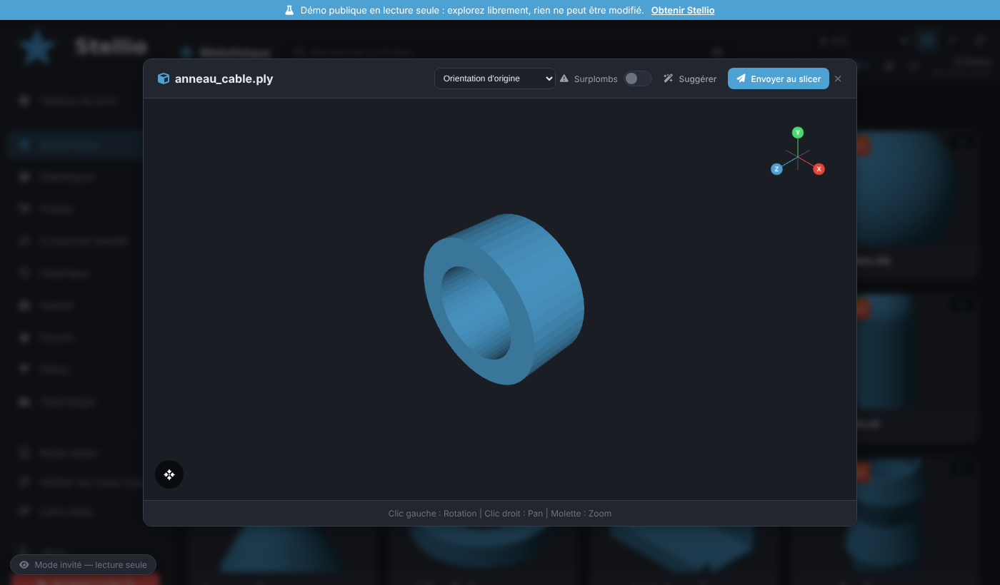<br>Visor 3D</a></td>
    <td align="center"><a href="../screenshots/04-filters.png">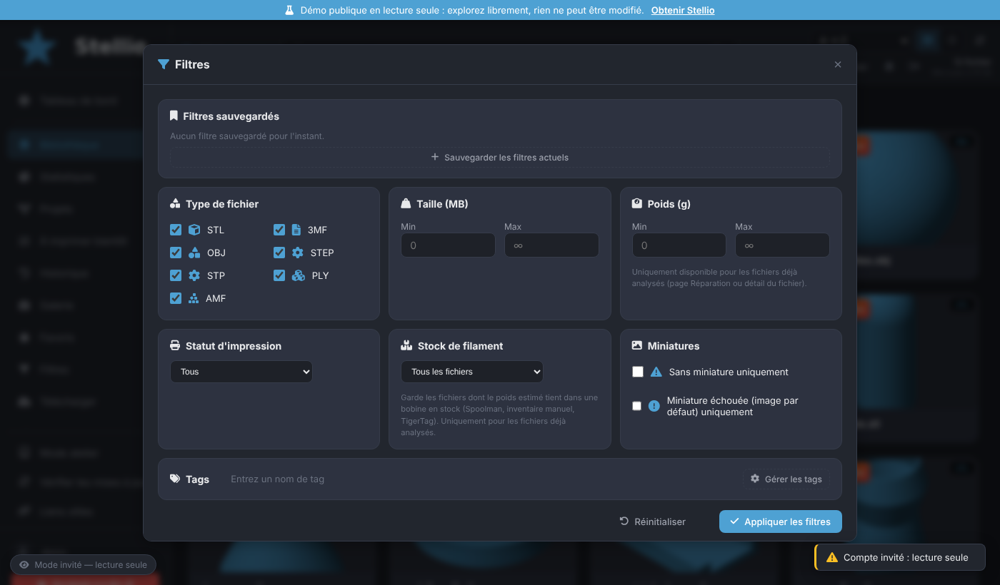<br>Filtros</a></td>
    <td align="center"><a href="../screenshots/05-repair.png">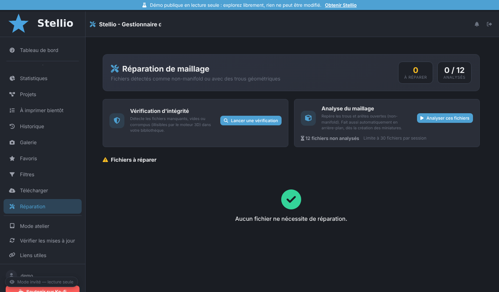<br>Reparación</a></td>
    <td align="center"><a href="../screenshots/06-converter.png">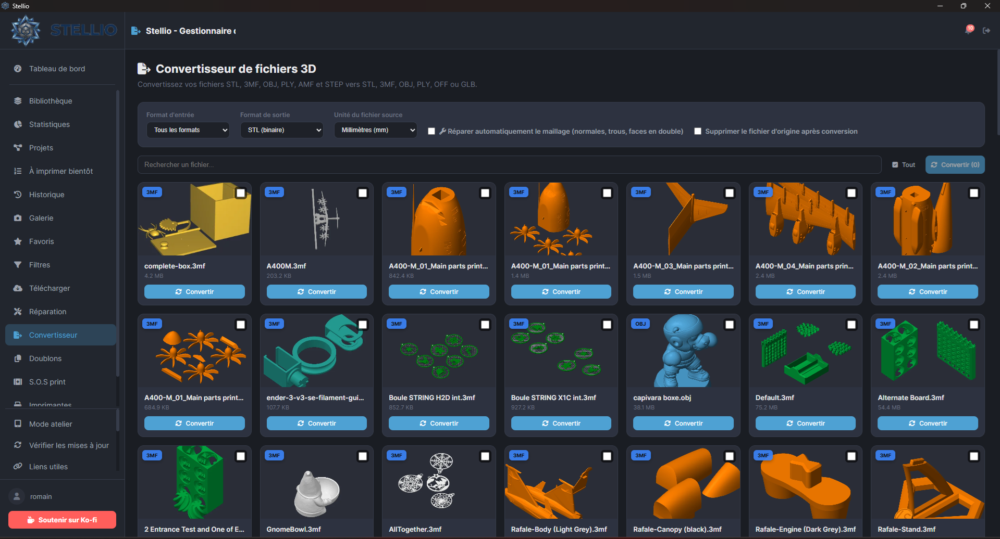<br>Conversor</a></td>
  </tr>
</table>


<p align="center">
  <a href="../../README.md">🇬🇧 English</a> |
  <a href="README_fr.md">🇫🇷 Français</a> |
  <a href="README_de.md">🇩🇪 Deutsch</a> |
  🇪🇸 <strong>Español</strong> |
  <a href="README_it.md">🇮🇹 Italiano</a> |
  <a href="README_pt.md">🇵🇹 Português</a> |
  <a href="README_ja.md">🇯🇵 日本語</a> |
  <a href="README_zh.md">🇨🇳 中文</a>
</p>

<p align="center">
  <a href="#-instalación">🚀 Instalación</a> •
  <a href="#-funcionalidades">✨ Funcionalidades</a> •
  <a href="#-documentación">📖 Documentación</a> •
  <a href="#-contribuir">🤝 Contribuir</a> •
  <a href="#-licencia">📜 Licencia</a>
</p>

---

## 🎯 Descripción general

**Stellio** es una aplicación de escritorio moderna que centraliza toda tu biblioteca 3D (STL, 3MF, OBJ, STEP, PLY, AMF), automatiza tareas repetitivas y se integra perfectamente con tu flujo de trabajo de impresión 3D.

Ya seas un maker principiante o un usuario experimentado con varias máquinas, Stellio te ahorra tiempo valioso gracias a la **IA local** (Ollama), una **gestión inteligente de impresoras** y una **interfaz pensada para la productividad**.

> 💡 **Filosofía**: Tus datos se quedan contigo. Todo funciona en local. En Raspberry Pi / Linux puedes conectar opcionalmente una IA en línea con tu propia clave API (ver más abajo); por defecto, nada sale de tu equipo.

---

## ✨ Funcionalidades

### 🏠 Panel de control y productividad
- 📊 **Panel de control al iniciar**: impresiones en curso, stock de filamento bajo, últimas impresiones y archivos recientes de un vistazo
- 🧱 **Totalmente personalizable**: reordena y oculta widgets arrastrando y soltando (20 disponibles: impresiones en curso, stock bajo, último S.O.S Print, sugerencias, instancias de Stellio…)
- 🖼️ **Más widgets**: «Proyectos terminados», «Galería» (las fotos de la galería desfilan, pausa al pasar el cursor, clic para ampliar) y «Presupuestos» (los 5 últimos presupuestos creados); todos los widgets tienen el mismo tamaño y el contenido se desplaza dentro
- ✅ **Lista «Primeros pasos»** para nuevos usuarios
- 💡 **Widget «Sugerencias»**: detecta archivos que reimprimes a menudo pero no revisas desde hace tiempo, y perfiles de slicer con una tasa de fallos alta
- ⌨️ **Paleta de comandos (`Ctrl+K`)**: navega, ejecuta una acción o encuentra al instante un archivo, una etiqueta, una bobina o un perfil de slicer
- 🔔 **Centro de notificaciones (campana)**: fin de impresión, fallos, mantenimiento próximo, stock de filamento bajo y recordatorios de secado en un solo lugar
- 📺 **Widget flotante** que muestra el progreso de la impresión en curso, visible en todas las páginas
- 🧭 **Visita guiada interactiva** para descubrir las funciones principales, que se puede relanzar desde Ajustes
- ♿ **Accesibilidad**: modo de alto contraste, reducción de animaciones, indicadores de foco de teclado visibles en todas partes
- 🪟 **Icono en la bandeja del sistema (Windows)**: un icono de Stellio junto al reloj indica que la aplicación sigue en marcha (clic = abrir, clic derecho = Abrir / Salir)

### 📚 Gestión de biblioteca
- 🗂️ **Múltiples fuentes**: carpetas locales, archivos individuales, recursos compartidos SMB/NFS — las carpetas 3D detectadas en el equipo se sugieren y se pueden añadir con un clic
- 🖼️ **Miniaturas 3D automáticas** vía PyRender (renderizado de alta calidad) o un rasterizador CPU con numpy (alternativa), con efecto de carga y **vista ampliada al pasar el cursor**
- 🌀 **Siempre fluida**: la generación de miniaturas se pausa en cuanto usas la aplicación y se reanuda cuando dejas de hacerlo
- ⚙️ **Ajuste «Rendimiento de miniaturas»** (Automático / Económico / Normal / Rápido) con indicador de progreso traducido; los STL muy detallados y los 3MF enormes o multicolor obtienen miniaturas 3D limpias, y los 3MF de PrusaSlicer se renderizan en 3D como los STL
- 🏷️ **Etiquetas personalizadas** con colores + etiquetado automático por IA, y **etiquetado con un clic de varios archivos seleccionados**
- 🔍 **Búsqueda semántica asistida por IA** ("busco un soporte para...") con **búsquedas recientes recordadas**
- ⭐ **Favoritos** y filtros avanzados (tipo, tamaño, peso, estado de impresión), con un **aviso de reposición** cuando el stock de filamento no basta para tus favoritos
- 🧵 **Filtro «Stock de filamento»**: conserva solo los archivos imprimibles con las bobinas que realmente tienes (Spoolman, inventario manual, [TigerTag](https://tigersystem.io)), por material
- 💾 **Filtros guardados**: guarda cualquier combinación de filtros y reutilízala con un clic
- 🔀 **Orden y búsqueda recordados**: el orden elegido (A → Z, carpeta, tamaño, fecha, etiqueta…) se recupera al reabrir la aplicación, y la búsqueda, los filtros activos y los resultados de la búsqueda con IA se mantienen cuando la biblioteca se actualiza automáticamente; vaciar el campo de búsqueda detiene al instante la búsqueda con IA en curso
- 🖨️ **Filtros de estado de impresión**: «Enviado al slicer», «Ya impreso (éxito o fallo)», «Ya logrado» y «Ya fallido»
- 📋 **Cola «Imprimir pronto»**, independiente de los favoritos, reordenable arrastrando y soltando y enviable directamente al slicer
- 🖱️ **Selección rápida**: selección por rango (`Mayús+clic`) y navegación con teclado (flechas + `Enter`)
- ✏️ **Renombrado masivo** (buscar/reemplazar, prefijo, sufijo, numeración) con vista previa antes de aplicar
- ↩️ **Deshacer eliminaciones** (`Ctrl+Z`) gracias a una papelera temporal de 5 minutos — eliminar una etiqueta, un proyecto o una fuente también se puede deshacer, sin confirmación bloqueante
- 🔗 **Origen del modelo**: enlace de origen, autor, licencia y notas en la ficha del archivo, con la fecha de descarga cuando corresponda
- 🧩 **Proyectos/Ensamblajes**: agrupa varios archivos en un solo objeto, con soporte multi-bandeja 3MF (navegación entre bandejas en el visor)
- 🧱 **3MF de varias placas en los proyectos**: al añadir un 3MF de varias placas a un proyecto, se divide automáticamente en un archivo 3MF por placa (6 placas = 6 archivos para imprimir), guardados en una carpeta oculta para no saturar la biblioteca, con miniaturas inmediatas y envío al slicer desde el proyecto; la acción **«Dividir placas»** (menú ⋯ de un archivo) crea un STL o 3MF independiente por placa
- 🔎 **Tarjetas de proyecto**: un clic en una miniatura abre el archivo en el visor 3D; el filtro «Todos / En curso / Terminados» se recuerda entre sesiones; valorar una impresión como «lograda» añade la pieza impresa a los proyectos que contienen el archivo y la quita de «Imprimir pronto»
- 💰 **Coste del proyecto**: un botón en la tarjeta del proyecto calcula el coste de todos sus archivos con los mismos ajustes que el coste de una pieza (estimación precisa del slicer, bobina, electricidad, desgaste, gastos fijos, margen, cantidades) y exporta el presupuesto en PDF
- 🔁 **Detección de duplicados** (exactos y similares por geometría)
- 🗜️ **Compatibilidad con archivos comprimidos**: explora y extrae modelos directamente desde archivos comprimidos
- 🖱️ **Arrastrar y soltar archivos 3D** desde el explorador — funciona en la app de escritorio y también desde un navegador (Raspberry Pi, móvil, acceso remoto)
- 📊 **Estadísticas detalladas** (formatos, plataformas, fiabilidad de perfiles)

### 🤖 Inteligencia artificial (Ollama local)
- 🏷️ **Etiquetado automático** inteligente de archivos
- 📝 **Descripción automática** de modelos
- 🔎 **Búsqueda semántica** en lenguaje natural
- 📐 **Análisis de imprimibilidad** (detección de voladizos) y **orientaciones sugeridas** (menos voladizo, se muestra el contacto con la cama)
- 🎯 **Recomendación de perfil de slicer** basada en la geometría + historial de éxito
- ⏱️ **Estimación del tiempo de impresión** antes del slicing
- 🩺 **S.O.S Print**: diagnóstico adaptativo de fallos de impresión, paso a paso — Stellio hace una pregunta a la vez, reduce una lista de hipótesis según tus respuestas (máximo 4 preguntas) y luego ofrece un diagnóstico final; el análisis de fotos está disponible en cualquier momento y las conversaciones se guardan (reabrir, marcar como resuelto)

### 🖨️ Gestión de impresoras
- 🔌 Compatible con **OctoPrint**, **Klipper/Moonraker**, **Bambu Lab** (MQTT), **Creality** (WebSocket), **FlashForge**, **Elegoo** (SDCP) y **PrusaLink**
- 📡 **Detección automática en red**: Stellio escanea tu red local (SSDP para Bambu Lab, broadcast UDP para Elegoo/Centauri/FlashForge, sondeo dirigido para Klipper/OctoPrint/PrusaLink/Creality) y te permite añadir las impresoras detectadas con un clic
- 📡 Monitorización en tiempo real (temperaturas, progreso, cámara)
- 🖼️ **Impresión en curso en la tarjeta**: miniatura y nombre del archivo en impresión cuando está en la biblioteca (miniatura del G-code para impresiones Klipper/Moonraker iniciadas fuera de Stellio); el tamaño de la cama (X, Y, Z) se indica por impresora y avisa antes del envío si la pieza es demasiado grande
- 🔧 **Mantenimiento predictivo** con seguimiento de tareas y recomendaciones específicas por marca (Bambu, Prusa, Creality, etc.)
- 🔩 **Piezas de desgaste y consumibles**: stock de boquillas, placas, correas… con alertas, vinculado a las tareas de mantenimiento (cada intervención descuenta una pieza)
- ⏱️ Contador automático de horas de impresión
- 📤 Envío directo al slicer, con un selector de bobina para asignar el filamento correcto desde el propio diálogo de envío, o subida a la impresora
- 👀 **Vista previa rápida** (peso, tiempo de impresión estimado) directamente en la ventana de envío al slicer, antes de confirmar
- 🛡️ **Verificación previa a la impresión mejorada**: avisa si la bobina asignada necesita secarse, si el filamento es abrasivo (se recomienda boquilla de acero endurecido) o si no existe calibración para esta impresora
- 🔁 **Reimprimir como la última vez**: desde el historial, un clic reabre la ventana de envío con la misma impresora, perfil y bobina
- 🎛️ **Calibraciones**: guarda flow, pressure advance, temperaturas… por filamento e impresora, que se recuperan en la ventana de envío al slicer
- 👥 **Modo colaborativo ligero**: comprueba si otro dispositivo conectado ya está viendo un archivo, y un aviso evita enviar dos veces el mismo archivo al slicer por error

### 🧵 Gestión de filamento
- 🔗 Integración con **Spoolman** (servidor de gestión de bobinas), con detección automática en tu red
- 🟠 Compatible con **AMS de Bambu Lab** (lectura de ranuras)
- 🟢 Compatible con **CFS de Creality**
- 🐯 Integración con [**TigerTag**](https://tigersystem.io) (identificación NFC/RFID de bobinas): inicia sesión para ver tus bobinas TigerTag en el inventario, o deja que Stellio recupere automáticamente una sesión existente de TigerTag Studio — solo lectura, nunca modifica tu inventario TigerTag
- ⚪ Bobinas manuales
- 📉 Seguimiento automático del consumo al enviar al slicer, con verificación de compatibilidad antes de imprimir (¿queda suficiente material?)
- 🔔 **Alertas de stock bajo** al iniciar, con un enlace rápido para comprar más
- 🛒 **Volver a comprar una bobina**: Stellio propone primero la tienda del fabricante de la marca (Arianeplast, Bambu Lab, Polymaker, eSUN, Sunlu…) y después las tiendas generalistas, con el stock comprobado automáticamente cuando el sitio lo permite
- 💨 **Secado de bobinas**: registro de secado, estado (seca / por secar) según el material, temperatura y duración sugeridas, y recordatorios en las notificaciones
- 📈 **Resumen por bobina**: impresiones, gramos, coste y diferencia no registrada en la ficha de cada bobina

### 📥 Descarga desde plataformas
- 🟠 **Printables** (API GraphQL)
- 🟢 **MakerWorld** (inicio de sesión Bambu Lab en 2 pasos)
- 🔵 **Thingiverse** (mediante clave de API)
- 🟣 **Nexprint** (biblioteca de modelos de Elegoo; inicio de sesión con el correo y la contraseña de la cuenta, almacenados cifrados)
- 🔷 **Creality Cloud** y **Snapmaker Space** (inicio de sesión desde Ajustes, credenciales guardadas cifradas; no se admite el inicio de sesión con Google)
- 📁 Descarga directa a tus fuentes configuradas
- 🆕 **Detección de nuevas versiones**: Stellio comprueba cada día si los modelos descargados (Printables, MakerWorld, Thingiverse) se han actualizado
- 🛒 **Enlaces útiles**: tiendas, fabricantes, sitios de modelos 3D y recursos agrupados en secciones plegables

### 🧩 Herramientas avanzadas
- 🎨 **Nesting automático** en la bandeja (rectpack o silueta real mediante shapely)
- 🔧 **Reparación de mesh** (trimesh + pymeshfix) con **comparativa antes/después** (estanqueidad, triángulos, vértices, tamaño)
- 🔄 **Conversor de formatos** (STL ↔ 3MF ↔ OBJ)
- 🛡️ **Verificación de integridad** (archivos dañados/faltantes)
- 💰 **Cálculo del coste de impresión**: material, electricidad, desgaste de la máquina (por hora), gastos fijos, margen en % y cantidad — precio unitario y total calculados al céntimo
- 🏷️ **Margen y precio de venta**: define tu margen por defecto (%) una vez en Ajustes → Tarifas de impresión; el historial muestra el precio de venta (coste + margen) junto al coste, mientras que las estadísticas siguen usando el coste real
- 🧾 **Presupuestos en PDF**: generados desde el cálculo de coste, con cliente, designación y notas personalizables; cabecera de presupuesto configurable (nombre/empresa, logotipo, dirección, teléfono, correo, web, NIF/IVA) y avisos legales en el pie de página
- 🗃️ **Historial de presupuestos**: cada presupuesto generado se conserva (copia del PDF) y se puede consultar, volver a descargar y eliminar desde el widget «Presupuestos» del panel
- 🌱 **Estimación medioambiental**: huella de CO₂ de tus impresiones (material + electricidad)
- 📸 **Galería de fotos de impresiones** (exitosas/fallidas)
- 🕒 **Historial** con valoración de éxito/fallo (alimenta la IA), botones **«Ver archivo»** y **«Reimprimir»** en cada fila (con detección de archivos movidos/eliminados) y filtros por plataforma, resultado (exitoso/fallido/parcial/sin valorar) e intervalo de fechas

### 📈 Informes y fiabilidad
- 🧮 **Fiabilidad de impresión**: tasa de éxito y coste de los fallos clasificados por perfil de slicer, material, impresora o bobina
- 🗓️ **Informe mensual**: impresiones, tasa de éxito, filamento, coste, fallos y CO₂ del mes, comparados con el mes anterior, exportable en PDF

### 🔔 Notificaciones
- 🪟 **Notificaciones nativas de Windows**
- 🌐 **Notificaciones del navegador**, activables para el acceso desde Raspberry Pi o móvil
- 📣 **Notificaciones push** (ntfy, Telegram, Discord o webhook): fin y fallo de impresión detectados incluso con la ventana cerrada, además de alertas de mantenimiento y de stock

### 🌐 Acceso móvil y remoto
- 📱 **Código QR** para acceder a tu biblioteca desde el móvil (PWA instalable)
- 📲 **App complementaria Android**: un código QR dedicado permite descargar e instalar el APK de la app complementaria de Stellio directamente desde los ajustes de acceso móvil, con la posibilidad de hacer fotos directamente desde una impresión
- 🌍 **Acceso remoto** mediante Cloudflare Tunnel (gratuito, URL aleatoria o fija), o **dirección personalizada** (nombre de dominio, DynDNS, VPN, Tailscale…) para prescindir de Cloudflare, con vuelta a Cloudflare en un clic
- 🔗 **Enlaces de compartición** temporales (24 h, un solo uso)

### 👥 Cuentas y multiinstancia
- 🔐 **Cuentas locales** con código de recuperación y pregunta secreta: restablecimiento de contraseña 100 % local, sin correo ni internet
- 🙋 **Confirmación de sesión**: al abrir la aplicación con una sesión guardada, Stellio pide confirmar la cuenta (Sí / No); en el teléfono, volver a la aplicación no vuelve a pedir las credenciales mientras la sesión sea válida
- 👤 **Cuentas de invitado de solo lectura**: comparte tu biblioteca, impresoras y stock sin ningún riesgo
- 🔄 **Instancias de Stellio**: detección automática de otras instalaciones en la red local y alta en un clic (solo tienes que introducir su clave local)
- 📨 **Enviar un archivo a otra instancia**: elige la carpeta de destino en la instancia de destino; el archivo recibido aparece enseguida en su biblioteca
- ✅ **Widget de estado de instancias** en el panel (marca verde o cruz roja para cada instancia guardada)

### 🎨 Personalización
- 🌓 Temas: Oscuro / Claro / Sistema
- 🎨 Temas de marca: Stellio, Bambu, Prusa, Voron, Creality
- 🎯 Color de acento personalizado
- 🌍 **8 idiomas**: FR, EN, DE, ES, IT, PT, JA, ZH
- 🧲 Reordenar la navegación arrastrando y soltando
- ↩️ **Deshacer ajustes**: revierte el último cambio de configuración realizado

### 💾 Copia de seguridad y actualizaciones
- 📦 Exportación/importación de copia de seguridad completa (.zip)
- 🔄 Actualizaciones automáticas desde GitHub (parche `.zip` — mismo mecanismo en Windows y Raspberry Pi/Linux)
- 🧰 **Comprobación de módulos**: en el primer inicio de cada versión, los módulos que falten (presupuestos PDF, importación de hojas de cálculo, notificaciones…) se descargan automáticamente
- 🔁 Reinicio fiable tras una actualización o al activar el modo depuración, en Windows y en Raspberry Pi/Linux
- 📋 Exportación de registros de diagnóstico (secretos ocultos)
- 💬 **Sugerencias e informes de errores desde la app**: envía una sugerencia o un error sin salir de Stellio — se crea un issue de GitHub por ti (de forma anónima, mediante una aplicación de GitHub dedicada), con un enlace al issue y una insignia «Nueva respuesta» cuando recibas una respuesta

---

## 🖼️ Capturas de pantalla

| | |
|---|---|
| 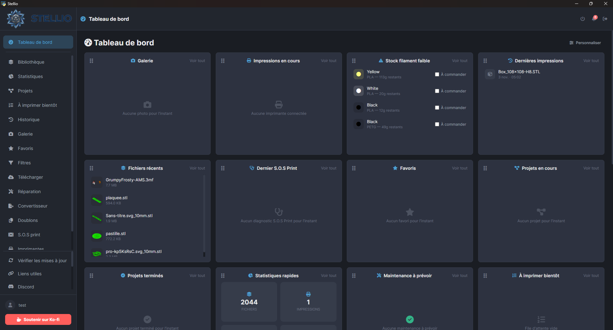 *Panel personalizable* | 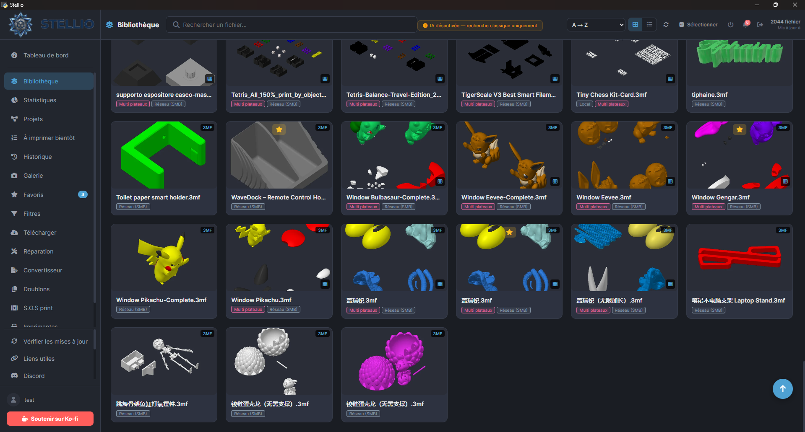 *Biblioteca con etiquetas y favoritos* |
| 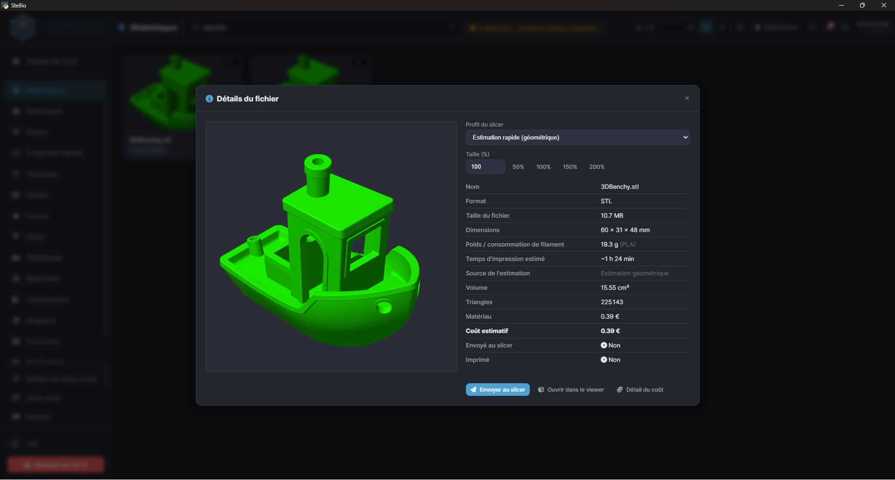 *Detalles del archivo: peso, tiempo y coste de impresión* | 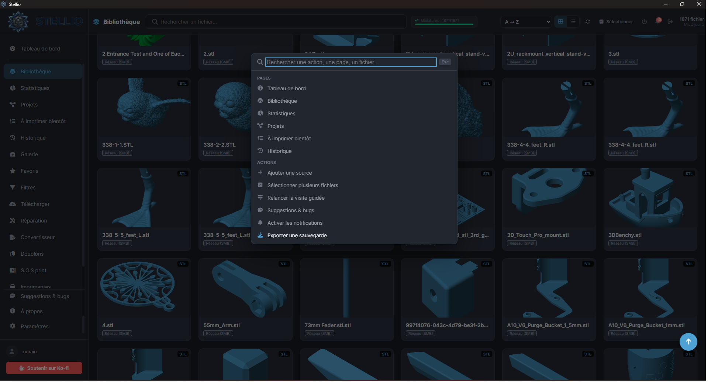 *Paleta de comandos (Ctrl+K)* |
| 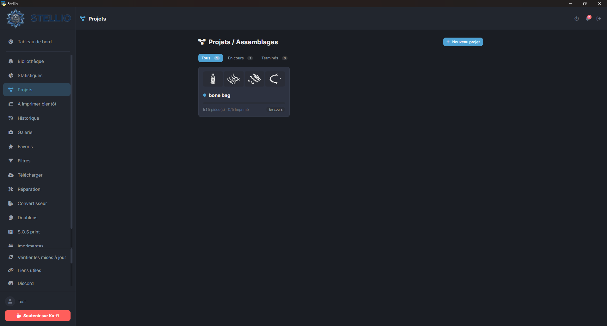 *Proyectos / ensamblajes* | 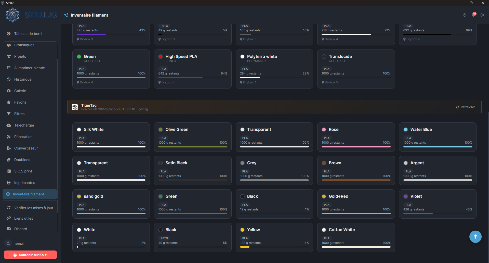 *Inventario de filamento* |
| 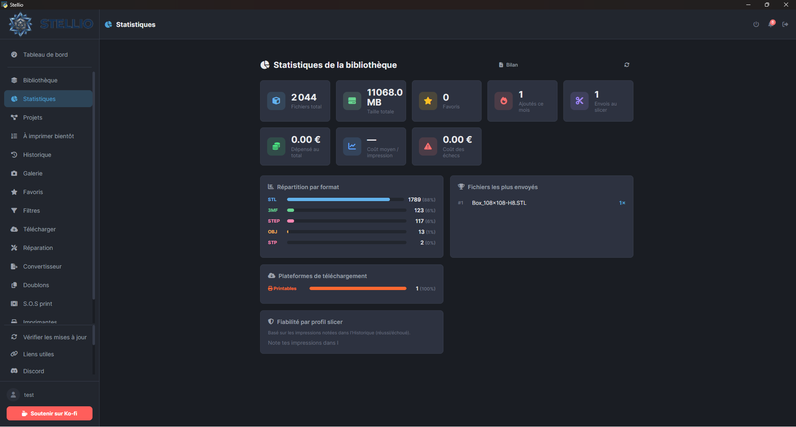 *Estadísticas de la biblioteca* | 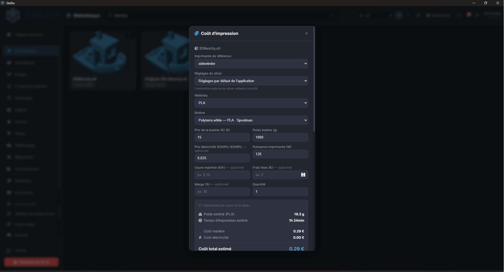 *Tarifas de impresión: electricidad, desgaste, margen* |
| 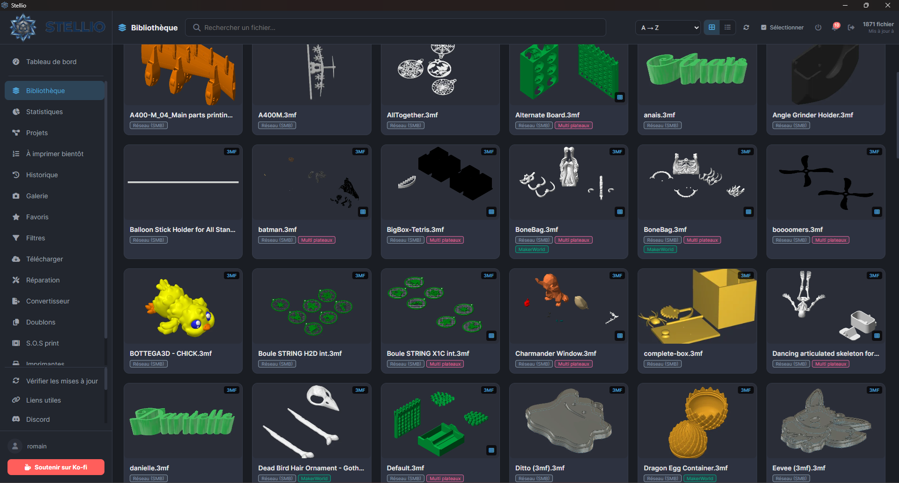 *Biblioteca con miniaturas* | 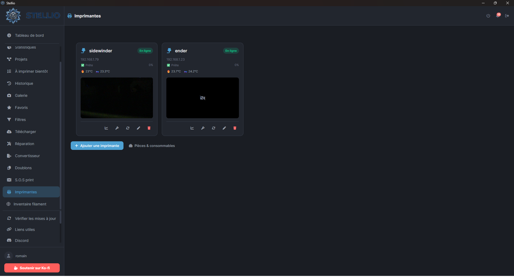 *Monitorización de impresoras* |
| 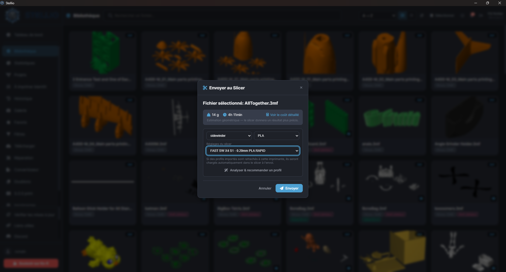 *Recomendación de perfil por IA* | 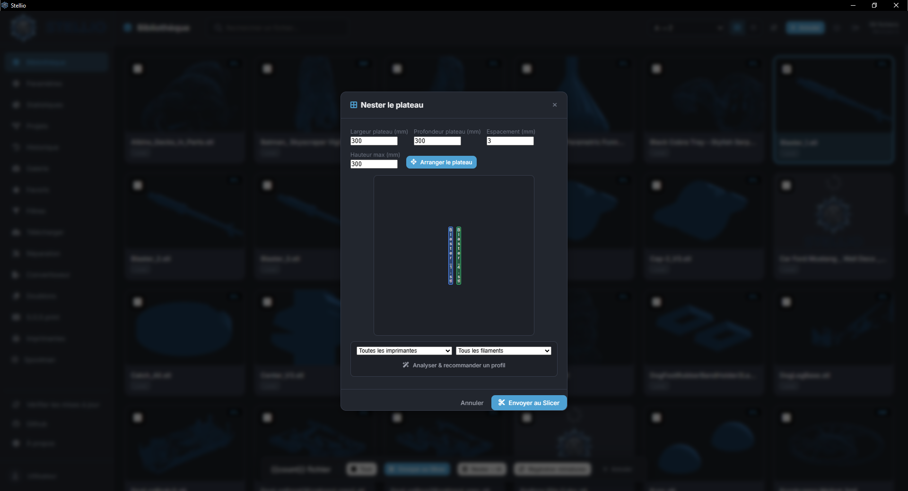 *Nesting automático* |

---

## 🚀 Instalación

### 🪟 Windows (recomendado)

1. Descarga el último instalador desde [Releases](https://github.com/stellio-app/stellio/releases)
2. Ejecuta `Stellio-Setup-<version>.exe`
3. ¡Listo! 🎉

> 💼 **Versión portable (sin instalación)**: descarga `Stellio-v<versión>-portable-win64.zip` desde las Releases, descomprímelo donde quieras (disco, memoria USB) y ejecuta `Stellio.exe`. Tus datos se quedan en la carpeta `data` junto al ejecutable (conserva el archivo `portable.flag`).

### 🍎 macOS

1. Descarga desde [Releases](https://github.com/stellio-app/stellio/releases) el `.dmg` adecuado para tu Mac: `Stellio-v<version>-macOS-arm64.dmg` (Apple Silicon: M1, M2, M3…) o `Stellio-v<version>-macOS-x86_64.dmg` (Intel).
2. Abre el `.dmg` y arrastra **Stellio** a **Aplicaciones**.
3. Primer arranque: clic derecho (o Control+clic) en **Stellio → Abrir** y confirma. 🎉

> ⚠️ Las versiones de macOS **aún no están notarizadas**, por lo que Gatekeeper muestra un aviso en el primer arranque (clic derecho → Abrir lo resuelve). Cada archivo incluye una suma de comprobación `.sha256` que puedes verificar.
>
> 💡 **¿Ventana en blanco?** El puerto 5000 suele estar ocupado por el «Receptor AirPlay» de macOS: Stellio elige entonces automáticamente otro puerto libre (5001–5030). Tus datos están en `~/.stellio`.

### 🐧 Raspberry Pi / Linux

Funciona en **modo servidor headless** (sin interfaz gráfica): Stellio se ejecuta en segundo plano y se controla desde un navegador, ya sea en la propia Pi o desde cualquier dispositivo de la red local.

**Requisitos**: se recomienda Raspberry Pi 4 o 5, Raspberry Pi OS de **64 bits**.

```bash
curl -O https://raw.githubusercontent.com/stellio-app/stellio/main/install-pi.sh
chmod +x install-pi.sh
./install-pi.sh
```

El script instala automáticamente:
- las dependencias del sistema (`ffmpeg`, `unrar`, bibliotecas de renderizado 3D)
- un entorno virtual de Python dedicado
- un **servicio systemd** (`stellio.service`) que inicia Stellio al arrancar y lo reinicia automáticamente si falla

Una vez instalado, Stellio está disponible en `http://<ip-de-la-pi>:5000`.

```bash
sudo systemctl status stellio     # Estado del servicio
sudo systemctl restart stellio    # Reiniciar
sudo journalctl -u stellio -f     # Ver los registros en directo
```

> 💡 **Mismas actualizaciones que en Windows**: el parche `.zip` publicado con cada versión es idéntico en ambas plataformas (código fuente puro, nada compilado). Stellio lo detecta y lo aplica automáticamente, y luego reinicia el servicio — sin necesidad de reinstalación manual.
>
> 🎥 Mismas funcionalidades que la versión de Windows, salvo la ventana de escritorio nativa (sustituida por acceso desde el navegador) y la IA local de Ollama, que necesita un modelo razonablemente potente para funcionar bien en una Pi — apunta `ollama_url` a un servidor Ollama remoto en Ajustes si lo necesitas.

### 🖥️ Proxmox VE (contenedor LXC con un solo comando)

En un servidor **Proxmox VE**, un script crea y configura todo el contenedor por ti. Abre el **Shell del host Proxmox** (Datacenter → tu nodo → Shell) y pega:

```bash
bash -c "$(curl -fsSL https://raw.githubusercontent.com/stellio-app/stellio/main/stellio-lxc.sh)"
```

El script ofrece ajustes por defecto o avanzados (CTID, núcleos, RAM, disco, bridge, VLAN, IP DHCP o fija, almacenamiento, carpeta del host a montar) y después:
- crea un contenedor **Debian 12 sin privilegios** (por defecto 2 núcleos, 2 GB de RAM, 32 GB de disco, arranque automático);
- instala Stellio en él con `install-pi.sh` (dependencias, entorno Python, **servicio systemd**);
- muestra la dirección de acceso `http://<ip-del-contenedor>:5000` y la contraseña root generada.

> 🔒 **Fuentes**: en este contenedor, añadir **carpetas y archivos locales está oculto** en Stellio; solo se ofrecen las fuentes de red **SMB** y **NFS**. Si montas una carpeta del host con `var_mount=/ruta/host:/mnt/modelos`, también se permite «Carpeta local». El ajuste está en `/etc/systemd/system/stellio.service.d/sources.conf` (variable `STELLIO_ALLOWED_SOURCE_TYPES`).

```bash
pct exec <CTID> -- update-stellio                 # Actualizar Stellio (desde el host Proxmox)
pct exec <CTID> -- journalctl -u stellio -f       # Seguir los registros
```

Modo sin menú: todas las opciones se pueden fijar con variables de entorno, p. ej. `var_mode=default var_cpu=4 var_ram=4096 var_disk=16 var_ip=192.168.1.50/24 var_gw=192.168.1.1` (lista completa al inicio del script).

💾 **Elección del almacenamiento**: seleccione «Ajustes por defecto + elección del almacenamiento» en el primer menú (o `var_choose_storage=1`) para elegir dónde se guardan el disco del contenedor (`var_storage`, p. ej. `local-zfs`) y las plantillas (`var_template_storage`, p. ej. `local`). El script comprueba que el almacenamiento existe y tiene espacio libre suficiente.

🌍 **Idioma**: los textos del script siguen el idioma de Proxmox (fr, en, de, es, pt, it, zh, ja); fuércelo con `var_lang=es` (inglés por defecto).

### 🧰 Específico de la edición servidor (Raspberry Pi / Linux)

> La versión de Windows no se ve afectada: estas funciones solo aparecen en Raspberry Pi, VM, LXC, Docker y Linux.

- ☁️ **IA en línea (opcional)**: en lugar de Ollama, usa Claude (Anthropic), ChatGPT (OpenAI) o Gemini (Google) con tu propia clave API (Ajustes → Inteligencia artificial). La clave se cifra en el servidor y nunca se devuelve al navegador; Ollama sigue siendo la opción por defecto, 100 % local. Las solicitudes (nombres de archivo, etiquetas, descripciones, fotos de S.O.S Print) van al proveedor elegido y se facturan con tu clave.
- 📥 **Perfiles de laminador**: Stellio no ve los laminadores de tu PC ni se conecta a las nubes de los laminadores (Orca Cloud, Bambu Cloud…). Exporta tus perfiles desde el laminador (OrcaSlicer: Archivo → Exportar → Exportar paquete de ajustes preestablecidos) e impórtalos en Ajustes → Mis perfiles de laminador; con Orca Cloud también puedes pegar el «Copy raw JSON» de un perfil. También es posible una **carpeta de perfiles vigilada** que Stellio vuelve a leer automáticamente (Syncthing, recurso de red, scp…).
- 🐯 [**TigerTag**](https://tigersystem.io): inicio de sesión oficial con correo y contraseña en Ajustes → Inventario de filamento → TigerTag (tu contraseña no se conserva, solo un token de sesión cifrado). ¿Cuenta creada con Google? Define primero una contraseña con «Olvidé mi contraseña» en la aplicación TigerTag. Alternativa: copiar al servidor la carpeta de datos de TigerTag Studio (Windows: carpeta «TigerTag…» en `%APPDATA%`, al menos `Local Storage` e `IndexedDB`) e indicar su ruta.

### Slicers compatibles

Stellio detecta automáticamente:
- ✅ OrcaSlicer
- ✅ Bambu Studio
- ✅ PrusaSlicer / SuperSlicer
- ✅ Ultimaker Cura
- ✅ Creality Print
- ✅ Elegoo Slicer
- ✅ Qidi Studio
- ✅ Anycubic Slicer Next
- ✅ Anycubic Slicer
- ✅ Simplify3D
- ✅ ideaMaker
- ✅ FlashPrint
- ✅ Lychee Slicer
- ✅ CraftWare
- ✅ MatterControl
- ✅ MakerBot Print
- ✅ Voxelizer
- ✅ Slic3r
- ✅ KISSlicer

### Impresoras compatibles

| Marca | Modelos | Conexión y funciones |
|---|---|---|
| **Bambu Lab** | X1 / X1C / X1E · X2D · P1P / P1S · P2S · A1 / A1 mini · H2D / H2S / H2C | MQTT (LAN + nube): monitorización en tiempo real, AMS, cámara, detección SSDP |
| **Prusa** | MK4 · MK3.9 · MK3.5 · MINI+ · XL · CORE One | PrusaLink (HTTP): monitorización, envío, cámara |
| **Creality** | Serie K1 / K2 · Ender-3 V3 · Hi | WebSocket: monitorización, CFS, detección UDP |
| **Elegoo** | Centauri Carbon 1 y 2 · resina Saturn / Mars | SDCP sobre WebSocket: monitorización, detección UDP |
| **FlashForge** | Adventurer 5M / 5M Pro · AD5X | API propietaria: monitorización, detección UDP |
| **Klipper / Moonraker** | Cualquier máquina con Klipper (Voron…) | HTTP: monitorización, envío, cámara, horas de impresión exactas |
| **OctoPrint** | Cualquier impresora controlada por OctoPrint | HTTP: monitorización, envío, cámara |

> Los modelos indicados son los que ofrece el formulario «Añadir impresora» de Stellio. Otros modelos que usen el mismo protocolo suelen funcionar también, pero no todos se han probado — [cuéntanoslo en GitHub](https://github.com/stellio-app/stellio/issues) si la tuya funciona o no.

---

## 🛠️ Tecnología

| Componente | Tecnología |
|---|---|
| Backend | Python 3.8+, Flask, Waitress |
| Frontend | HTML5, CSS3, JavaScript nativo |
| Base de datos | SQLite (modo WAL) |
| Escritorio | pywebview (Windows, macOS) / modo navegador headless (Raspberry Pi, Linux) |
| Renderizado 3D | PyRender, rasterizador CPU con numpy, Three.js |
| Mesh y nesting | trimesh, pymeshfix, shapely, rectpack |
| IA | Ollama (local) |
| Red | paho-mqtt, smbclient, requests |
| Cifrado | cryptography (AES, IV aleatorio por llamada) |
| Archivos comprimidos | zipfile, rarfile, py7zr, tarfile |

---

## 📖 Documentación

### Atajos de teclado

| Atajo | Acción |
|---|---|
| `Ctrl+K` | Paleta de comandos |
| `Ctrl+F` | Buscar |
| `Ctrl+N` | Nueva descarga |
| `Ctrl+,` | Ajustes |
| `Ctrl+Z` | Deshacer la última eliminación (papelera de 5 min) |
| `Alt+1-8` | Navegación rápida |
| `Mayús+Clic` | Seleccionar un rango de archivos |
| `↑ ↓ ← →` + `Enter` | Navegar y abrir archivos en la biblioteca |
| `F` | Alternar favoritos |
| `T` | Gestor de etiquetas |
| `?` | Ayuda de atajos |
| `Esc` | Cerrar modal / limpiar búsqueda |

### Estructura del proyecto

```
stellio/
├── main.py             # Backend Flask + Desktop
├── interface/              # index.html, script.js, style.css (UI)
├── packaging/              # launcher.py, installer (.iss), macOS entitlements
├── release-notes/          # notes_version_X.Y.Z.txt (release texts)
├── tests/  tools/          # pytest tests, maintenance tools (incl. stellio_manager.bat)
├── check_deps.py       # Verificador de dependencias autorreparable
├── modules/            # Módulos separados de main.py (print_session, share_link, timelapse, mqtt_publisher…)
├── worker.py           # Esqueleto de worker 3MF sin uso (provisional)
├── assets/             # Logos, iconos
├── languages/          # Archivos de traducción (JSON)
├── apk/                # Paquete de la app complementaria Android
├── docs/               # Documentación, política de privacidad, READMEs traducidos
├── requirements.txt    # Dependencias de Python
├── install-pi.sh       # Script de instalación para Raspberry Pi / Linux (servicio systemd)
└── stellio-lxc.sh      # Script de instalación LXC para Proxmox VE
```

¿Tienes una idea? ¡[Abre un issue](https://github.com/stellio-app/stellio/issues)!

---

## 🤝 Contribuir


¡Las contribuciones son bienvenidas! 🎉

1. **Haz un fork** del proyecto
2. Crea tu rama (`git checkout -b feature/MiFuncionalidad`)
3. Confirma tus cambios (`git commit -m 'Añade MiFuncionalidad'`)
4. Sube la rama (`git push origin feature/MiFuncionalidad`)
5. Abre un **Pull Request**

### Recomendaciones
- Sigue el estilo de código existente
- Añade comentarios en francés o inglés
- Prueba tus cambios en Windows si es posible
- Actualiza la documentación si es necesario

### Informar de un error

Lo más sencillo es hacerlo directamente desde la app: abre **Sugerencias y errores** en la barra lateral y describe el problema — se envía como un issue de GitHub por ti. También puedes abrir un issue tú mismo en GitHub.

Usa la plantilla de informe de errores e incluye:
- Versión de Stellio
- Sistema operativo
- Pasos para reproducirlo
- Registros de error (exportables desde Ajustes → Diagnóstico)

---

## 📜 Licencia

Este proyecto está licenciado bajo la **GNU Affero General Public License v3.0** — consulta el archivo [LICENSE](../../LICENSE) para más detalles.

> 💡 **En resumen**: eres libre de copiar, modificar y distribuir este software. Si modificas Stellio o lo usas para ofrecer un servicio en red, debes publicar el código fuente completo bajo la misma licencia AGPLv3.

---

## 🔒 Privacidad

Stellio es local-first: tus datos permanecen en tu equipo, por defecto no se recopila ni se envía nada a servidores externos. Consulta nuestra [Política de privacidad](../privacy/PRIVACY.md) para más detalles. La única excepción, y solo si la activas tú mismo: la IA en línea (Claude, ChatGPT, Gemini) de la edición servidor envía tus solicitudes de IA al proveedor elegido.

---

## 🔏 Política de firma de código

El instalador de Windows y el AppImage de Linux publicados en [Releases](https://github.com/stellio-app/stellio/releases) **aún no están firmados digitalmente**, por lo que Windows SmartScreen puede mostrar una advertencia. Las compilaciones de macOS no están notarizadas. Cada archivo de las releases incluye una suma de comprobación SHA-256 (`.sha256`) que puedes verificar, y el actualizador integrado la comprueba antes de instalar. Consulta [CODE_SIGNING_POLICY.md](../../CODE_SIGNING_POLICY.md) para conocer el estado actual, cómo verificar una descarga y nuestros planes de firma.

---

## 🤝 Colaboración

<p align="center">
  <a href="https://tigersystem.io"></a>
</p>

Stellio es socio de integración de [**TigerTag**](https://tigersystem.io), el sistema de identificación NFC/RFID de filamentos: tus bobinas aparecen directamente en el inventario de filamento de Stellio.

- 🌐 [Sitio oficial](https://tigersystem.io) — [tigertag.io](https://tigertag.io)
- 🖥️ [Studio Manager (aplicación de escritorio)](https://github.com/TigerTag-Project/TigerTag-Studio-Manager)
- 📘 [Guía RFID y documentación](https://github.com/TigerTag-Project/TigerTag-RFID-Guide)
- 📱 [Aplicación iOS](https://apps.apple.com/fr/app/tigertag-rfid-connect/id6745437963)

---

## 🙏 Agradecimientos

- [Ollama](https://ollama.com/) por la IA local
- [Flask](https://flask.palletsprojects.com/) por el backend
- [Three.js](https://threejs.org/) por el renderizado 3D web
- [trimesh](https://github.com/mikedh/trimesh) por el procesamiento de mesh
- [Spoolman](https://github.com/Donkie/Spoolman) por la gestión de bobinas de filamento
- [TigerTag](https://tigersystem.io) por la identificación NFC/RFID de filamentos
- A la comunidad maker por sus comentarios y sugerencias
- A todos los contribuidores ❤️

---

## 📞 Contacto y soporte

- 🐛 **Informar de un error**: [GitHub Issues](https://github.com/stellio-app/stellio/issues) o directamente desde la app (**Sugerencias y errores**)
- 💡 **Solicitar una funcionalidad**: [GitHub Discussions](https://github.com/stellio-app/stellio/discussions)
- 📧 **Email**: contact@stellio-app.com
- 🌐 **Sitio web**: [stellio-app.com](https://stellio-app.com)
- 💬 **Discord**: [Únete a la comunidad de Discord](https://discord.gg/ySxpHvS6bd)

---

## ⭐ Apoya el proyecto

Si Stellio te resulta útil, puedes:
- Darle una **estrella** ⭐ en GitHub
- Compartir el proyecto con tu comunidad
- [Contribuir con código](#-contribuir) o traducciones
- Informar de errores para ayudar a mejorar la app
- Apoyar el desarrollo con una pequeña propina en Ko-fi ☕

<p align="center">
  <a href="https://ko-fi.com/E6J828RYVD">
    
  </a>
</p>

---

<p align="center"><strong>Hecho con ❤️ para la comunidad maker</strong></p>

<p align="center">
  <a href="https://github.com/stellio-app/stellio">⭐ Da una estrella a este repo</a> •
  <a href="https://github.com/stellio-app/stellio/issues">🐛 Informar de un error</a> •
  <a href="https://github.com/stellio-app/stellio/discussions">💡 Solicitar una funcionalidad</a> •
  <a href="https://discord.gg/ySxpHvS6bd">💬 Únete al Discord</a>
</p>
