<p align="center">
  
</p>

<h3 align="center">メイカーと3Dプリンターオーナーのための究極の3Dファイルマネージャー</h3>

<p align="center">
  <a href="https://github.com/stellio-app/stellio/releases"></a>
  <a href="https://www.python.org/"></a>
  <a href="https://flask.palletsprojects.com/"></a>
  <a href="https://www.gnu.org/licenses/agpl-3.0"></a>
  <a href="https://github.com/stellio-app/stellio/blob/main"></a>
  <a href="https://github.com/stellio-app/stellio/blob/main"></a>
</p>

<p align="center">
  <a href="https://demo.stellio-app.com"><b>▶ オンラインデモを試す（読み取り専用）</b></a>
</p>

<p align="center">
  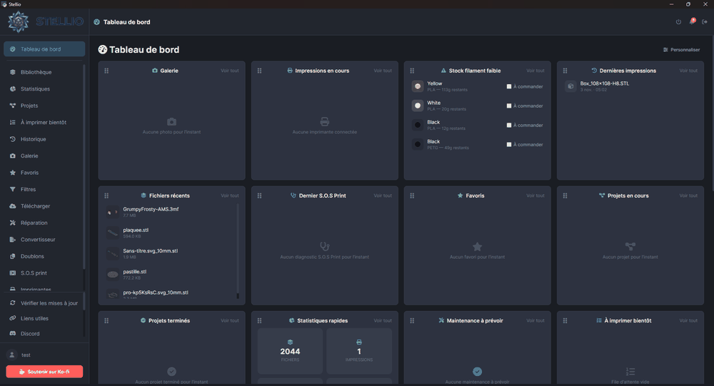
</p>

<table align="center">
  <tr>
    <td align="center"><a href="../screenshots/02-library.png">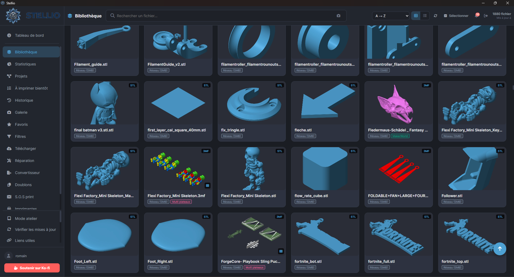<br>ライブラリ</a></td>
    <td align="center"><a href="../screenshots/03-viewer.png">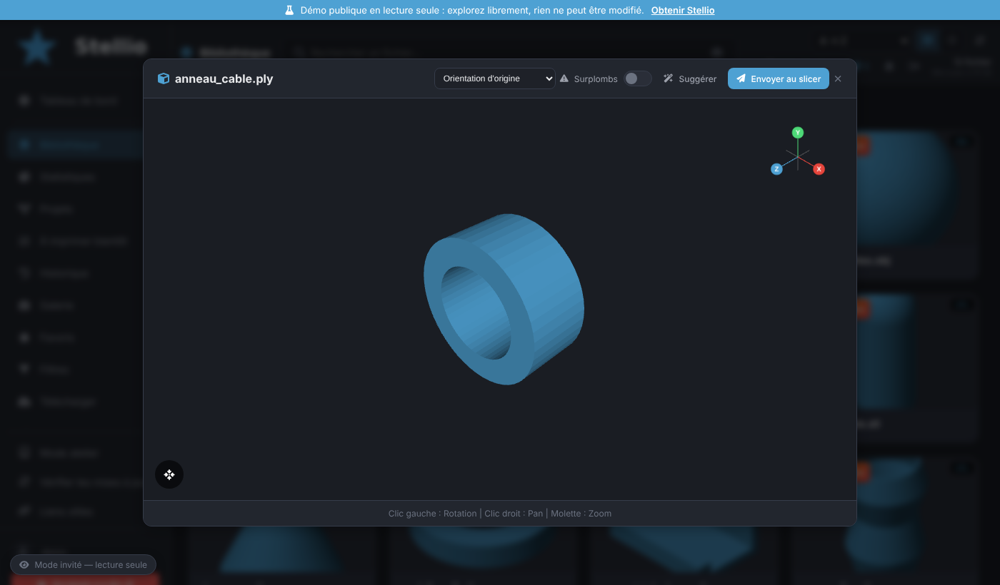<br>3D ビューア</a></td>
    <td align="center"><a href="../screenshots/04-filters.png">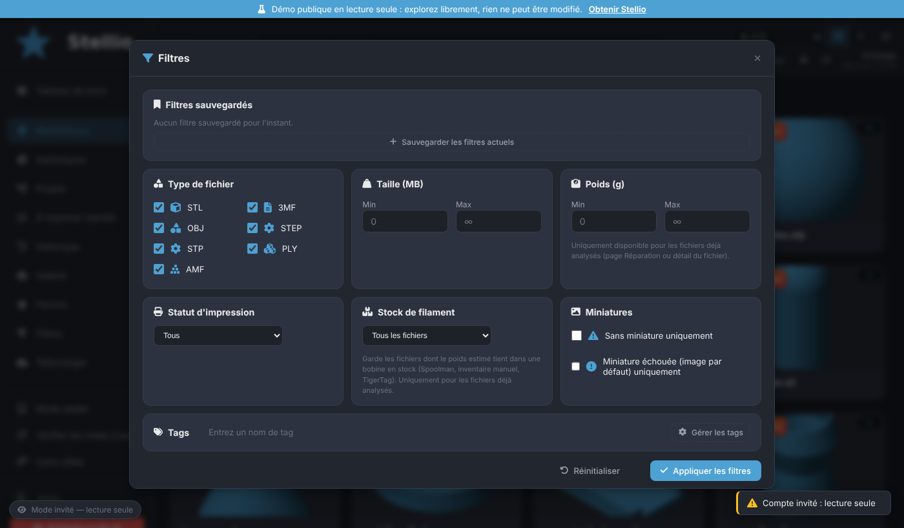<br>フィルター</a></td>
    <td align="center"><a href="../screenshots/05-repair.png">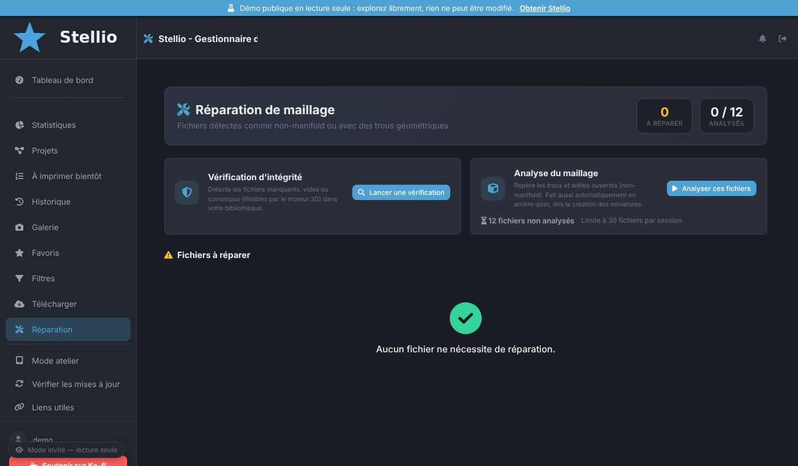<br>修復</a></td>
    <td align="center"><a href="../screenshots/06-converter.png">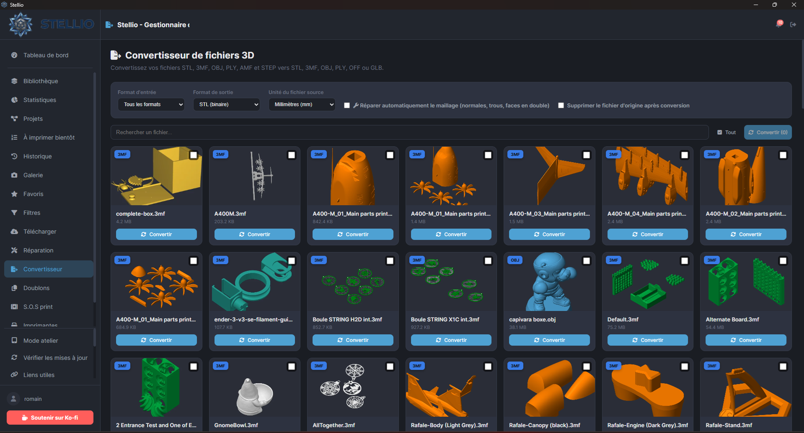<br>コンバーター</a></td>
  </tr>
</table>


<p align="center">
  <a href="../../README.md">🇬🇧 English</a> |
  <a href="README_fr.md">🇫🇷 Français</a> |
  <a href="README_de.md">🇩🇪 Deutsch</a> |
  <a href="README_es.md">🇪🇸 Español</a> |
  <a href="README_it.md">🇮🇹 Italiano</a> |
  <a href="README_pt.md">🇵🇹 Português</a> |
  🇯🇵 <strong>日本語</strong> |
  <a href="README_zh.md">🇨🇳 中文</a>
</p>

<p align="center">
  <a href="#-インストール">🚀 インストール</a> •
  <a href="#-機能">✨ 機能</a> •
  <a href="#-ドキュメント">📖 ドキュメント</a> •
  <a href="#-コントリビュート">🤝 コントリビュート</a> •
  <a href="#-ライセンス">📜 ライセンス</a>
</p>

---

## 🎯 概要

**Stellio** は、3Dライブラリ（STL、3MF、OBJ、STEP、PLY、AMF）を一元管理し、繰り返し作業を自動化して、3Dプリントのワークフローにシームレスに統合するモダンなデスクトップアプリです。

初心者メイカーでも、複数台のプリンターを運用する熟練ユーザーでも、**ローカルAI**（Ollama）、**スマートなプリンター管理**、そして**生産性を重視したインターフェース**により、Stellioは貴重な時間を節約します。

> 💡 **理念**：あなたのデータはあなたの手元に残ります。すべてローカルで動作します。Raspberry Pi / Linux では、ご自身のAPIキーでオンラインAIを任意で接続できます（下記参照）。既定では、データはお使いのマシンの外に出ません。

---

## ✨ 機能

### 🏠 ダッシュボードと生産性
- 📊 **起動時のダッシュボード**：印刷中のジョブ、フィラメントの在庫不足、最近の印刷、最近のファイルを一目で確認
- 🧱 **完全カスタマイズ可能**：ドラッグ＆ドロップによるウィジェットの並べ替えと非表示（20種類：印刷中、在庫不足、最新のS.O.S Print、提案、Stellioインスタンスなど）
- 🖼️ **ウィジェットを追加**：「完了したプロジェクト」、「ギャラリー」（ギャラリーの写真を順に表示、ホバーで一時停止、クリックで拡大）、「見積書」（最新5件の見積書）。すべてのウィジェットが同じサイズで、内容はウィジェット内でスクロールします
- ✅ 新規ユーザー向けの**「はじめに」チェックリスト**
- 💡 **「提案」ウィジェット**：よく再印刷しているのにしばらく見直していないファイルや、失敗率の高いスライサープロファイルを検出
- ⌨️ **コマンドパレット（`Ctrl+K`）**：移動、アクションの実行、ファイル・タグ・スプール・スライサープロファイルの即時検索
- 🔔 **通知センター（ベル）**：印刷完了、失敗、メンテナンス予定、フィラメント在庫不足、乾燥リマインダーを1か所に集約
- 📺 **フローティングウィジェット**：現在の印刷の進捗をすべてのページに表示
- 🧭 **インタラクティブなガイドツアー**：主要機能を紹介。設定から再開可能
- ♿ **アクセシビリティ**：ハイコントラストモード、アニメーション軽減、どこでも見えるキーボードフォーカス表示
- 🪟 **システムトレイアイコン（Windows）**：時計の横の Stellio アイコンでアプリが動作中であることが分かります（クリック = 開く、右クリック = 開く / 終了）

### 📚 ライブラリ管理
- 🗂️ **複数のソース**：ローカルフォルダ、単一ファイル、SMB/NFS共有 — パソコン上で検出された3Dフォルダが提案され、ワンクリックで追加可能
- 🖼️ **自動3Dサムネイル**：PyRender（高品質レンダリング）または numpy CPUラスタライザー（フォールバック）。読み込みエフェクトと**ホバーで拡大プレビュー**付き
- 🌀 **常に快適**：アプリを操作するとサムネイル生成が一時停止し、操作をやめると再開します
- ⚙️ **「サムネイルのパフォーマンス」設定**（自動 / 節約 / 標準 / 高速）と翻訳済みの進行状況インジケーター。非常に詳細な STL や巨大・マルチカラーの 3MF もきれいな 3D サムネイルになり、PrusaSlicer の 3MF も STL と同様に 3D で描画されます
- 🏷️ **カスタムタグ**（色分け）＋ AIによる自動タグ付け。**選択した複数ファイルへのワンクリックタグ付け**にも対応
- 🔍 **AI支援によるセマンティック検索**（「〜用のサポート材を探している」など）。**最近の検索を記憶**
- ⭐ **お気に入り**と高度なフィルター（種類、サイズ、重量、印刷ステータス）。お気に入りに対してフィラメント在庫が不足している場合は**補充の警告**を表示
- 🧵 **「フィラメント在庫」フィルター**：実際に持っているスプール（Spoolman、手動インベントリ、[TigerTag](https://tigersystem.io)）で印刷可能なファイルだけを、素材別に表示
- 💾 **フィルターの保存**：フィルターの組み合わせを保存して、ワンクリックで再利用
- 🔀 **並び順と検索を記憶**：選択した並び順（A → Z、フォルダ、サイズ、日付、タグなど）は再起動後も復元され、ライブラリの自動更新中も検索・有効なフィルター・AI検索の結果は維持されます。検索欄を空にすると、実行中のAI検索を即座に停止します
- 🖨️ **印刷ステータスのフィルター**：「スライサーに送信済み」「印刷済み（成功または失敗）」「成功済み」「失敗済み」
- 📋 **「近日印刷」キュー**：お気に入りとは別管理。ドラッグ＆ドロップで並べ替え、スライサーへ直接送信可能
- 🖱️ **高速選択**：範囲選択（`Shift+クリック`）とキーボードナビゲーション（矢印キー＋`Enter`）
- ✏️ **一括リネーム**（検索/置換、接頭辞、接尾辞、連番）。適用前にプレビュー表示
- ↩️ **削除の取り消し**（`Ctrl+Z`）：5分間の一時ごみ箱により実現 — タグ・プロジェクト・ソースの削除も、確認ダイアログなしで元に戻せます
- 🔗 **モデルの出典**：ファイル詳細に元リンク、作者、ライセンス、メモを表示。ダウンロード済みの場合はダウンロード日も記録
- 🧩 **プロジェクト／アセンブリ**：複数ファイルを1つのオブジェクトとしてグループ化。マルチプレート3MF対応（ビューアでのプレート間ナビゲーション）
- 🧱 **プロジェクト内の複数プレート3MF**：複数プレートの3MFをプロジェクトに追加すると、プレートごとに1つの3MFファイルへ自動分割されます（6プレート＝印刷用ファイル6個）。ファイルは非表示フォルダに保存されるためライブラリが散らからず、サムネイルはすぐに表示され、プロジェクトから直接スライサーへ送信できます。ファイルの「⋯」メニューの **「プレートを分割」** では、プレートごとに個別のSTLまたは3MFを作成します
- 🔎 **プロジェクトカード**：サムネイルをクリックすると3Dビューアーでファイルが開きます。「すべて / 進行中 / 完了」フィルターはセッション間で記憶されます。印刷を「成功」と評価すると、そのファイルを含むプロジェクトに印刷済みの部品が追加され、「近日印刷」から外れます
- 💰 **プロジェクトのコスト**：プロジェクトカードのボタンで、単品のコストと同じ設定（スライサーによる正確な見積もり、スプール、電気代、消耗、固定費、マージン、数量）で全ファイルのコストを計算し、見積書をPDFで出力できます
- 🔁 **重複検出**（完全一致・形状の類似）
- 🗜️ **アーカイブ対応**：アーカイブ内のモデルを直接閲覧・展開
- 🖱️ エクスプローラーからの**3Dファイルのドラッグ＆ドロップ** — デスクトップアプリに加え、ブラウザ経由（Raspberry Pi、モバイル、リモートアクセス）でも動作
- 📊 **詳細な統計情報**（フォーマット、プラットフォーム、プロファイルの信頼性）

### 🤖 人工知能（ローカルOllama）
- 🏷️ ファイルのスマートな**自動タグ付け**
- 📝 モデルの**自動説明文生成**
- 🔎 自然言語による**セマンティック検索**
- 📐 **印刷可能性の解析**（オーバーハング検出）と**推奨される向き**（オーバーハングが少ない向き、ベッドとの接触率を表示）
- 🎯 形状と成功履歴に基づく**スライサープロファイルの推奨**
- ⏱️ スライス前の**印刷時間の見積もり**
- 🩺 **S.O.S Print**：印刷失敗のアダプティブ診断機能 — Stellioは一度に1つずつ質問し、回答に応じて仮説のリストを絞り込み（最大4問）、最終的な診断を提示します。写真解析はいつでも利用可能で、会話は保存され、再度開いたり「解決済み」にしたりできます

### 🖨️ プリンター管理
- 🔌 **OctoPrint**、**Klipper/Moonraker**、**Bambu Lab**（MQTT）、**Creality**（WebSocket）、**FlashForge**、**Elegoo**（SDCP）、**PrusaLink** に対応
- 📡 **自動ネットワーク検出**：Stellioはローカルネットワークをスキャンし（Bambu Lab向けSSDP、Elegoo/Centauri/FlashForge向けUDPブロードキャスト、Klipper/OctoPrint/PrusaLink/Creality向けの個別プロービング）、検出したプリンターをワンクリックで追加できます
- 📡 リアルタイム監視（温度、進捗、カメラ）
- 🖼️ **カードに印刷中のファイルを表示**：印刷中のファイルがライブラリにある場合はサムネイルとファイル名を表示します（Stellio外で開始したKlipper/Moonrakerの印刷にはG-codeのサムネイル）。ベッドサイズ（X、Y、Z）はプリンターごとに設定でき、部品が大きすぎる場合は送信前に警告します
- 🔧 ブランド別のタスク管理と推奨事項による**予知保全**（Bambu、Prusa、Crealityなど）
- 🔩 **消耗部品・消耗品**：ノズル、プレート、ベルトなどの在庫をアラート付きで管理し、メンテナンスタスクと連動（作業ごとに部品を1つ消費）
- ⏱️ 自動印刷時間カウンター
- 📤 スライサーへの直接送信。送信ダイアログから直接正しいフィラメントを割り当てるスプールセレクター付き。またはプリンターへのアップロード
- 👀 スライサーへの送信ウィンドウで、確定前に**クイックプレビュー**（重量、推定印刷時間）を表示
- 🛡️ **強化された印刷前チェック**：割り当てたスプールの乾燥が必要な場合、フィラメントが研磨性の場合（硬化鋼ノズル推奨）、このプリンター用のキャリブレーションがない場合に警告
- 🔁 **前回と同じ設定で再印刷**：履歴からワンクリックで、同じプリンター・プロファイル・スプールで送信ウィンドウを再度開く
- 🎛️ **キャリブレーション**：フィラメントとプリンターごとに flow、pressure advance、温度などを保存し、スライサー送信ウィンドウで呼び出し
- 👥 **軽量コラボレーションモード**：別の接続デバイスがすでにファイルを閲覧中かどうかが分かり、同じファイルを誤って二重にスライサーへ送信するのを警告で防止

### 🧵 フィラメント管理
- 🔗 **Spoolman** 連携（スプール管理サーバー）。ネットワーク上での自動検出に対応
- 🟠 **Bambu Lab AMS** 対応（スロット読み取り）
- 🟢 **Creality CFS** 対応
- 🐯 [**TigerTag**](https://tigersystem.io) 連携（NFC/RFIDによるスプール識別）：ログインしてTigerTagのスプールを在庫に表示、または既存のTigerTag Studioセッションを自動で取得 — 読み取り専用で、TigerTagの在庫を変更することはありません
- ⚪ 手動スプール
- 📉 スライサー送信時の自動消費量トラッキング、印刷前の互換性チェック（残量は十分か？）
- 🔔 起動時の**在庫不足アラート**、購入用のクイックリンク付き
- 🛒 **スプールの買い足し**：まずそのブランドのメーカー公式ショップ（Arianeplast、Bambu Lab、Polymaker、eSUN、Sunluなど）を表示し、続いて総合ショップを表示します。サイトが対応していれば在庫も自動で確認します
- 💨 **スプールの乾燥**：乾燥ログ、素材に応じた状態（乾燥済み／要乾燥）、推奨温度・時間、通知でのリマインダー
- 📈 **スプールサマリー**：各スプールの詳細に、印刷数、グラム数、コスト、未追跡の差分を表示

### 📥 プラットフォームからのダウンロード
- 🟠 **Printables**（GraphQL API）
- 🟢 **MakerWorld**（2段階のBambu Labログイン）
- 🔵 **Thingiverse**（APIキー経由）
- 🟣 **Nexprint**（Elegoo のモデルライブラリ。アカウントのメールアドレスとパスワードでログイン。暗号化して保存）
- 🔷 **Creality Cloud** と **Snapmaker Space**（設定からログイン、認証情報は暗号化して保存。Googleでのログインには対応していません）
- 📁 設定済みのソースへの直接ダウンロード
- 🆕 **新バージョンの検出**：ダウンロード済みモデル（Printables、MakerWorld、Thingiverse）が更新されていないか、Stellioが毎日確認
- 🛒 **便利なリンク**：ショップ、メーカー、3Dモデルサイト、リソースを折りたたみ式セクションにまとめて表示

### 🧩 高度なツール
- 🎨 **自動ネスティング**（rectpackまたはshapelyによる実シルエット）
- 🔧 **メッシュ修復**（trimesh + pymeshfix）。**修復前後の比較**（水密性、三角形数、頂点数、サイズ）付き
- 🔄 **フォーマット変換**（STL ↔ 3MF ↔ OBJ）
- 🛡️ **整合性チェック**（破損・欠落ファイル）
- 💰 **印刷コスト計算**：材料費、電気代、機械の摩耗（時間あたり）、固定費、利益率（％）、数量 — 単価と合計を1円単位まで計算
- 🏷️ **マージンと販売価格**：設定 → 印刷料金で既定のマージン（%）を一度設定すると、履歴にコストの横に販売価格（コスト + マージン）が表示されます。統計は引き続き実コストで計算されます
- 🧾 **PDF見積書**：コスト計算から生成。顧客名、品名、備考をカスタマイズ可能。見積書ヘッダー（氏名/会社名、ロゴ、住所、電話、メール、Webサイト、税務ID）とフッターの法的表記も設定可能
- 🗃️ **見積書の履歴**：作成した見積書はすべて（PDFのコピーとして）保存され、ダッシュボードの「見積書」ウィジェットから閲覧・再ダウンロード・削除できます
- 🌱 **環境負荷の見積もり**：印刷のCO₂排出量（材料＋電力）
- 📸 **印刷写真ギャラリー**（成功／失敗）
- 🕒 成功／失敗評価付きの**履歴**（AIの学習データに反映）。各行に**「ファイルを見る」**と**「再印刷」**ボタン（移動・削除されたファイルの検出付き）、プラットフォーム・結果（成功／失敗／一部／未評価）・期間によるフィルター

### 📈 レポートと信頼性
- 🧮 **印刷の信頼性**：スライサープロファイル、素材、プリンター、スプール別の成功率と失敗コストのランキング
- 🗓️ **月次レポート**：その月の印刷数、成功率、フィラメント、コスト、失敗、CO₂を前月と比較。PDFでエクスポート可能

### 🔔 通知
- 🪟 **Windowsネイティブ通知**
- 🌐 Raspberry Piやモバイル経由のアクセス用に有効化できる**ブラウザ通知**
- 📣 **プッシュ通知**（ntfy、Telegram、Discord、Webhook）：ウィンドウを閉じていても印刷の完了・失敗を検知し、メンテナンスや在庫のアラートも通知

### 🌐 モバイル・リモートアクセス
- 📱 モバイルからライブラリにアクセスするための**QRコード**（インストール可能なPWA）
- 📲 **Androidコンパニオンアプリ**：専用のQRコードから、Stellioコンパニオンアプリ（APK）を直接ダウンロード・インストールできます（モバイルアクセス設定内）。印刷中のジョブから直接写真を撮影することも可能
- 🌍 Cloudflare Tunnelによる**リモートアクセス**（無料、ランダムまたは固定URL）、またはCloudflareを使わない**カスタムアドレス**（ドメイン名、DynDNS、VPN、Tailscaleなど）。ワンクリックでCloudflareに戻すことも可能
- 🔗 一時的な**共有リンク**（24時間、1回限り）

### 👥 アカウントとマルチインスタンス
- 🔐 リカバリーコードと秘密の質問による**ローカルアカウント**：メールやインターネットなしで、100％ローカルでパスワードをリセット
- 🙋 **セッションの確認**：保存済みのセッションでアプリを開くと、Stellioがアカウントの確認を求めます（はい / いいえ）。スマートフォンでは、セッションが有効な間はアプリに戻っても認証情報を再入力する必要がありません
- 👤 **読み取り専用のゲストアカウント**：ライブラリ、プリンター、在庫を安全に共有
- 🔄 **Stellioインスタンス**：ローカルネットワーク上の他のインストールを自動検出し、ワンクリックで追加（相手のローカルキーを入力するだけ）
- 📨 **別のインスタンスへのファイル送信**：送信先インスタンスで保存先フォルダを選択でき、受信したファイルはすぐにそのライブラリに表示されます
- ✅ ダッシュボードの**インスタンス状態ウィジェット**（保存済みの各インスタンスについて、緑のチェックまたは赤い×で表示）

### 🎨 カスタマイズ
- 🌓 テーマ：ダーク／ライト／システム
- 🎨 ブランドテーマ：Stellio、Bambu、Prusa、Voron、Creality
- 🎯 カスタムアクセントカラー
- 🌍 **8言語対応**：FR、EN、DE、ES、IT、PT、JA、ZH
- 🧲 ドラッグ＆ドロップによるナビゲーションの並べ替え
- ↩️ **設定の取り消し**：直前に行った設定変更を元に戻す

### 💾 バックアップとアップデート
- 📦 完全バックアップのエクスポート／インポート（.zip）
- 🔄 GitHubからの自動アップデート（`.zip`パッチ — WindowsとRaspberry Pi/Linuxで同じ仕組み）
- 🧰 **モジュールの確認**：各バージョンの初回起動時に、不足しているモジュール（PDF見積書、スプレッドシートの取り込み、通知など）を自動でダウンロードします
- 🔁 アップデート後やデバッグモード有効化後の再起動が、WindowsでもRaspberry Pi/Linuxでも確実に動作
- 📋 診断ログのエクスポート（機密情報はマスク）
- 💬 **アプリから直接ご提案・バグ報告**：Stellio を離れずに提案やバグを送信できます。GitHub の Issue が自動で作成され（専用の GitHub App 経由で匿名）、Issue へのリンクと、返信が届いたときの「新しい返信」バッジが表示されます

---

## 🖼️ スクリーンショット

| | |
|---|---|
| 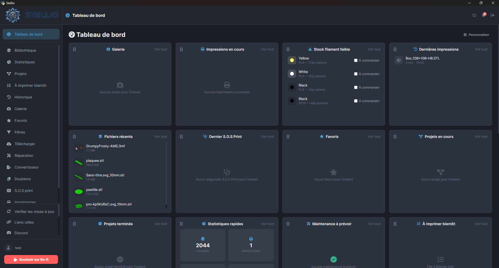 *カスタマイズ可能なダッシュボード* | 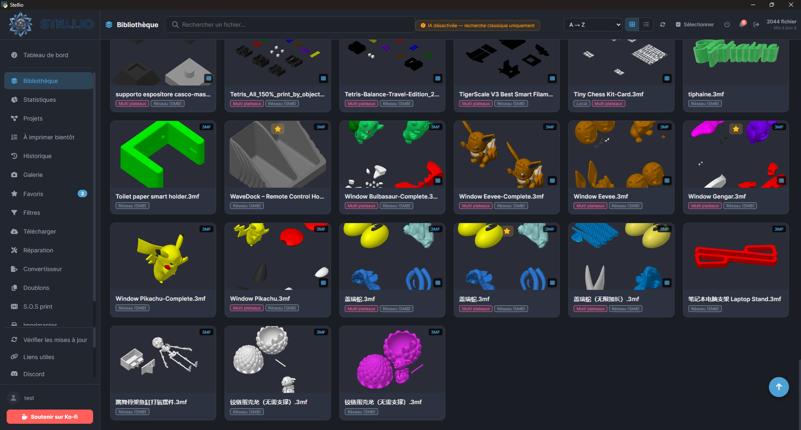 *タグとお気に入り付きライブラリ* |
| 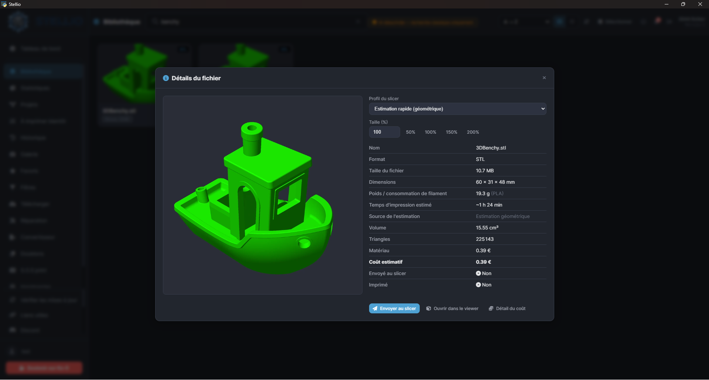 *ファイル詳細：重量・造形時間・コスト* | 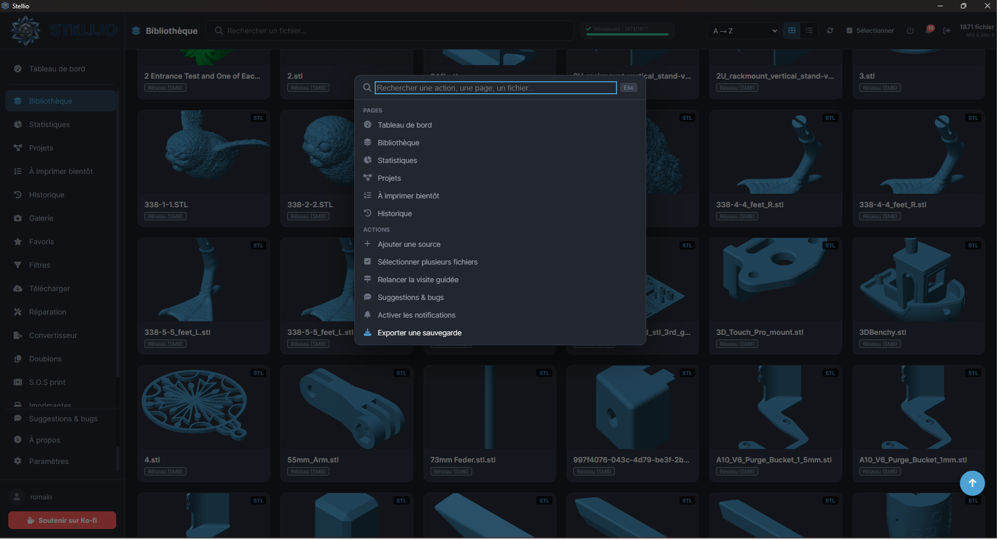 *コマンドパレット (Ctrl+K)* |
| 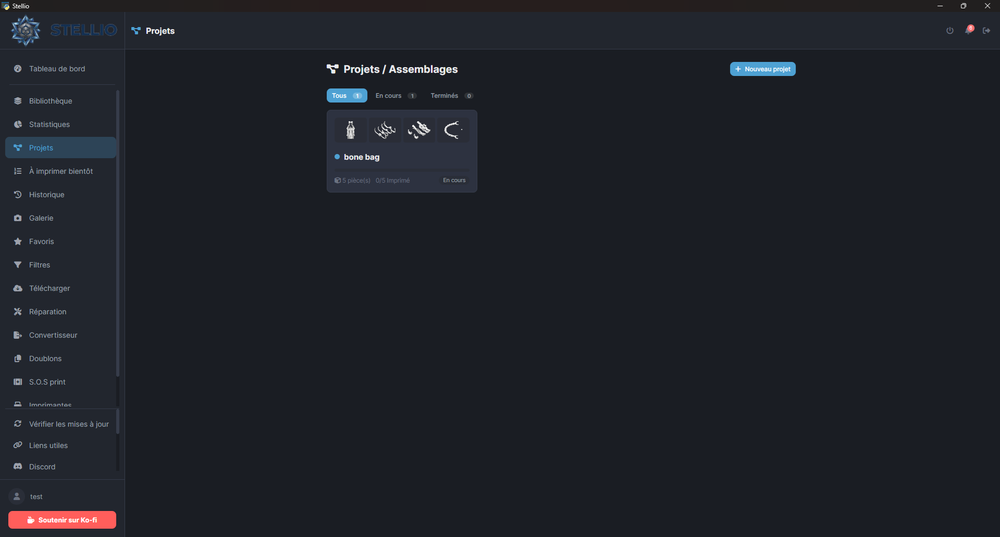 *プロジェクト / アセンブリ* | 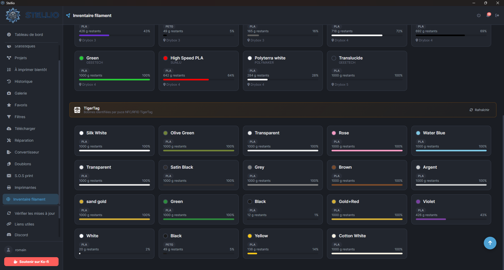 *フィラメント在庫* |
| 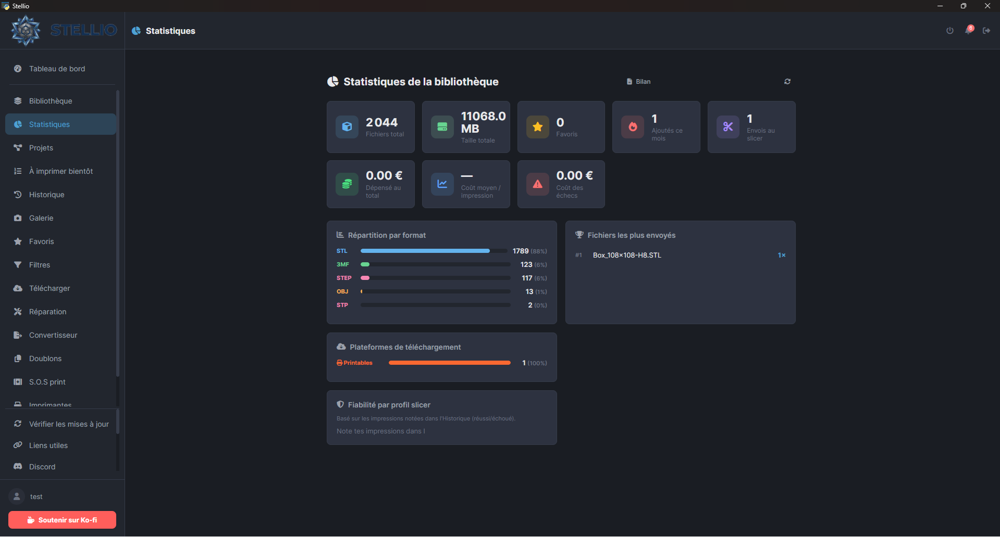 *ライブラリ統計* | 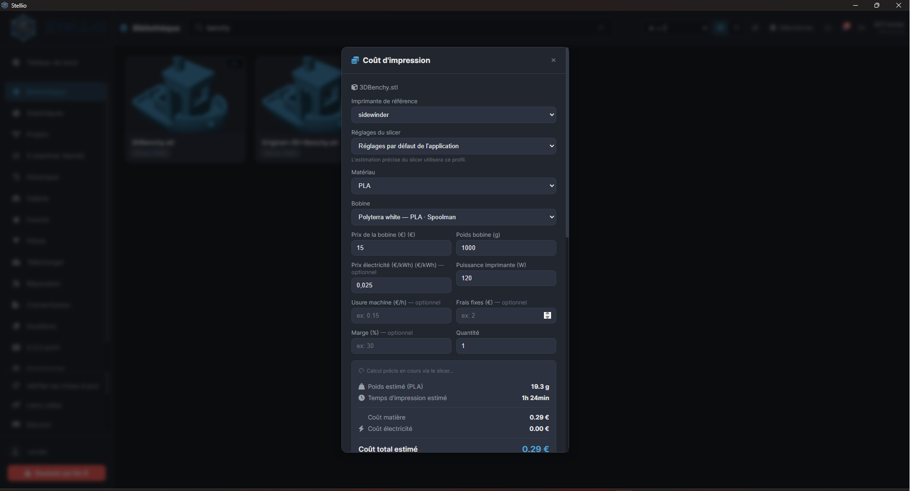 *印刷料金：電気代・摩耗・マージン* |
| 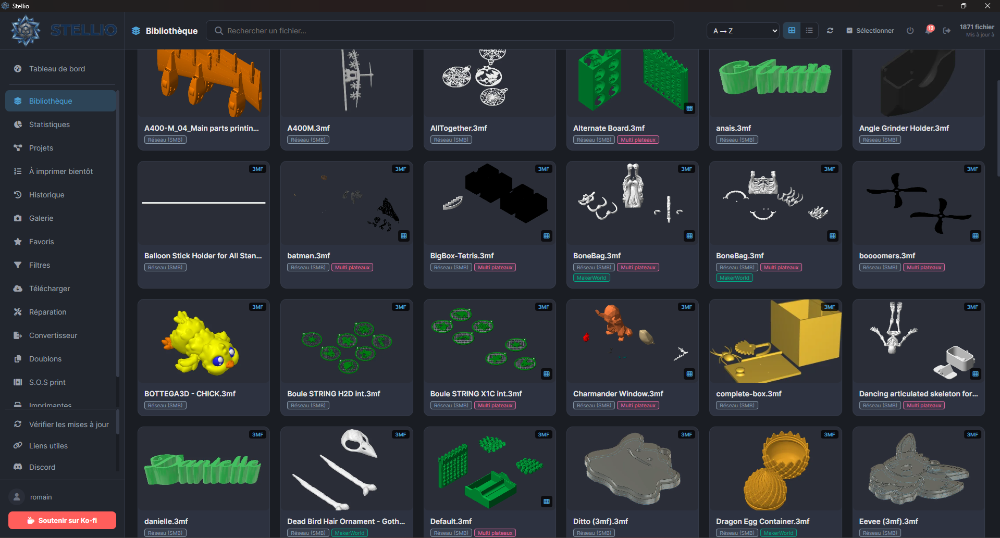 *サムネイル付きライブラリ* | 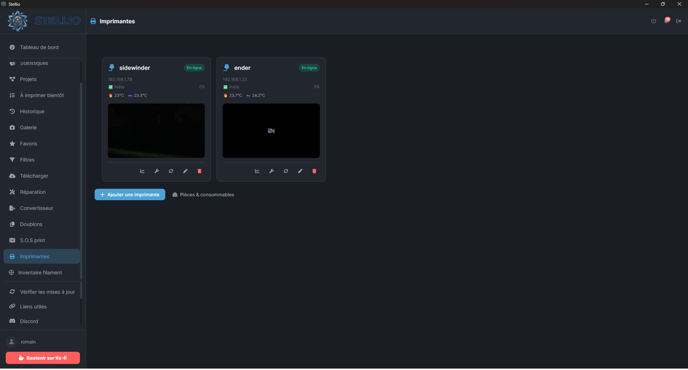 *プリンター監視* |
| 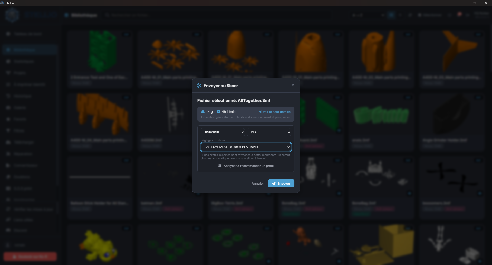 *AIによるプロファイル推奨* | 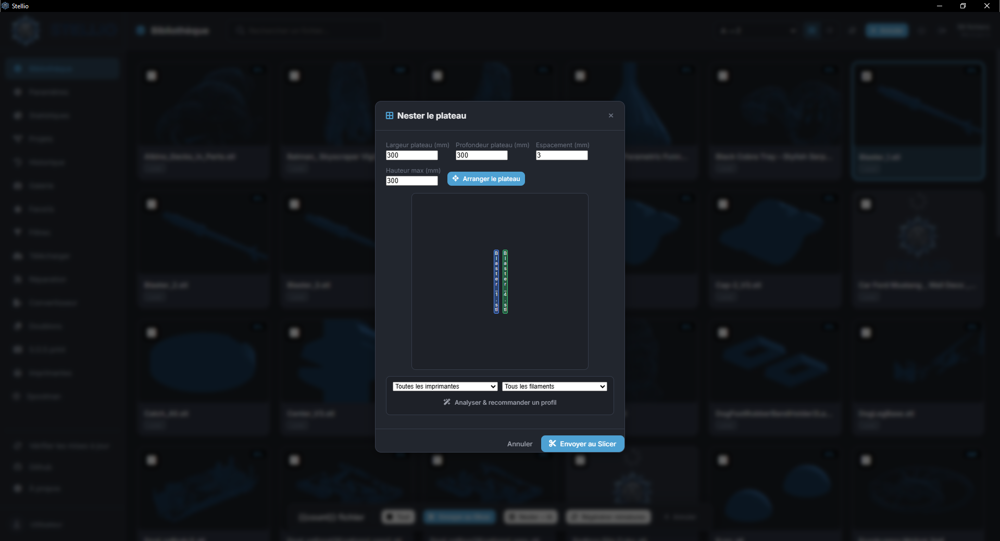 *自動ネスティング* |

---

## 🚀 インストール

### 🪟 Windows（推奨）

1. [Releases](https://github.com/stellio-app/stellio/releases) から最新のインストーラーをダウンロード
2. `Stellio-Setup-<version>.exe` を実行
3. 完了です！🎉

> 💼 **ポータブル版（インストール不要）**：Releases から `Stellio-v<バージョン>-portable-win64.zip` をダウンロードし、好きな場所（ディスク、USBメモリ）に展開して `Stellio.exe` を起動します。データは実行ファイルの横の `data` フォルダーに保存されます（`portable.flag` ファイルは削除しないでください）。

### 🍎 macOS

1. [Releases](https://github.com/stellio-app/stellio/releases) からお使いの Mac に合った `.dmg` をダウンロードします：`Stellio-v<version>-macOS-arm64.dmg`（Apple シリコン：M1、M2、M3…）または `Stellio-v<version>-macOS-x86_64.dmg`（Intel）。
2. `.dmg` を開き、**Stellio** を**アプリケーション**にドラッグします。
3. 初回起動：**Stellio** を右クリック（または Control キーを押しながらクリック）して**開く**を選び、確認します。🎉

> ⚠️ macOS 版は**まだ公証されていません**。初回起動時に Gatekeeper の警告が表示されます（右クリック →「開く」で回避できます）。各ファイルには確認用の `.sha256` チェックサムが付属しています。
>
> 💡 **ウィンドウが真っ白？** ポート 5000 は macOS の「AirPlay レシーバー」に使われていることがよくあります。その場合、Stellio は空いている別のポート（5001〜5030）を自動で選びます。データは `~/.stellio` に保存されます。

### 🐧 Raspberry Pi / Linux

**ヘッドレスサーバーモード**（GUIなし）で動作します：Stellioはバックグラウンドで動作し、Pi自体、またはローカルネットワーク上の任意のデバイスのブラウザからアクセスします。

**必要環境**：Raspberry Pi 4または5を推奨、**64ビット**版Raspberry Pi OS。

```bash
curl -O https://raw.githubusercontent.com/stellio-app/stellio/main/install-pi.sh
chmod +x install-pi.sh
./install-pi.sh
```

このスクリプトは以下を自動でインストールします：
- システム依存関係（`ffmpeg`、`unrar`、3Dレンダリングライブラリ）
- 専用のPython仮想環境
- 起動時にStellioを起動し、クラッシュ時に自動再起動する **systemdサービス**（`stellio.service`）

インストール後、Stellioは `http://<piのIP>:5000` でアクセスできます。

```bash
sudo systemctl status stellio     # サービスの状態
sudo systemctl restart stellio    # 再起動
sudo journalctl -u stellio -f     # ログをリアルタイムで確認
```

> 💡 **Windowsと同じアップデート方式**：各リリースで公開される`.zip`パッチは両プラットフォームで同一です（純粋なソースコードで、コンパイル済みバイナリは含まれません）。Stellioが自動的に検出・適用し、サービスを再起動します — 手動での再インストールは不要です。
>
> 🎥 Windows版と同じ機能を利用できますが、ネイティブなデスクトップウィンドウ（ブラウザアクセスに置き換え）と、Pi上で快適に動作させるためにある程度の性能のモデルが必要なローカルOllama AIは例外です — 必要に応じて設定内で `ollama_url` をリモートのOllamaサーバーに向けてください。

### 🖥️ Proxmox VE（1コマンドで LXC コンテナを作成）

**Proxmox VE** サーバーでは、スクリプトがコンテナの作成と設定をすべて行います。**Proxmox ホストのシェル**（Datacenter → ノード → Shell）を開き、次を貼り付けます：

```bash
bash -c "$(curl -fsSL https://raw.githubusercontent.com/stellio-app/stellio/main/stellio-lxc.sh)"
```

スクリプトはデフォルト設定または詳細設定（CTID、コア数、RAM、ディスク、ブリッジ、VLAN、DHCP または固定 IP、ストレージ、マウントするホストのフォルダ）を提供し、その後：
- **非特権 Debian 12** コンテナを作成します（デフォルトは 2 コア、RAM 2 GB、ディスク 32 GB、起動時に自動開始）。
- `install-pi.sh` で Stellio をインストールします（依存関係、Python 環境、**systemd サービス**）。
- アクセス先 `http://<コンテナのIP>:5000` と生成された root パスワードを表示します。

> 🔒 **ソース**：このコンテナでは、Stellio の**ローカルのフォルダー／ファイルの追加は非表示**で、**SMB** と **NFS** のネットワークソースのみ選べます。`var_mount=/ホストのパス:/mnt/models` でホストのフォルダをマウントした場合は、「ローカルフォルダ」も許可されます。設定は `/etc/systemd/system/stellio.service.d/sources.conf`（変数 `STELLIO_ALLOWED_SOURCE_TYPES`）にあります。

```bash
pct exec <CTID> -- update-stellio                 # Stellio を更新（Proxmox ホストから）
pct exec <CTID> -- journalctl -u stellio -f       # ログをリアルタイムで確認
```

メニューなしモード：すべてのオプションは環境変数で指定できます。例：`var_mode=default var_cpu=4 var_ram=4096 var_disk=16 var_ip=192.168.1.50/24 var_gw=192.168.1.1`（全一覧はスクリプト冒頭）。

💾 **ストレージの選択**：最初のメニューで「デフォルト設定＋ストレージ選択」を選ぶ（または `var_choose_storage=1`）と、コンテナのディスク（`var_storage`、例：`local-zfs`）とテンプレート（`var_template_storage`、例：`local`）の保存先を選べます。スクリプトはストレージの存在と空き容量を確認します。

🌍 **言語**：スクリプトの文言は Proxmox の言語に従います（fr, en, de, es, pt, it, zh, ja）。`var_lang=ja` で強制できます（既定は英語）。

### 🧰 サーバー版（Raspberry Pi / Linux）専用

> Windows 版には影響しません。これらの機能は Raspberry Pi、VM、LXC、Docker、Linux でのみ表示されます。

- ☁️ **オンラインAI（任意）**：Ollama の代わりに、ご自身のAPIキーで Claude（Anthropic）、ChatGPT（OpenAI）、Gemini（Google）を利用できます（設定 → 人工知能）。キーはサーバー上で暗号化され、ブラウザには送り返されません。既定は引き続き完全ローカルの Ollama です。リクエスト（ファイル名、タグ、説明、S.O.S Printの写真）は選択したプロバイダーに送信され、あなたのキーで課金されます。
- 📥 **スライサーのプロファイル**：Stellio は PC 上のスライサーを認識できず、スライサーのクラウド（Orca Cloud、Bambu Cloud など）にも接続しません。スライサーからプロファイルをエクスポート（OrcaSlicer：ファイル → エクスポート → プリセットバンドルをエクスポート）し、設定 → 自分のスライサープロファイル からインポートしてください。Orca Cloud ではプロファイルの「Copy raw JSON」を貼り付けることもできます。Stellio が自動で再読み込みする**監視プロファイルフォルダー**（Syncthing、ネットワーク共有、scp など）も利用できます。
- 🐯 [**TigerTag**](https://tigersystem.io)：設定 → フィラメント在庫 → TigerTag で、メールアドレスとパスワードによる公式ログインが使えます（パスワードは保存されず、暗号化されたセッショントークンのみ保持）。Google で作成したアカウントは、先に TigerTag アプリの「パスワードを忘れた場合」でパスワードを設定してください。代替手段：TigerTag Studio のデータフォルダー（Windows：`%APPDATA%` 内の「TigerTag…」フォルダー。少なくとも `Local Storage` と `IndexedDB`）をサーバーにコピーし、そのパスを指定します。

### 対応スライサー

Stellioは以下を自動検出します：
- ✅ OrcaSlicer
- ✅ Bambu Studio
- ✅ PrusaSlicer / SuperSlicer
- ✅ Ultimaker Cura
- ✅ Creality Print
- ✅ Elegoo Slicer
- ✅ Qidi Studio
- ✅ Anycubic Slicer Next
- ✅ Anycubic Slicer
- ✅ Simplify3D
- ✅ ideaMaker
- ✅ FlashPrint
- ✅ Lychee Slicer
- ✅ CraftWare
- ✅ MatterControl
- ✅ MakerBot Print
- ✅ Voxelizer
- ✅ Slic3r
- ✅ KISSlicer

### 対応プリンター

| メーカー | モデル | 接続と機能 |
|---|---|---|
| **Bambu Lab** | X1 / X1C / X1E · X2D · P1P / P1S · P2S · A1 / A1 mini · H2D / H2S / H2C | MQTT（LAN + クラウド）：リアルタイム監視、AMS、カメラ、SSDP自動検出 |
| **Prusa** | MK4 · MK3.9 · MK3.5 · MINI+ · XL · CORE One | PrusaLink（HTTP）：監視、アップロード、カメラ |
| **Creality** | K1 / K2 シリーズ · Ender-3 V3 · Hi | WebSocket：監視、CFS、UDP自動検出 |
| **Elegoo** | Centauri Carbon 1 / 2 · レジン Saturn / Mars シリーズ | SDCP（WebSocket）：監視、UDP自動検出 |
| **FlashForge** | Adventurer 5M / 5M Pro · AD5X | 独自API：監視、UDP自動検出 |
| **Klipper / Moonraker** | Klipper が動作するすべての機種（Voron など） | HTTP：監視、アップロード、カメラ、正確な印刷時間 |
| **OctoPrint** | OctoPrint で制御するすべてのプリンター | HTTP：監視、アップロード、カメラ |

> 掲載しているモデルは、Stellio の「プリンターを追加」フォームで選べるものです。同じプロトコルを使う他のモデルも通常は動作しますが、すべてをテストしたわけではありません。お使いの機種が動作したかどうかを [GitHub でお知らせください](https://github.com/stellio-app/stellio/issues)。

---

## 🛠️ 技術スタック

| コンポーネント | 技術 |
|---|---|
| バックエンド | Python 3.8+、Flask、Waitress |
| フロントエンド | HTML5、CSS3、Vanilla JavaScript |
| データベース | SQLite（WALモード） |
| デスクトップ | pywebview（Windows、macOS）／ヘッドレスブラウザモード（Raspberry Pi、Linux） |
| 3Dレンダリング | PyRender、numpy CPUラスタライザー、Three.js |
| メッシュ・ネスティング | trimesh、pymeshfix、shapely、rectpack |
| AI | Ollama（ローカル） |
| ネットワーク | paho-mqtt、smbclient、requests |
| 暗号化 | cryptography（AES、呼び出しごとにランダムIV） |
| アーカイブ | zipfile、rarfile、py7zr、tarfile |

---

## 📖 ドキュメント

### キーボードショートカット

| ショートカット | アクション |
|---|---|
| `Ctrl+K` | コマンドパレット |
| `Ctrl+F` | 検索 |
| `Ctrl+N` | 新規ダウンロード |
| `Ctrl+,` | 設定 |
| `Ctrl+Z` | 直前の削除を元に戻す（5分間のごみ箱） |
| `Alt+1-8` | クイックナビゲーション |
| `Shift+クリック` | ファイルを範囲選択 |
| `↑ ↓ ← →` + `Enter` | ライブラリ内の移動とファイルを開く |
| `F` | お気に入りの切り替え |
| `T` | タグマネージャー |
| `?` | ショートカットヘルプ |
| `Esc` | モーダルを閉じる／検索をクリア |

### プロジェクト構成

```
stellio/
├── main.py             # Flask + デスクトップバックエンド
├── interface/              # index.html, script.js, style.css (UI)
├── packaging/              # launcher.py, installer (.iss), macOS entitlements
├── release-notes/          # notes_version_X.Y.Z.txt (release texts)
├── tests/  tools/          # pytest tests, maintenance tools (incl. stellio_manager.bat)
├── check_deps.py       # 自己修復型の依存関係チェッカー
├── modules/            # main.py から分離したモジュール (print_session, share_link, timelapse, mqtt_publisher…)
├── worker.py           # 未使用の3MFワーカーの雛形（仮実装）
├── assets/             # ロゴ、アイコン
├── languages/          # 翻訳ファイル（JSON）
├── apk/                # Androidコンパニオンアプリのパッケージ
├── docs/               # ドキュメント、プライバシーポリシー、翻訳版README
├── requirements.txt    # Python依存関係
├── install-pi.sh       # Raspberry Pi / Linux用インストールスクリプト（systemdサービス）
└── stellio-lxc.sh      # Proxmox VE 用 LXC インストールスクリプト
```

アイデアがありますか？[Issueを作成してください](https://github.com/stellio-app/stellio/issues)！

---

## 🤝 コントリビュート


コントリビュートを歓迎します！🎉

1. プロジェクトを**フォーク**する
2. ブランチを作成する（`git checkout -b feature/AmazingFeature`）
3. 変更をコミットする（`git commit -m 'Add AmazingFeature'`）
4. ブランチをプッシュする（`git push origin feature/AmazingFeature`）
5. **プルリクエスト**を開く

### ガイドライン
- 既存のコードスタイルに従ってください
- コメントはフランス語または英語で記述してください
- 可能であればWindowsで変更をテストしてください
- 必要に応じてドキュメントを更新してください

### バグ報告

最も簡単なのはアプリから直接送信する方法です。サイドバーの **ご提案・バグ報告** を開いて問題を説明すると、GitHub の Issue として自動送信されます。GitHub 上で自分で Issue を作成することもできます。

バグ報告テンプレートを使用し、以下を含めてください：
- Stellioのバージョン
- OS
- 再現手順
- エラーログ（設定 → 診断からエクスポート可能）

---

## 📜 ライセンス

このプロジェクトは **GNU Affero General Public License v3.0** のもとでライセンスされています — 詳細は[LICENSE](../../LICENSE)ファイルをご覧ください。

> 💡 **要約**：本ソフトウェアの複製、改変、配布は自由に行えます。Stellioを改変したり、ネットワークホスト型サービスとして提供したりする場合は、完全なソースコードを同じAGPLv3ライセンスの下で公開する必要があります。

---

## 🔒 プライバシー

Stellioはローカルファースト設計です：データはお使いの端末に残り、デフォルトでは外部サーバーへの収集や送信は一切行われません。詳細は[プライバシーポリシー](../privacy/PRIVACY.md)をご覧ください。唯一の例外は、ご自身で有効にした場合のサーバー版のオンラインAI（Claude、ChatGPT、Gemini）で、AIリクエストを選択したプロバイダーに送信します。

---

## 🔏 コード署名ポリシー

[Releases](https://github.com/stellio-app/stellio/releases) で公開されているWindowsインストーラーとLinux AppImageは、**まだコード署名されていません**。そのため、Windows SmartScreenの警告が表示される場合があります。macOS版もノータリゼーション（公証）されていません。各リリースファイルにはSHA-256チェックサム（`.sha256`）が付属しており、ご自身で検証できます。内蔵アップデーターもインストール前にこれを確認します。現在の状況、ダウンロードの検証方法、署名の計画については[CODE_SIGNING_POLICY.md](../../CODE_SIGNING_POLICY.md)をご覧ください。

---

## 🤝 パートナーシップ

<p align="center">
  <a href="https://tigersystem.io"></a>
</p>

Stellio は、NFC/RFID によるフィラメント識別システム [**TigerTag**](https://tigersystem.io) の連携パートナーです。スプールを Stellio のフィラメント在庫にそのまま表示できます。

- 🌐 [公式サイト](https://tigersystem.io) — [tigertag.io](https://tigertag.io)
- 🖥️ [Studio Manager（デスクトップアプリ）](https://github.com/TigerTag-Project/TigerTag-Studio-Manager)
- 📘 [RFID ガイドとドキュメント](https://github.com/TigerTag-Project/TigerTag-RFID-Guide)
- 📱 [iOS アプリ](https://apps.apple.com/fr/app/tigertag-rfid-connect/id6745437963)

---

## 🙏 謝辞

- ローカルAIの[Ollama](https://ollama.com/)
- バックエンドの[Flask](https://flask.palletsprojects.com/)
- Web 3Dレンダリングの[Three.js](https://threejs.org/)
- メッシュ処理の[trimesh](https://github.com/mikedh/trimesh)
- フィラメントスプール管理の[Spoolman](https://github.com/Donkie/Spoolman)
- NFC/RFIDによるフィラメント識別の[TigerTag](https://tigersystem.io)
- フィードバックや提案をくれたメイカーコミュニティ
- すべてのコントリビューターに ❤️

---

## 📞 お問い合わせ・サポート

- 🐛 **バグ報告**：[GitHub Issues](https://github.com/stellio-app/stellio/issues)、またはアプリから直接（**ご提案・バグ報告**）
- 💡 **機能リクエスト**：[GitHub Discussions](https://github.com/stellio-app/stellio/discussions)
- 📧 **メール**：contact@stellio-app.com
- 🌐 **ウェブサイト**：[stellio-app.com](https://stellio-app.com)
- 💬 **Discord**: [Discord コミュニティに参加](https://discord.gg/ySxpHvS6bd)

---

## ⭐ プロジェクトを応援する

Stellioが役に立ったと感じたら、ぜひ：
- GitHubで**スター** ⭐ をつける
- 周りの人にプロジェクトを共有する
- [コードで貢献する](#-コントリビュート)、または翻訳に協力する
- バグを報告してアプリの改善に協力する
- Ko-fi で開発を応援する ☕

<p align="center">
  <a href="https://ko-fi.com/E6J828RYVD">
    
  </a>
</p>

---

<p align="center"><strong>メイカーコミュニティのために ❤️ を込めて作られました</strong></p>

<p align="center">
  <a href="https://github.com/stellio-app/stellio">⭐ このリポジトリにスターをつける</a> •
  <a href="https://github.com/stellio-app/stellio/issues">🐛 バグを報告する</a> •
  <a href="https://github.com/stellio-app/stellio/discussions">💡 機能をリクエストする</a> •
  <a href="https://discord.gg/ySxpHvS6bd">💬 Discord に参加</a>
</p>
