<p align="center">
  
</p>

<h3 align="center">O gerenciador de arquivos 3D definitivo para makers e donos de impressoras 3D</h3>

<p align="center">
  <a href="https://github.com/stellio-app/stellio/releases"></a>
  <a href="https://www.python.org/"></a>
  <a href="https://flask.palletsprojects.com/"></a>
  <a href="https://www.gnu.org/licenses/agpl-3.0"></a>
  <a href="https://github.com/stellio-app/stellio/blob/main"></a>
  <a href="https://github.com/stellio-app/stellio/blob/main"></a>
</p>

<p align="center">
  <a href="https://demo.stellio-app.com"><b>▶ Experimente a demo online (somente leitura)</b></a> &nbsp;·&nbsp; <a href="https://stellio-app.com/docs/"><b>📖 Documentação</b></a>
</p>

<p align="center">
  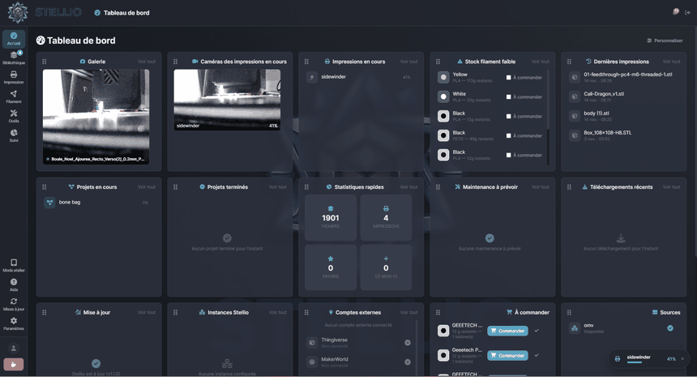
</p>

<table align="center">
  <tr>
    <td align="center"><a href="../screenshots/02-library.png">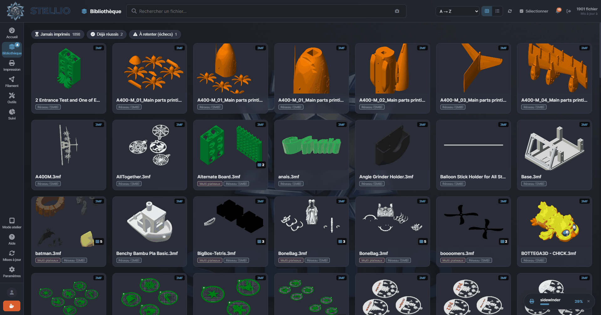<br>Biblioteca</a></td>
    <td align="center"><a href="../screenshots/03-viewer.png">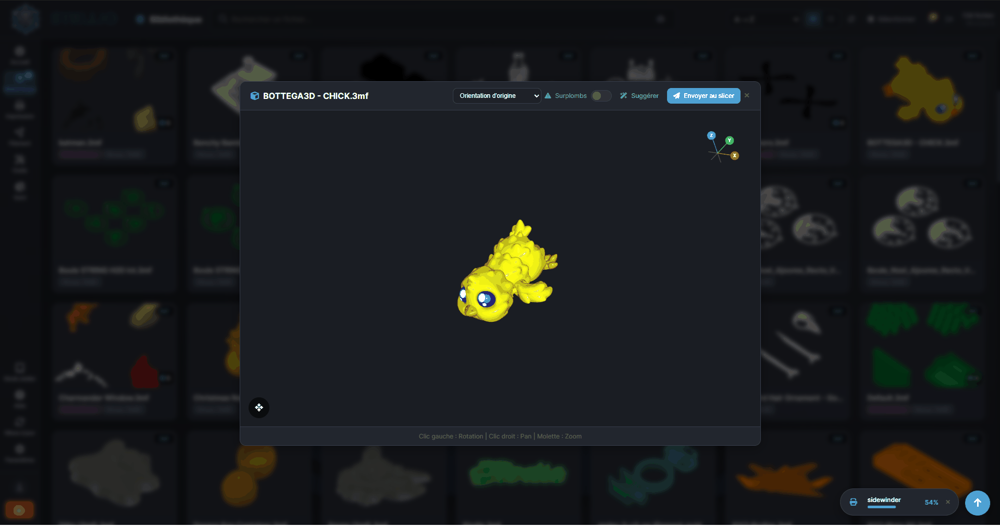<br>Visualizador 3D</a></td>
    <td align="center"><a href="../screenshots/04-filters.png">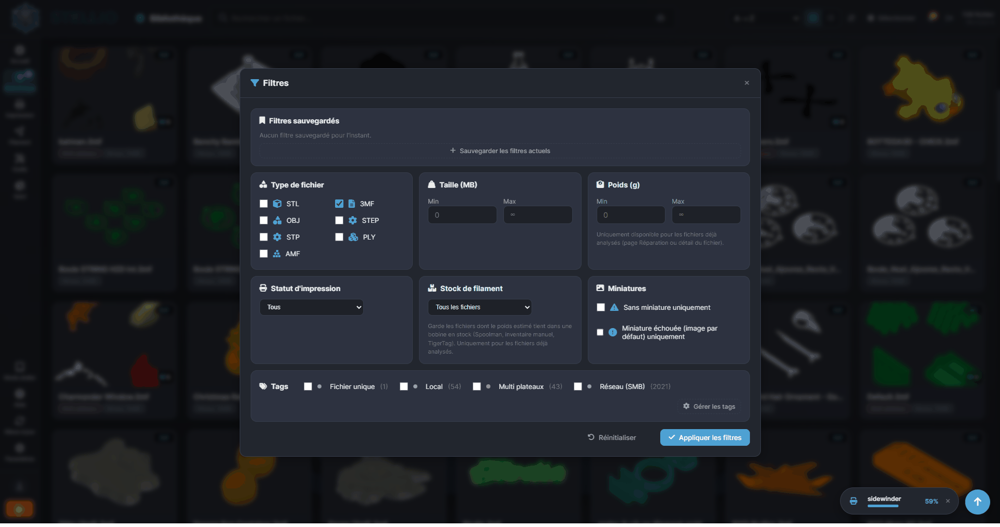<br>Filtros</a></td>
    <td align="center"><a href="../screenshots/05-repair.png">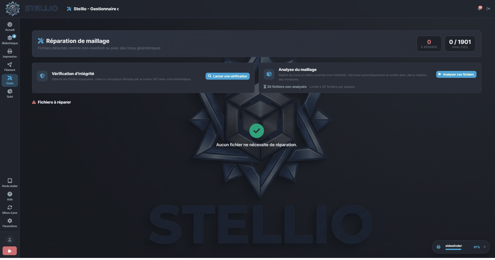<br>Reparo</a></td>
    <td align="center"><a href="../screenshots/06-converter.png">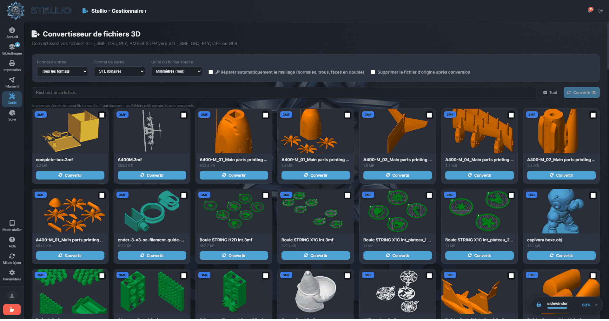<br>Conversor</a></td>
  </tr>
</table>


<p align="center">
  <a href="../../README.md">🇬🇧 English</a> |
  <a href="README_fr.md">🇫🇷 Français</a> |
  <a href="README_de.md">🇩🇪 Deutsch</a> |
  <a href="README_es.md">🇪🇸 Español</a> |
  <a href="README_it.md">🇮🇹 Italiano</a> |
  🇵🇹 <strong>Português</strong> |
  <a href="README_ja.md">🇯🇵 日本語</a> |
  <a href="README_zh.md">🇨🇳 中文</a>
</p>

<p align="center">
  <a href="#-instalação">🚀 Instalação</a> •
  <a href="#-funcionalidades">✨ Funcionalidades</a> •
  <a href="#-documentação">📖 Documentação</a> •
  <a href="#-como-contribuir">🤝 Como contribuir</a> •
  <a href="#-licença">📜 Licença</a>
</p>

---

## 🎯 Visão geral

**Stellio** é um aplicativo de desktop moderno que centraliza toda a sua biblioteca 3D (STL, 3MF, OBJ, STEP, PLY, AMF), automatiza tarefas repetitivas e se integra perfeitamente ao seu fluxo de trabalho de impressão 3D.

Seja você um maker iniciante ou um usuário experiente com várias máquinas, o Stellio economiza um tempo precioso graças à **IA local** (Ollama), a uma **gestão inteligente de impressoras** e a uma **interface pensada para produtividade**.

> 💡 **Filosofia**: Seus dados ficam com você. Tudo funciona localmente. No Raspberry Pi / Linux você pode, opcionalmente, conectar uma IA online com a sua própria chave de API (veja abaixo); por padrão, nada sai do seu computador.

---

## ✨ Funcionalidades

### 🏠 Painel e produtividade
- 📊 **Painel ao iniciar**: impressões em andamento, estoque de filamento baixo, últimas impressões e arquivos recentes num relance
- 🧱 **Totalmente personalizável**: reordene e oculte widgets arrastando e soltando (20 disponíveis: impressões em andamento, estoque baixo, último S.O.S Print, sugestões, instâncias do Stellio…)
- 🖼️ **Mais widgets**: «Projetos concluídos», «Galeria» (as fotos da galeria desfilam, pausa ao passar o cursor, clique para ampliar) e «Orçamentos» (os 5 últimos orçamentos criados); todos os widgets têm o mesmo tamanho e o conteúdo rola dentro deles
- ✅ **Checklist «Primeiros passos»** para novos usuários
- 💡 **Widget «Sugestões»**: identifica arquivos que você reimprime com frequência mas não revê há algum tempo, e perfis de slicer com alta taxa de falha
- ⌨️ **Paleta de comandos (`Ctrl+K`)**: navegue, execute uma ação ou encontre instantaneamente um arquivo, uma tag, um carretel ou um perfil de slicer
- 🔔 **Central de notificações (sino)**: fim de impressão, falhas, manutenção próxima, estoque de filamento baixo e lembretes de secagem num só lugar
- 📺 **Widget flutuante** que mostra o progresso da impressão em andamento, visível em todas as páginas
- 🧭 **Tour guiado interativo** para descobrir os principais recursos, reiniciável nas Configurações
- ♿ **Acessibilidade**: modo de alto contraste, redução de animações, indicadores de foco do teclado visíveis em todo lugar
- 🪟 **Ícone na bandeja do sistema (Windows)**: um ícone do Stellio ao lado do relógio mostra que o app continua em execução (clique = abrir, clique direito = Abrir / Sair)

### 📚 Gerenciamento de biblioteca
- 🗂️ **Múltiplas fontes**: pastas locais, arquivos individuais, compartilhamentos SMB/NFS — as pastas 3D detectadas no computador são sugeridas e podem ser adicionadas com um clique
- 🖼️ **Miniaturas 3D automáticas** via PyRender (renderização de alta qualidade) ou um rasterizador de CPU numpy (alternativa), com efeito de carregamento e **pré-visualização ampliada ao passar o mouse**
- 🌀 **Sempre fluido**: a geração de miniaturas pausa assim que você usa o aplicativo e retoma quando você para
- ⚙️ **Ajuste «Desempenho das miniaturas»** (Automático / Econômico / Normal / Rápido) com indicador de progresso traduzido; STL muito detalhados e 3MF enormes ou multicoloridos recebem miniaturas 3D limpas, e os 3MF do PrusaSlicer são renderizados em 3D como os STL
- 🏷️ **Tags personalizadas** com cores + marcação automática por IA, e **marcação com um clique de vários arquivos selecionados**
- 🔍 **Busca semântica assistida por IA** ("estou procurando um suporte para...") com **buscas recentes memorizadas**
- ⭐ **Favoritos** e filtros avançados (tipo, tamanho, peso, status de impressão), com um **aviso de reposição** quando o estoque de filamento não é suficiente para seus favoritos
- 🧵 **Filtro «Estoque de filamento»**: mantém apenas os arquivos imprimíveis com os carretéis que você realmente tem (Spoolman, inventário manual, [TigerTag](https://tigersystem.io)), por material
- 💾 **Filtros salvos**: salve qualquer combinação de filtros e reutilize-a com um clique
- 🔀 **Ordenação e busca lembradas**: a ordenação escolhida (A → Z, pasta, tamanho, data, tag…) é restaurada ao reabrir o aplicativo, e a busca, os filtros ativos e os resultados da busca com IA permanecem quando a biblioteca é atualizada automaticamente; limpar o campo de busca interrompe imediatamente a busca com IA em andamento
- 🖨️ **Filtros de status de impressão**: «Enviado ao slicer», «Já impresso (sucesso ou falha)», «Já bem-sucedido» e «Já falhou»
- 📋 **Fila «Imprimir em breve»**, separada dos favoritos, reordenável por arrastar e soltar e enviável diretamente ao slicer
- 🖱️ **Seleção rápida**: seleção por intervalo (`Shift+clique`) e navegação pelo teclado (setas + `Enter`)
- ✏️ **Renomeação em massa** (localizar/substituir, prefixo, sufixo, numeração) com pré-visualização antes de aplicar
- ↩️ **Desfazer exclusões** (`Ctrl+Z`) graças a uma lixeira temporária de 5 minutos — excluir uma tag, um projeto ou uma fonte também pode ser desfeito, sem confirmação bloqueante
- 🔗 **Origem do modelo**: link de origem, autor, licença e notas na ficha do arquivo, com a data de download quando aplicável
- 🧩 **Projetos/Montagens**: agrupe vários arquivos em um único objeto, com suporte a múltiplas bandejas 3MF (navegação entre bandejas no visualizador)
- 🧱 **3MF com várias placas nos projetos**: ao adicionar um 3MF com várias placas a um projeto, ele é dividido automaticamente em um arquivo 3MF por placa (6 placas = 6 arquivos para imprimir), guardados em uma pasta oculta para não sobrecarregar a biblioteca, com miniaturas imediatas e envio ao slicer a partir do projeto; a ação **«Dividir placas»** (menu ⋯ de um arquivo) cria um STL ou 3MF separado para cada placa
- 🔎 **Cartões de projeto**: um clique em uma miniatura abre o arquivo no visualizador 3D; o filtro «Todos / Em andamento / Concluídos» é lembrado entre sessões; avaliar uma impressão como «bem-sucedida» adiciona a peça impressa aos projetos que contêm o arquivo e a remove de «Imprimir em breve»
- 💰 **Custo do projeto**: um botão no cartão do projeto calcula o custo de todos os seus arquivos com as mesmas configurações do custo de uma peça (estimativa precisa do slicer, bobina, eletricidade, desgaste, custos fixos, margem, quantidades) e exporta o orçamento em PDF
- 🔁 **Detecção de duplicatas** (exatas e semelhantes por geometria)
- 🗜️ **Suporte a arquivos compactados**: navegue e extraia modelos diretamente de arquivos compactados
- 🖱️ **Arrastar e soltar arquivos 3D** do explorador de arquivos — funciona no app de desktop e também por um navegador (Raspberry Pi, celular, acesso remoto)
- 📊 **Estatísticas detalhadas** (formatos, plataformas, confiabilidade dos perfis)

### 🤖 Inteligência artificial (Ollama local)
> ⚠️ A IA não é 100 % fiável: pode cometer erros (etiquetas, descrições, diagnósticos do S.O.S Print…). Encare as suas respostas como pistas a verificar, não como certezas.

- 🏷️ **Marcação automática** inteligente dos arquivos
- 📝 **Descrição automática** dos modelos
- 🔎 **Busca semântica** em linguagem natural
- 📐 **Análise de imprimibilidade** (detecção de balanços/overhangs) e **orientações sugeridas** (menos overhang, contato com a mesa exibido)
- 🎯 **Recomendação de perfil de slicer** baseada na geometria + histórico de sucesso
- ⏱️ **Estimativa do tempo de impressão** antes do fatiamento
- 🩺 **S.O.S Print**: diagnóstico adaptativo de falhas de impressão, passo a passo — o Stellio faz uma pergunta por vez, reduz uma lista de hipóteses conforme suas respostas (sem limite de perguntas: novas hipóteses são acrescentadas e a investigação continua após um «ainda não resolvido») e depois entrega um diagnóstico final; a análise de fotos está disponível a qualquer momento e as conversas são salvas (reabrir, marcar como resolvido) ⚠️ A IA não é 100 % fiável e pode errar: as suas hipóteses são pistas a verificar. A partir da **pergunta 3**, o botão **Concluir e propor uma solução** dá as causas mais prováveis e pergunta «Este diagnóstico resolveu o problema?» (**Sim, resolvido** / **Não, continuar a investigação**). O botão **Parar a investigação** permite abandonar a qualquer momento.

### 🖨️ Gerenciamento de impressoras
- 🔌 Suporte a **OctoPrint**, **Klipper/Moonraker**, **Bambu Lab** (MQTT), **Creality** (WebSocket), **FlashForge**, **Elegoo** (SDCP) e **PrusaLink**
- 📡 **Descoberta automática na rede**: o Stellio varre sua rede local (SSDP para Bambu Lab, broadcast UDP para Elegoo/Centauri/FlashForge, sondagem direcionada para Klipper/OctoPrint/PrusaLink/Creality) e permite adicionar as impressoras detectadas com um clique
- 📡 Monitoramento em tempo real (temperaturas, progresso, câmera)
- 🖼️ **Impressão em andamento no cartão**: miniatura e nome do arquivo em impressão quando ele está na biblioteca (miniatura do G-code para impressões Klipper/Moonraker iniciadas fora do Stellio); o tamanho da mesa (X, Y, Z) é informado por impressora e gera um aviso antes do envio se a peça for grande demais
- 🔧 **Manutenção preditiva** com acompanhamento de tarefas e recomendações específicas por marca (Bambu, Prusa, Creality, etc.)
- 🔩 **Peças de desgaste e consumíveis**: estoque de bicos, mesas, correias… com alertas, vinculado às tarefas de manutenção (cada intervenção desconta uma peça)
- ⏱️ Contador automático de horas de impressão
- 📤 Envio direto ao slicer, com um seletor de carretel para atribuir o filamento certo diretamente na janela de envio, ou upload para a impressora
- 👀 **Pré-visualização rápida** (peso, tempo de impressão estimado) diretamente na janela de envio ao slicer, antes de confirmar
- 🛡️ **Verificação pré-impressão aprimorada**: avisa se o carretel atribuído precisa ser seco, se o filamento é abrasivo (recomendado bico de aço endurecido) ou se não existe calibração para esta impressora
- 🔁 **Reimprimir como da última vez**: a partir do histórico, um clique reabre a janela de envio com a mesma impressora, perfil e carretel
- 🎛️ **Calibrações**: salve flow, pressure advance, temperaturas… por filamento e por impressora, recuperadas na janela de envio ao slicer
- 👥 **Modo colaborativo leve**: veja se outro dispositivo conectado já está consultando um arquivo, e um aviso evita enviar o mesmo arquivo duas vezes ao slicer por engano
- 🛡️ **Plugin Administração e instâncias supervisionadas**: uma página para contas de convidado e funções, equipas, sessões, registo de auditoria e instâncias emparelhadas. Uma instância principal pode supervisionar outra **após a aceitação do seu proprietário**: contas, funções e permissões passam a ser geridas a partir da principal, o conteúdo local fica privado por predefinição e o proprietário pode sair da supervisão a qualquer momento. Uma instância não ligada mantém o controlo total.

### 🧵 Materiais: filamento e resina
- **Inventário de resina**: a categoria da barra lateral passa a **Materiais** (Filamento + Resina). Adicione seus frascos à mão (marca, tipo, cor, volume, restante, preço, local), subtraia o que usar em ml e receba o mesmo lembrete **«A encomendar»** do filamento (limite baixo, caixa manual, links de busca de lojas, «já encomendado»), também no widget do painel. Desde a 1.1.8, escolha o **frasco ativo** de cada impressora de resina e a resina usada é **descontada automaticamente** no fim de uma impressão (volume do ficheiro `.sl1`, senão estimado a partir do modelo e assinalado como tal; sem volume fiável nada é descontado; cada desconto pode ser anulado)
- 🏭 **Produção assistida (1.1.8)**: a partir do menu de um ficheiro, o Stellio propõe impressora e perfil de slicer, verifica ficheiro, impressora e consumíveis e **aguarda a sua validação** antes de enviar o ficheiro (não inicia impressões à distância). O fim da impressão é registado e as recomendações seguidas, com o seu resultado, corrigem a classificação do Intelligence.
- 🆕 **Também na 1.1.9**: em **Peças semelhantes**, um botão **Ficheiros ignorados** lista os ficheiros que o índice não conseguiu ler (miniaturas, causa — demasiado grande acima de 60 MB, malha vazia, ilegível, em falta — e solução para cada um) com **Tentar de novo**; o **cartão da impressora** cabe no ecrã sem deslocar no PC / servidor e mostra o progresso antes das temperaturas no telemóvel; no **modo oficina**, tocar numa impressora a imprimir abre o seu cartão (e o ecrã já não fica cortado na vertical na APK); um **motivo da falha** opcional ao marcar uma impressão como falhada; as janelas abertas a partir das Definições (ex. *Adicionar uma fonte*) passam para a frente; os textos das notificações seguem o idioma da aplicação; o aviso *Sem restrição do núcleo* da página Plugins desaparece.
- 🆕 **Também na 1.2.0**: o endereço do Spoolman mantém o caminho (ex. FilaMan com o plugin *Spoolman API*: `http://host:porta/spoolman`); com o inventário manual desativado, a secção de pesagem já não oferece pesagem manual; as secções de *Os meus likes* / *As minhas criações* voltam a recolher ao regressar à página; o widget *Ficheiros recentes* ordena os ficheiros SMB e extraídos por data de adição e *Transferências recentes* atualiza-se sozinho. Os plugins assinados do catálogo podem incluir código Python (recusado sem assinatura de confiança); primeiro exemplo **Separar por cor** (3MF multicolor → uma mesa por cor).
- 🔗 Integração com **Spoolman** (servidor de gestão de carretéis), com detecção automática na sua rede
- 🟠 Suporte a **AMS da Bambu Lab** (leitura dos slots)
- 🟢 Suporte a **CFS da Creality**
- 🐯 Integração com [**TigerTag**](https://tigersystem.io) (identificação NFC/RFID de carretéis): entre na sua conta para ver seus carretéis TigerTag no inventário, ou deixe o Stellio recuperar automaticamente uma sessão existente do TigerTag Studio — somente leitura, nunca modifica seu inventário TigerTag
- ⚪ Carretéis manuais
- 📉 Acompanhamento automático do consumo ao enviar para o slicer, com verificação de compatibilidade antes de imprimir (material suficiente?)
- 🔔 **Alertas de estoque baixo** na inicialização, com um link rápido para comprar mais
- 🛒 **Comprar uma bobina de novo**: o Stellio oferece primeiro a loja do fabricante da marca (Arianeplast, Bambu Lab, Polymaker, eSUN, Sunlu…) e depois as lojas generalistas, com o estoque verificado automaticamente quando o site permite
- 💨 **Secagem de carretéis**: registro de secagem, status (seco / precisa secar) conforme o material, temperatura e duração sugeridas e lembretes nas notificações
- 📈 **Resumo por carretel**: impressões, gramas, custo e diferença não rastreada na ficha de cada carretel

### 📥 Download de plataformas
- 🟠 **Printables** (API GraphQL)
- 🟢 **MakerWorld** (login Bambu Lab em 2 etapas)
- 🔵 **Thingiverse** (via chave de API)
- 🟣 **Nexprint** (biblioteca de modelos da Elegoo; início de sessão com o e-mail e a palavra-passe da conta, guardados de forma cifrada)
- 🔷 **Creality Cloud** e **Snapmaker Space** (login em Configurações, credenciais armazenadas criptografadas; o login com o Google não é compatível)
- 📁 Download direto para suas fontes configuradas
- 🆕 **Detecção de novas versões**: o Stellio verifica todos os dias se os modelos baixados (Printables, MakerWorld, Thingiverse) foram atualizados
- 🛒 **Links úteis**: lojas, fabricantes, sites de modelos 3D e recursos agrupados em seções recolhíveis

### 🧩 Ferramentas avançadas
- 🧩 **Plugins integrados (1.1.7)**: BigPrint, impressoras de resina, impressoras USB, timelapse, ferramentas de ficheiros (conversão / fusão 3MF), estúdio de mesa, notificações push, webhooks, resumo semanal, MQTT e Obico passam a ser plugins distribuídos com o Stellio e só carregam se ativados (separador Plugins). A atualização desde a 1.1.6 é invisível: o que já usava é ativado automaticamente, com as definições intactas; uma instalação nova arranca leve. Também integrados: **Partilha e sincronização**, **Spoolman**, um plugin por fornecedor de IA mais o **assistente de IA**, e **Stellio Pro** (clientes, orçamentos, faturas, encomendas, contabilidade, tarifa de energia, planeamento, necessidades de material, stock de peças) — cada um só adiciona as suas páginas e botões quando ativado. Desde a 1.1.8, os plugins externos são **auditados antes da instalação**, o catálogo e os plugins podem ser **assinados com Ed25519** e, no **Linux**, o núcleo restringe os seus ficheiros e a rede (no Windows e macOS as permissões continuam declarativas).
- 🗂️ **Oficina avançada (1.1.7)**: ferramentas na barra lateral por categoria (conta proprietária) — **Biblioteca** (organização automática por regras, diff 3D visual incluindo STEP, peças semelhantes pela forma com miniaturas, licenças com notificações de validade, ficha da peça), **Impressão** (compatibilidade modelo ↔ impressora, verificação antes de imprimir com orientação aconselhada, arquivo do G-code de cada impressão), **Materiais** (necessidades de material face ao stock), **Ferramentas** (mesa multimodelo com encaixe da geometria real, assistente de fabrico) e **Administração** (tarefas, base de dados, registo de auditoria, equipas, sessões). Cada entrada pode ser desativada em Definições › Elementos de navegação.
- 🔑 **API pública e webhooks**: tokens de âmbito limitado, rotas `/api/v1` com documentação OpenAPI, SDK Python e JavaScript; webhooks de saída assinados (HMAC-SHA256) com novas tentativas e registo.
- 👥 **Equipas e segurança**: funções (administrador, gestor, operador, utilizador simples, convidado), permissões por pasta, projeto e impressora, espaços de trabalho partilhados, sessões ativas revogáveis, registo de ligações, registo de auditoria paginado com exportação CSV.
- 🧠 **Stellio Intelligence** (Estatísticas): perfil de slicer recomendado por material / impressora e causas prováveis de falha, aprendidos com as suas impressões avaliadas (estatísticas, não um modelo de IA). O planeamento de produção ganha ainda rentabilidade por impressora e tempo de trabalho humano.
- 🪶 **STL gigantes**: análise em fluxo, miniatura e visualizador simplificados, limiar de carregamento adaptado à memória livre e **Criar uma versão leve** (cópia simplificada junto ao original, que nunca é alterado). As miniaturas de ficheiros grandes são desenhadas num processo separado: uma falha já não derruba a aplicação.
- 🎨 **Nesting automático** na mesa (rectpack ou silhueta real via shapely)
- 🧩 **Unir em 3MF**: selecione vários modelos (STL, 3MF, OBJ…) e o Stellio cria um único ficheiro 3MF — uma placa se tudo couber, caso contrário um ficheiro com várias placas (estrutura compatível com Bambu Studio / OrcaSlicer; o PrusaSlicer mostra todas as peças juntas). Escolhe o nome e a pasta (incluindo partilhas de rede, com criação de pasta) e o Stellio pergunta se quer eliminar ou manter os ficheiros originais.
- 🖌️ **Cor da bobina para o slicer**: ao enviar, a cor e o material da bobina escolhida são aplicados ao perfil de filamento carregado no OrcaSlicer, Bambu Studio ou PrusaSlicer (é preciso um perfil de filamento importado e associado à impressora; no envio em lote, só se todas as bobinas forem iguais).
- 🔧 **Reparo de mesh** (trimesh + pymeshfix) com **comparação antes/depois** (estanqueidade, triângulos, vértices, tamanho)
- 🔄 **Conversor de formatos** (STL ↔ 3MF ↔ OBJ)
- 📏 **BigPrint (Ferramentas)**: amplie um modelo para o tamanho real (ex. 1,8 m); é cortado em peças que cabem na mesa, esvaziado, com pinos e numerado, com pré-visualização 3D explodida e estimativa de filamento/custo; grava as peças STL, um projeto 3MF e um relatório numa pasta local ou de rede. Baseado no motor de código aberto [bigprint](https://github.com/PooterTF/bigprint) (AGPL-3.0).
- 📅 **Planeamento de produção** (menu **Impressão**): data de fim estimada por impressora, capacidade disponível face à carga pedida, alertas de sobrecarga e atraso previsível, cumprimento de prazos.
- 🧬 **Rastreabilidade de impressão** (menu **Impressão**): cada impressão ligada à versão exata do modelo e ao perfil de slicer, melhor combinação por modelo.
- 🛡️ **Verificação de integridade** (arquivos corrompidos/ausentes)
- 💰 **Cálculo de custo de impressão**: material, eletricidade, desgaste da máquina (por hora), custos fixos, margem em % e quantidade — preço unitário e total calculados ao centavo
- 🏷️ **Margem e preço de venda**: defina sua margem padrão (%) uma vez em Configurações → Tarifas de impressão; o histórico mostra o preço de venda (custo + margem) ao lado do custo, enquanto as estatísticas continuam usando o custo real
- 🧾 **Orçamentos em PDF**: gerados a partir do cálculo de custo, com cliente, designação e notas personalizáveis; cabeçalho do orçamento configurável (nome/empresa, logotipo, endereço, telefone, e-mail, site, CNPJ/NIF) e avisos legais no rodapé
- 🗃️ **Histórico de orçamentos**: cada orçamento gerado é guardado (cópia do PDF) e pode ser consultado, baixado de novo e excluído a partir do widget «Orçamentos» do painel
- 🌱 **Estimativa ambiental**: pegada de CO₂ das suas impressões (material + eletricidade)
- 📸 **Galeria de fotos de impressões** (bem-sucedidas/com falha)
- 🕒 **Histórico** com avaliação de sucesso/falha (alimenta a IA), botões **«Ver arquivo»** e **«Reimprimir»** em cada linha (com detecção de arquivos movidos/excluídos) e filtros por plataforma, resultado (bem-sucedida/falha/parcial/sem avaliação) e intervalo de datas

### 📈 Relatórios e confiabilidade
- 🧮 **Confiabilidade de impressão**: taxa de sucesso e custo das falhas classificados por perfil de slicer, material, impressora ou carretel
- 🗓️ **Relatório mensal**: impressões, taxa de sucesso, filamento, custo, falhas e CO₂ do mês, comparados com o mês anterior, exportável em PDF

### 🔔 Notificações
- 🪟 **Notificações nativas do Windows**
- 🌐 **Notificações do navegador**, ativáveis para acesso via Raspberry Pi ou celular
- 📖 **Documentação** : [stellio-app.com/docs](https://stellio-app.com/docs/)
- 📣 **Notificações push** (ntfy, Telegram, Discord ou webhook): fim e falha de impressão detectados mesmo com a janela fechada, além de alertas de manutenção e de estoque

### 🌐 Acesso móvel e remoto
- 📱 **QR code** para acessar sua biblioteca pelo celular (PWA instalável)
- 📲 **App complementar Android**: um QR code dedicado permite baixar e instalar o APK do app complementar do Stellio diretamente nas configurações de acesso móvel, com a possibilidade de tirar fotos diretamente de uma impressão
- 🌍 **Acesso remoto** via Cloudflare Tunnel (gratuito, URL aleatória ou fixa), ou **endereço personalizado** (nome de domínio, DynDNS, VPN, Tailscale…) para dispensar o Cloudflare, com retorno ao Cloudflare em um clique
- 🔗 **Links de compartilhamento** temporários (24h, uso único)

### 👥 Contas e multi-instância
- 🔐 **Contas locais** com código de recuperação e pergunta secreta: redefinição de senha 100 % local, sem e-mail nem internet
- 🙋 **Confirmação da sessão**: quando o aplicativo abre com uma sessão salva, o Stellio pede para confirmar a conta (Sim / Não); no telefone, voltar ao aplicativo não pede as credenciais de novo enquanto a sessão for válida
- 👤 **Contas de convidado somente leitura**: compartilhe sua biblioteca, impressoras e estoque sem nenhum risco
- 🔄 **Instâncias do Stellio**: detecção automática de outras instalações na rede local e adição com um clique (basta informar a chave local delas)
- 📨 **Envio de arquivo para outra instância**: escolha da pasta de destino na instância de destino, e o arquivo recebido aparece imediatamente na biblioteca dela
- ✅ **Widget de status das instâncias** no painel (marca verde ou cruz vermelha para cada instância salva)

### 🎨 Personalização
- 🌓 Temas: Escuro / Claro / Sistema
- 🎨 Temas de marca: Stellio, Bambu, Prusa, Voron, Creality
- 🎯 Cor de destaque personalizada
- 🌍 **8 idiomas**: FR, EN, DE, ES, IT, PT, JA, ZH
- 🧲 Reorganização da navegação por arrastar e soltar
- ↩️ **Desfazer configurações**: reverta a última alteração de configuração feita

### 💾 Backup e atualizações
- 📦 Exportação/importação de backup completo (.zip)
- 🔄 Atualizações automáticas a partir do GitHub (patch `.zip` — mesmo mecanismo no Windows e no Raspberry Pi/Linux)
- 🧰 **Verificação de módulos**: na primeira inicialização de cada versão, os módulos ausentes (orçamentos PDF, importação de planilhas, notificações…) são baixados automaticamente
- 🔁 Reinício confiável após uma atualização ou ao ativar o modo de depuração, no Windows e no Raspberry Pi/Linux
- 📋 Exportação de logs de diagnóstico (segredos ocultados)
- 💬 **Sugestões e relatórios de erros a partir da app**: envie uma sugestão ou um erro sem sair do Stellio — é criada uma issue no GitHub por si (de forma anónima, através de uma aplicação GitHub dedicada), com uma ligação para a issue e um selo «Nova resposta» quando recebe uma resposta

---

## 🖼️ Capturas de tela

| | |
|---|---|
| 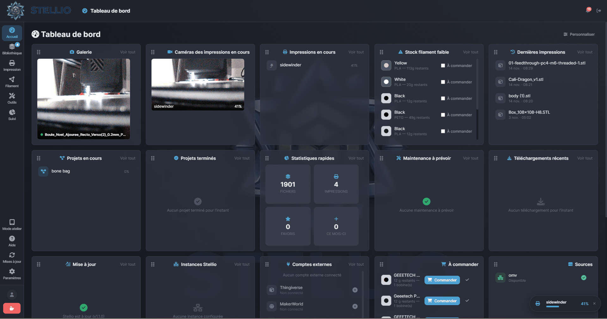 *Painel personalizável* | 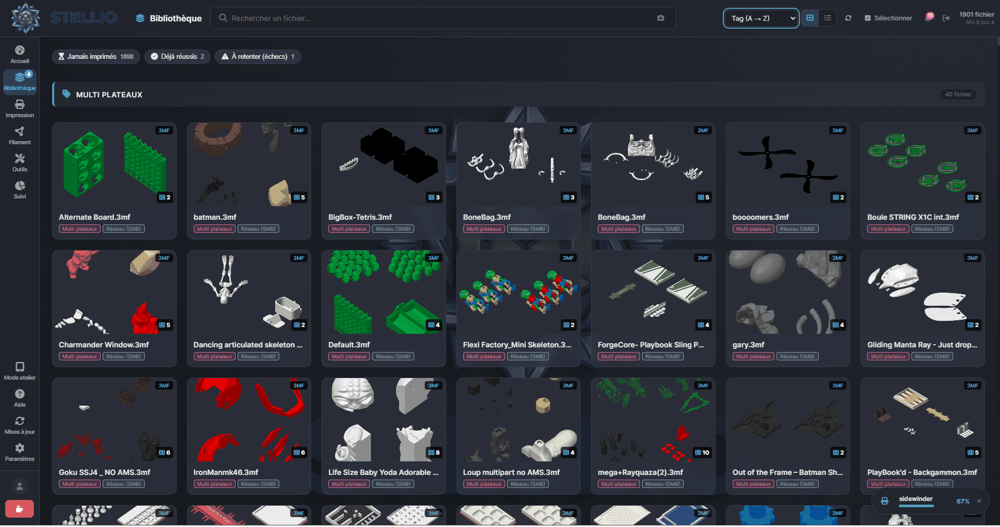 *Biblioteca com tags e favoritos* |
| 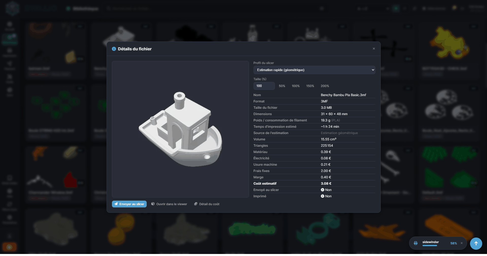 *Detalhes do arquivo: peso, tempo e custo de impressão* | 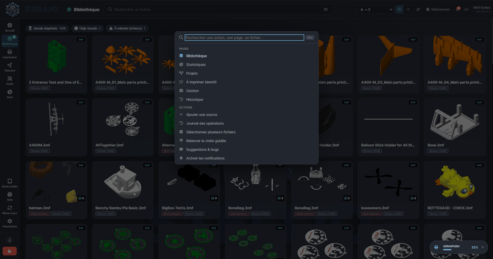 *Paleta de comandos (Ctrl+K)* |
| 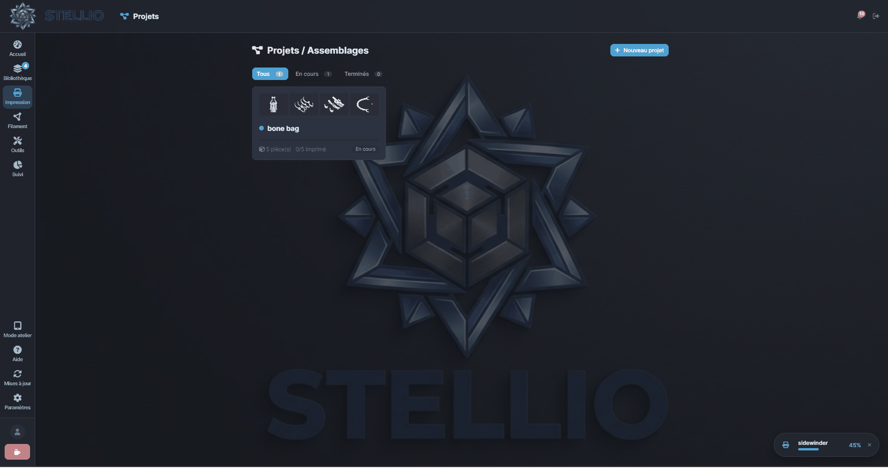 *Projetos / montagens* | 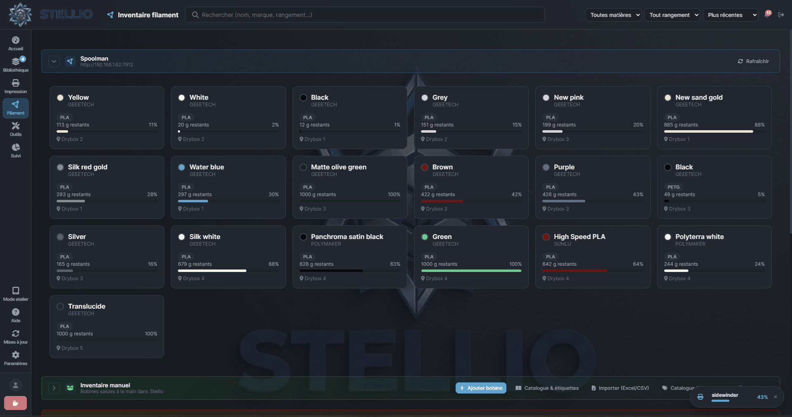 *Inventário de filamento* |
| 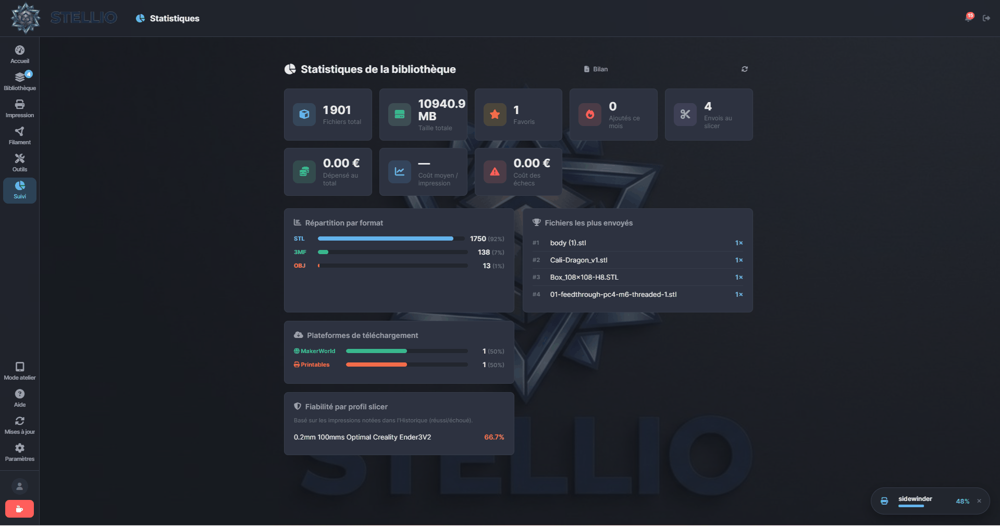 *Estatísticas da biblioteca* | 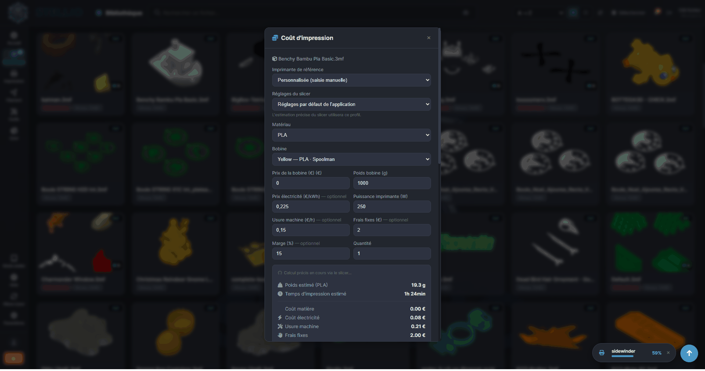 *Tarifas de impressão: eletricidade, desgaste, margem* |
|  *Biblioteca com miniaturas* | 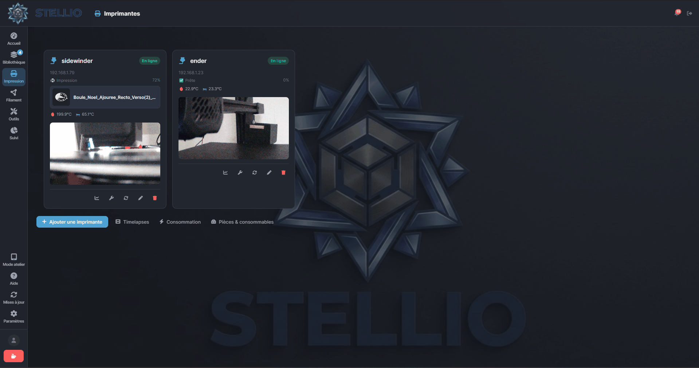 *Monitoramento de impressoras* |
| 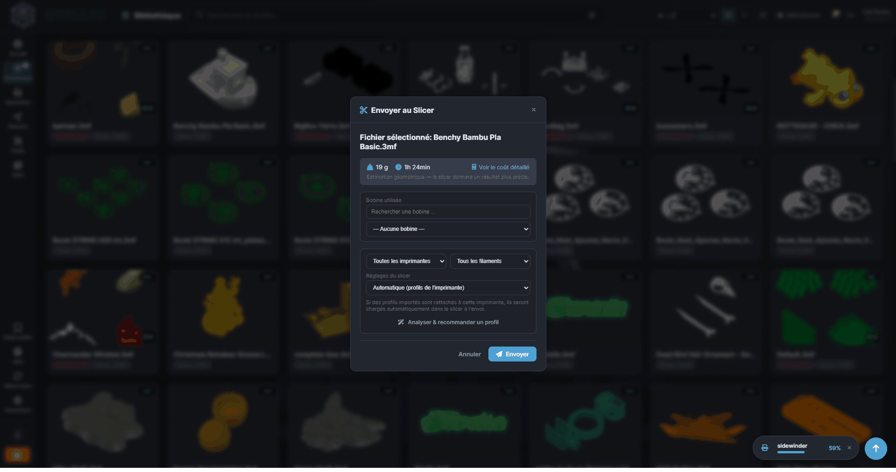 *Recomendação de perfil por IA* | 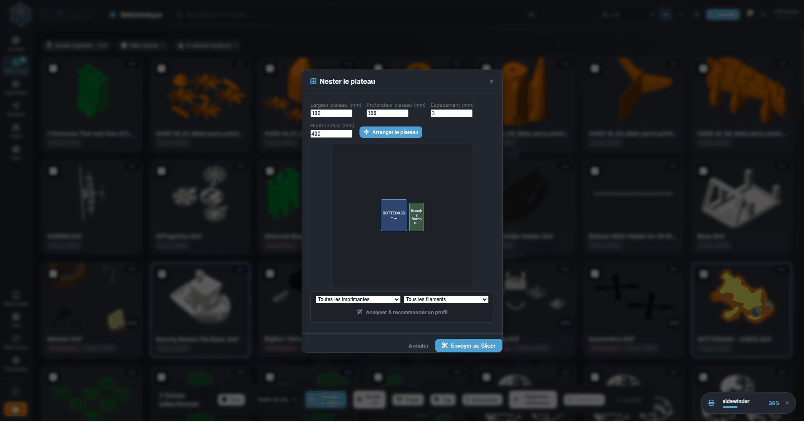 *Nesting automático* |
| 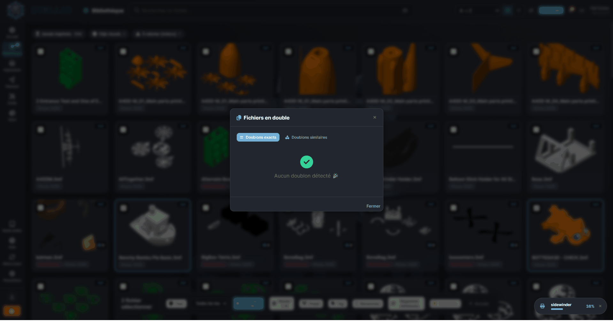 *Deteção de duplicados* |  *Filtros avançados* |
| 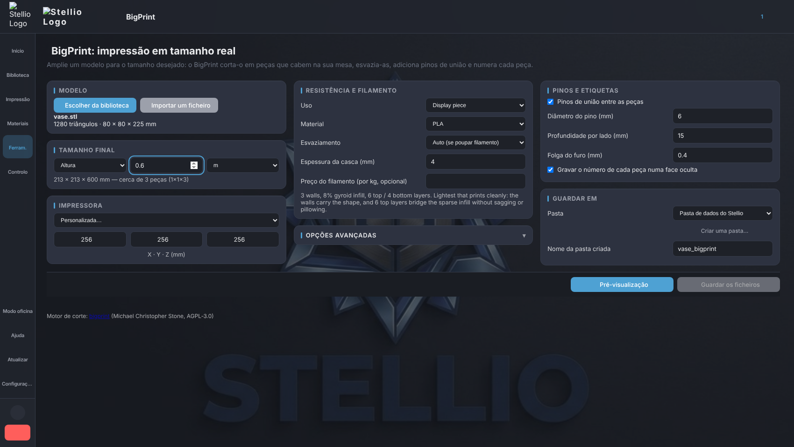 *BigPrint: ampliar para o tamanho real e cortar em peças* | 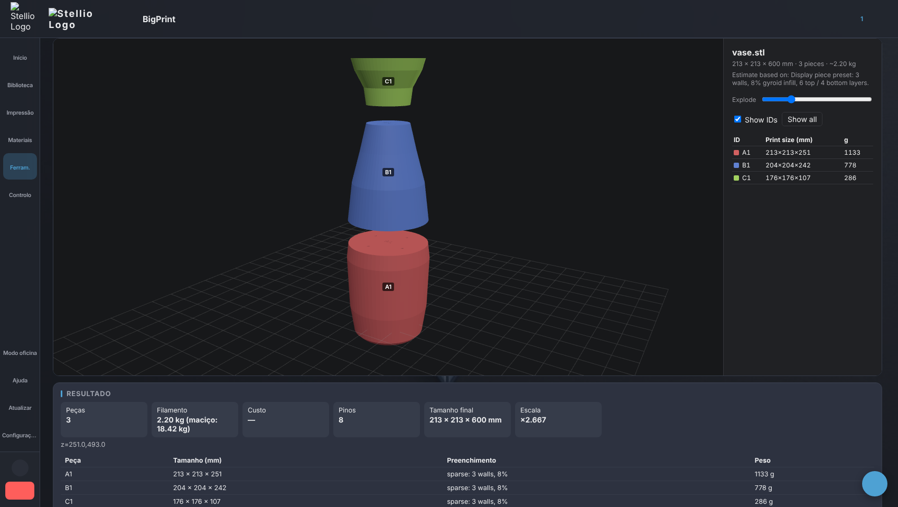 *BigPrint: vista explodida, filamento e lista de peças* |
| 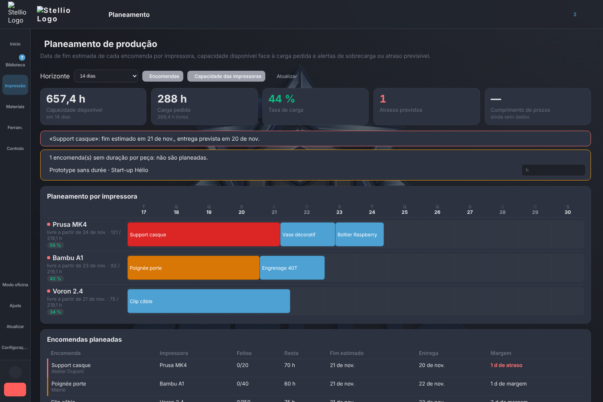 *Planeamento de produção: datas de fim por impressora, capacidade e alertas* | |
| 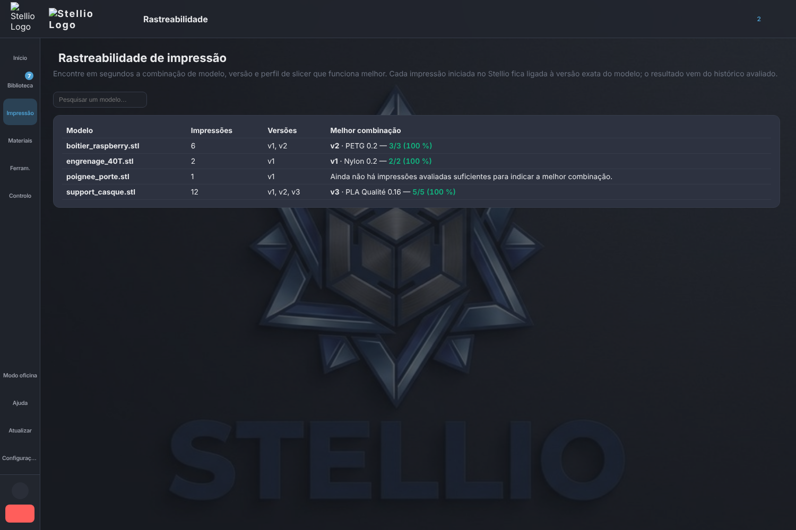 *Rastreabilidade: melhor combinação de versão e perfil por modelo* | 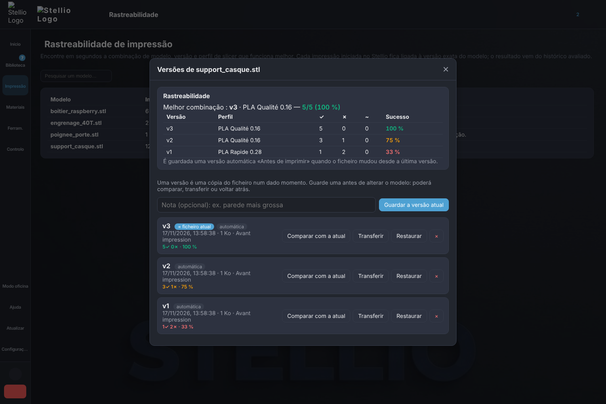 *Versões do modelo: taxa de sucesso por versão e perfil* |

---

## 🚀 Instalação

### 🪟 Windows (recomendado)

1. Baixe o instalador mais recente em [Releases](https://github.com/stellio-app/stellio/releases)
2. Execute `Stellio-Setup-<version>.exe`
3. Pronto! 🎉

> 💼 **Versão portátil (sem instalação)**: baixe `Stellio-v<versão>-portable-win64.zip` nas Releases, descompacte onde quiser (disco, pendrive) e execute `Stellio.exe`. Seus dados ficam na pasta `data` ao lado do executável (mantenha o arquivo `portable.flag`).

### 🍎 macOS

1. Descarregue em [Releases](https://github.com/stellio-app/stellio/releases) o `.dmg` adequado ao seu Mac: `Stellio-v<version>-macOS-arm64.dmg` (Apple Silicon: M1, M2, M3…) ou `Stellio-v<version>-macOS-x86_64.dmg` (Intel).
2. Abra o `.dmg` e arraste o **Stellio** para **Aplicações**.
3. Primeiro arranque: clique com o botão direito (ou Control+clique) em **Stellio → Abrir** e confirme. 🎉

> ⚠️ As versões para macOS **ainda não estão notarizadas**, por isso o Gatekeeper mostra um aviso no primeiro arranque (botão direito → Abrir resolve). Cada ficheiro inclui uma soma de verificação `.sha256` que pode confirmar.
>
> 💡 **Janela em branco?** A porta 5000 está muitas vezes ocupada pelo «Recetor AirPlay» do macOS: o Stellio escolhe então automaticamente outra porta livre (5001–5030). Os seus dados ficam em `~/.stellio`.

### 🐧 Raspberry Pi / Linux

Funciona em **modo servidor headless** (sem interface gráfica): o Stellio roda em segundo plano e é acessado por um navegador, seja no próprio Pi ou em qualquer dispositivo da rede local.

**Requisitos**: Raspberry Pi 4 ou 5 recomendado, Raspberry Pi OS de **64 bits**.

```bash
curl -O https://raw.githubusercontent.com/stellio-app/stellio/main/install-pi.sh
chmod +x install-pi.sh
./install-pi.sh
```

O script instala automaticamente:
- as dependências do sistema (`ffmpeg`, `unrar`, bibliotecas de renderização 3D)
- um ambiente virtual Python dedicado
- um **serviço systemd** (`stellio.service`) que inicia o Stellio ao ligar e o reinicia automaticamente em caso de falha

Após a instalação, o Stellio fica disponível em `http://<ip-do-pi>:5000`.

```bash
sudo systemctl status stellio     # Status do serviço
sudo systemctl restart stellio    # Reiniciar
sudo journalctl -u stellio -f     # Acompanhar os logs em tempo real
```

> 💡 **Mesmas atualizações que no Windows**: o patch `.zip` publicado em cada versão é idêntico nas duas plataformas (código-fonte puro, nada compilado). O Stellio o detecta e aplica automaticamente, depois reinicia o serviço — sem necessidade de reinstalação manual.
>
> 🎥 Mesmas funcionalidades da versão Windows, exceto a janela de desktop nativa (substituída pelo acesso via navegador) e a IA Ollama local, que precisa de um modelo razoavelmente robusto para rodar bem em um Pi — aponte `ollama_url` para um servidor Ollama remoto nas Configurações, se necessário.

### 🖥️ Proxmox VE (contêiner LXC com um único comando)

Em um servidor **Proxmox VE**, um script cria e configura todo o contêiner para você. Abra o **Shell do host Proxmox** (Datacenter → seu nó → Shell) e cole:

```bash
bash -c "$(curl -fsSL https://raw.githubusercontent.com/stellio-app/stellio/main/stellio-lxc.sh)"
```

O script oferece configurações padrão ou avançadas (CTID, núcleos, RAM, disco, bridge, VLAN, IP DHCP ou fixo, armazenamento, pasta do host a montar) e então:
- cria um contêiner **Debian 12 sem privilégios** (por padrão 2 núcleos, 2 GB de RAM, 32 GB de disco, início automático);
- instala o Stellio nele com `install-pi.sh` (dependências, ambiente Python, **serviço systemd**);
- exibe o endereço de acesso `http://<ip-do-contêiner>:5000` e a senha root gerada.

> 🔒 **Origens**: neste contêiner, a adição de **pastas e arquivos locais fica oculta** no Stellio; apenas as origens de rede **SMB** e **NFS** são oferecidas. Se você montar uma pasta do host com `var_mount=/caminho/host:/mnt/modelos`, «Pasta local» também é permitida. A configuração está em `/etc/systemd/system/stellio.service.d/sources.conf` (variável `STELLIO_ALLOWED_SOURCE_TYPES`).

```bash
pct exec <CTID> -- update-stellio                 # Atualizar o Stellio (a partir do host Proxmox)
pct exec <CTID> -- journalctl -u stellio -f       # Acompanhar os logs
```

Modo sem menu: todas as opções podem ser definidas por variáveis de ambiente, por exemplo `var_mode=default var_cpu=4 var_ram=4096 var_disk=16 var_ip=192.168.1.50/24 var_gw=192.168.1.1` (lista completa no início do script).

💾 **Escolha do armazenamento**: selecione «Definições por omissão + escolha do armazenamento» no primeiro menu (ou `var_choose_storage=1`) para escolher onde ficam o disco do contentor (`var_storage`, ex. `local-zfs`) e os modelos (`var_template_storage`, ex. `local`). O script verifica se o armazenamento existe e tem espaço livre suficiente.

🌍 **Idioma**: os textos do script seguem o idioma do Proxmox (fr, en, de, es, pt, it, zh, ja); force com `var_lang=pt` (inglês por omissão).

### 🧰 Específico da edição servidor (Raspberry Pi / Linux)

> A versão para Windows não é afetada: estes recursos só aparecem em Raspberry Pi, VM, LXC, Docker e Linux.

- 🧱 **Apenas edição servidor na 1.1.7**: notificações push externas, resumo periódico, MQTT / Home Assistant, webhooks de saída, API pública, sincronização entre instâncias e acesso móvel ficam ocultos e desativados no Windows.
- ☁️ **IA online (opcional)**: no lugar do Ollama, use Claude (Anthropic), ChatGPT (OpenAI) ou Gemini (Google) com a sua própria chave de API (Configurações → Inteligência artificial). A chave é criptografada no servidor e nunca devolvida ao navegador; o Ollama continua sendo a opção padrão, 100% local. As solicitações (nomes de arquivos, tags, descrições, fotos do S.O.S Print) vão para o provedor escolhido e são cobradas na sua chave.
- 📥 **Perfis do fatiador**: o Stellio não enxerga os fatiadores do seu PC nem se conecta às nuvens dos fatiadores (Orca Cloud, Bambu Cloud…). Exporte seus perfis do fatiador (OrcaSlicer: Arquivo → Exportar → Exportar pacote de predefinições) e importe-os em Configurações → Meus perfis de fatiador; no Orca Cloud você também pode colar o «Copy raw JSON» de um perfil. Também é possível uma **pasta de perfis monitorada** que o Stellio relê automaticamente (Syncthing, compartilhamento de rede, scp…).
- 🐯 [**TigerTag**](https://tigersystem.io): login oficial com e-mail e senha em Configurações → Inventário de filamento → TigerTag (a senha não é guardada, apenas um token de sessão criptografado). Conta criada com o Google? Defina primeiro uma senha com «Esqueci a senha» no aplicativo TigerTag. Alternativa: copiar para o servidor a pasta de dados do TigerTag Studio (Windows: pasta «TigerTag…» em `%APPDATA%`, pelo menos `Local Storage` e `IndexedDB`) e informar o caminho.

### Slicers compatíveis

O Stellio detecta automaticamente:
- ✅ OrcaSlicer
- ✅ Bambu Studio
- ✅ PrusaSlicer / SuperSlicer
- ✅ Ultimaker Cura
- ✅ Creality Print
- ✅ Elegoo Slicer
- ✅ Qidi Studio
- ✅ Anycubic Slicer Next
- ✅ Anycubic Slicer
- ✅ Simplify3D
- ✅ ideaMaker
- ✅ FlashPrint
- ✅ Lychee Slicer
- ✅ CHITUBOX / CHITUBOX Pro / Anycubic Photon Workshop / PreForm / Voxeldance Tango 
- ✅ CraftWare
- ✅ MatterControl
- ✅ MakerBot Print
- ✅ Voxelizer
- ✅ Slic3r
- ✅ KISSlicer

### Impressoras compatíveis

| Marca | Modelos | Conexão e recursos |
|---|---|---|
| **Bambu Lab** | X1 / X1C / X1E · X2D · P1P / P1S · P2S · A1 / A1 mini · H2D / H2S / H2C | MQTT (LAN + nuvem): monitoramento em tempo real, AMS, câmera, detecção SSDP |
| **Prusa** | MK4 · MK3.9 · MK3.5 · MINI+ · XL · CORE One | PrusaLink (HTTP): monitoramento, envio, câmera |
| **Creality** | Série K1 / K2 · Ender-3 V3 · Hi | WebSocket: monitoramento, CFS, detecção UDP |
| **Elegoo** | Centauri Carbon 1 e 2 · resina Saturn / Mars | SDCP sobre WebSocket: monitoramento, detecção UDP |
| **FlashForge** | Adventurer 5M / 5M Pro · AD5X | API proprietária: monitoramento, detecção UDP |
| **Klipper / Moonraker** | Qualquer máquina com Klipper (Voron…) | HTTP: monitoramento, envio, câmera, horas de impressão exatas |
| **OctoPrint** | Qualquer impressora controlada pelo OctoPrint | HTTP: monitoramento, envio, câmera |
| **Duet / RepRapFirmware** | Qualquer placa Duet 2/3 | HTTP: monitoramento, envio |
| **Repetier-Server** | Qualquer impressora gerida pelo Repetier-Server | HTTP: monitoramento, envio |
| **Resina** | Formlabs (API web) · Anycubic Photon Wi-Fi · Chitubox / Phrozen / Uniformation (SDCP) | Apenas monitoramento · manutenção (FEP, cuba, LCD…) |
| **Impressora USB** | Marlin, Prusa, Creality, placas Klipper… ligadas ao PC do Stellio | Deteção de portas série (a porta nunca é aberta): ligada / ausente, sem estado nem temperaturas |

> Os modelos listados são os oferecidos no formulário «Adicionar impressora» do Stellio. Outros modelos que usam o mesmo protocolo geralmente funcionam, mas nem todos foram testados — [conte-nos no GitHub](https://github.com/stellio-app/stellio/issues) se a sua funciona ou não.

---

## 🛠️ Tecnologia

| Componente | Tecnologia |
|---|---|
| Backend | Python 3.8+, Flask, Waitress |
| Frontend | HTML5, CSS3, JavaScript puro |
| Banco de dados | SQLite (modo WAL) |
| Desktop | pywebview (Windows, macOS) / modo navegador headless (Raspberry Pi, Linux) |
| Renderização 3D | PyRender, rasterizador de CPU numpy, Three.js |
| Mesh e nesting | trimesh, pymeshfix, shapely, rectpack |
| IA | Ollama (local) |
| Rede | paho-mqtt, smbclient, requests |
| Criptografia | cryptography (AES, IV aleatório por chamada) |
| Arquivos compactados | zipfile, rarfile, py7zr, tarfile |

---

## 📖 Documentação

### Atalhos de teclado

| Atalho | Ação |
|---|---|
| `Ctrl+K` | Paleta de comandos |
| `Ctrl+F` | Busca |
| `Ctrl+N` | Novo download |
| `Ctrl+,` | Configurações |
| `Ctrl+Z` | Desfazer a última exclusão (lixeira de 5 min) |
| `Alt+1-8` | Navegação rápida |
| `Shift+Clique` | Selecionar um intervalo de arquivos |
| `↑ ↓ ← →` + `Enter` | Navegar e abrir arquivos na biblioteca |
| `F` | Alternar favoritos |
| `T` | Gerenciador de tags |
| `?` | Ajuda de atalhos |
| `Esc` | Fechar modal / limpar busca |

### Estrutura do projeto

```
stellio/
├── main.py             # Backend Flask + Desktop
├── interface/              # index.html, script.js, style.css (UI)
├── packaging/              # launcher.py, installer (.iss), macOS entitlements
├── release-notes/          # notes.txt (release text, replaced at each release)
├── tests/  tools/          # pytest tests, maintenance tools (incl. stellio_manager.bat)
├── check_deps.py       # Verificador de dependências autorreparável
├── modules/            # Módulos do núcleo separados do main.py (print_session, share_link, plugin_host, print_events…)
├── bundled_plugins/    # Plugins integrados (BigPrint, MQTT, webhooks, timelapse…), carregados só se ativados
├── worker.py           # Esqueleto de worker 3MF sem uso (provisório)
├── assets/             # Logos, ícones
├── languages/          # Arquivos de tradução (JSON)
├── apk/                # Pacote do app complementar Android
├── docs/               # Documentação, política de privacidade, READMEs traduzidos
├── requirements.txt    # Dependências Python
├── install-pi.sh       # Script de instalação para Raspberry Pi / Linux (serviço systemd)
└── stellio-lxc.sh      # Script de instalação LXC para Proxmox VE
```

Tem uma ideia? [Abra uma issue](https://github.com/stellio-app/stellio/issues)!

---

## 🤝 Como contribuir


Contribuições são bem-vindas! 🎉

1. Faça um **fork** do projeto
2. Crie sua branch (`git checkout -b feature/MinhaFuncionalidade`)
3. Faça commit das suas alterações (`git commit -m 'Adiciona MinhaFuncionalidade'`)
4. Envie a branch (`git push origin feature/MinhaFuncionalidade`)
5. Abra um **Pull Request**

### Diretrizes
- Siga o estilo de código existente
- Adicione comentários em francês ou inglês
- Teste suas alterações no Windows, se possível
- Atualize a documentação se necessário

### Reportar um bug

A forma mais simples é diretamente a partir da app: abra **Sugestões e erros** na barra lateral e descreva o problema — é enviado como uma issue do GitHub por si. Também pode abrir uma issue você mesmo no GitHub.

Use o modelo de relatório de bug e inclua:
- Versão do Stellio
- Sistema operacional
- Passos para reproduzir
- Logs de erro (exportáveis em Configurações → Diagnóstico)

---

## 📜 Licença

Este projeto está licenciado sob a **GNU Affero General Public License v3.0** — consulte o arquivo [LICENSE](../../LICENSE) para mais detalhes.

> 💡 **Em resumo**: você é livre para copiar, modificar e distribuir este software. Se você modificar o Stellio ou usá-lo para oferecer um serviço hospedado em rede, deve publicar o código-fonte completo sob a mesma licença AGPLv3.

---

## 🔒 Privacidade

O Stellio é local-first: seus dados permanecem na sua máquina, e nada é coletado ou enviado para servidores externos por padrão. Veja nossa [Política de Privacidade](../privacy/PRIVACY.md) para todos os detalhes. A única exceção, e somente se você mesmo a ativar: a IA online (Claude, ChatGPT, Gemini) da edição servidor envia suas solicitações de IA ao provedor escolhido.

---

## 🔏 Política de assinatura de código

O instalador do Windows e o AppImage do Linux publicados nas [Releases](https://github.com/stellio-app/stellio/releases) **ainda não são assinados digitalmente**, então o Windows SmartScreen pode exibir um aviso. As versões para macOS não são notarizadas. Cada arquivo de uma release acompanha uma soma de verificação SHA-256 (`.sha256`) que você pode conferir, e o atualizador integrado a verifica antes de instalar. Veja [CODE_SIGNING_POLICY.md](../../CODE_SIGNING_POLICY.md) para o estado atual, como verificar um download e nossos planos de assinatura.

---

## 🤝 Parceria

<p align="center">
  <a href="https://tigersystem.io"></a>
</p>

O Stellio é parceiro de integração da [**TigerTag**](https://tigersystem.io), o sistema de identificação NFC/RFID de filamentos: suas bobinas aparecem diretamente no inventário de filamento do Stellio.

- 🌐 [Site oficial](https://tigersystem.io) — [tigertag.io](https://tigertag.io)
- 🖥️ [Studio Manager (aplicativo de desktop)](https://github.com/TigerTag-Project/TigerTag-Studio-Manager)
- 📘 [Guia RFID e documentação](https://github.com/TigerTag-Project/TigerTag-RFID-Guide)
- 📱 [Aplicativo iOS](https://apps.apple.com/fr/app/tigertag-rfid-connect/id6745437963)

---

## 🙏 Agradecimentos

- [Ollama](https://ollama.com/) pela IA local
- [Flask](https://flask.palletsprojects.com/) pelo backend
- [Three.js](https://threejs.org/) pela renderização 3D na web
- [trimesh](https://github.com/mikedh/trimesh) pelo processamento de mesh
- [Spoolman](https://github.com/Donkie/Spoolman) pela gestão de carretéis de filamento
- [TigerTag](https://tigersystem.io) pela identificação NFC/RFID de filamentos
- [Open Filament Database](https://openfilamentdatabase.org) (Open Filament Collective) pelo catálogo de carretéis (licença MIT)
- [bigprint](https://github.com/PooterTF/bigprint) de Michael Christopher Stone (PooterTF) pela ferramenta BigPrint (corte de modelos em tamanho real, AGPL-3.0)
- [OpenPrintTag](https://specs.openprinttag.org/) pelo padrão de etiquetas NFC de carretéis (Prusa Research, licença MIT)
- À comunidade maker pelos comentários e sugestões
- A todos os contribuidores ❤️

---

## 📞 Contato e suporte

- 🐛 **Reportar um bug**: [GitHub Issues](https://github.com/stellio-app/stellio/issues) ou diretamente na app (**Sugestões e erros**)
- 💡 **Solicitar uma funcionalidade**: [GitHub Discussions](https://github.com/stellio-app/stellio/discussions)
- 📧 **Email**: contact@stellio-app.com
- 🌐 **Site**: [stellio-app.com](https://stellio-app.com)
- 🧩 **Plugins**: [stellio-app/stellio-plugins](https://github.com/stellio-app/stellio-plugins) (catálogo oficial, adicione o seu plugin por Pull Request)
- 💬 **Discord**: [Entre na comunidade do Discord](https://discord.gg/ySxpHvS6bd)

---

## ⭐ Apoie o projeto

Se o Stellio é útil para você, considere:
- Dar uma **estrela** ⭐ no GitHub
- Compartilhar o projeto com outras pessoas
- [Contribuir com código](#-como-contribuir) ou traduções
- Reportar bugs para ajudar a melhorar o app
- Apoiar o desenvolvimento com uma pequena gorjeta no Ko-fi ☕

<p align="center">
  <a href="https://ko-fi.com/E6J828RYVD">
    
  </a>
</p>

---

<p align="center"><strong>Feito com ❤️ para a comunidade maker</strong></p>

<p align="center">
  <a href="https://github.com/stellio-app/stellio">⭐ Dê uma estrela a este repositório</a> •
  <a href="https://github.com/stellio-app/stellio/issues">🐛 Reportar um bug</a> •
  <a href="https://github.com/stellio-app/stellio/discussions">💡 Solicitar uma funcionalidade</a> •
  <a href="https://discord.gg/ySxpHvS6bd">💬 Entrar no Discord</a>
</p>
