<p align="center">
  
</p>

<h3 align="center">面向创客与3D打印机用户的终极3D文件管理工具</h3>

<p align="center">
  <a href="https://github.com/stellio-app/stellio/releases"></a>
  <a href="https://www.python.org/"></a>
  <a href="https://flask.palletsprojects.com/"></a>
  <a href="https://www.gnu.org/licenses/agpl-3.0"></a>
  <a href="https://github.com/stellio-app/stellio/blob/main"></a>
  <a href="https://github.com/stellio-app/stellio/blob/main"></a>
</p>

<p align="center">
  <a href="https://demo.stellio-app.com"><b>▶ 在线试用演示（只读）</b></a> &nbsp;·&nbsp; <a href="https://stellio-app.com/docs/"><b>📖 文档</b></a>
</p>

<p align="center">
  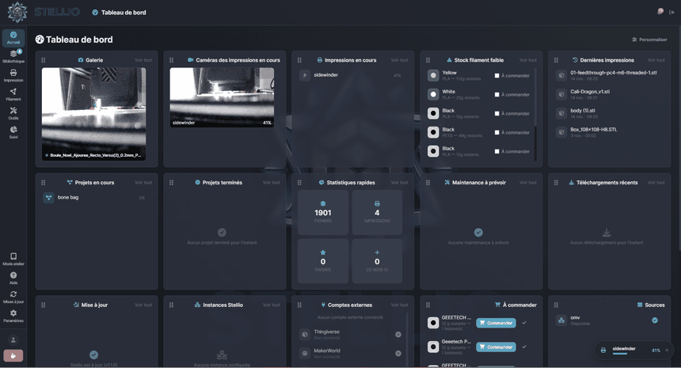
</p>

<table align="center">
  <tr>
    <td align="center"><a href="../screenshots/02-library.png">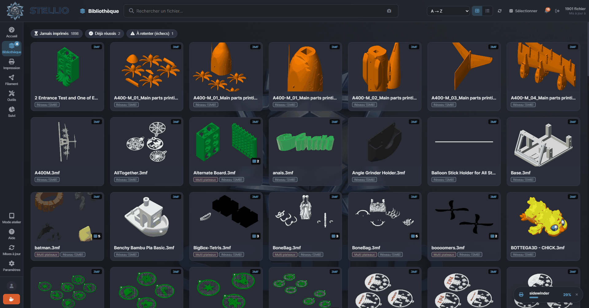<br>库</a></td>
    <td align="center"><a href="../screenshots/03-viewer.png">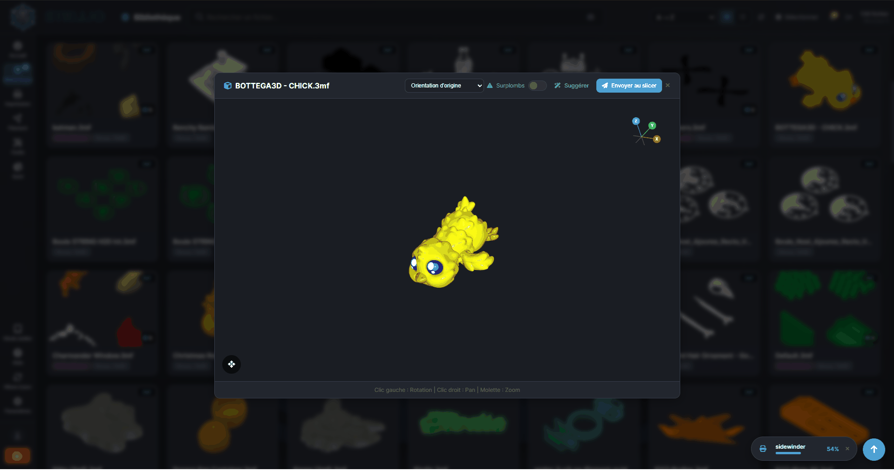<br>3D 查看器</a></td>
    <td align="center"><a href="../screenshots/04-filters.png">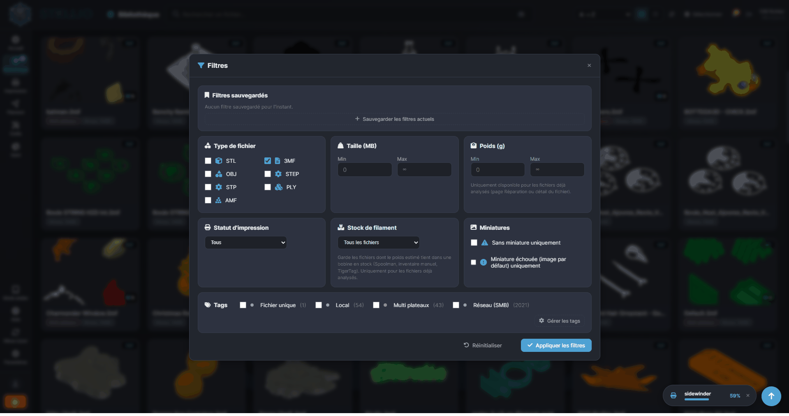<br>筛选</a></td>
    <td align="center"><a href="../screenshots/05-repair.png">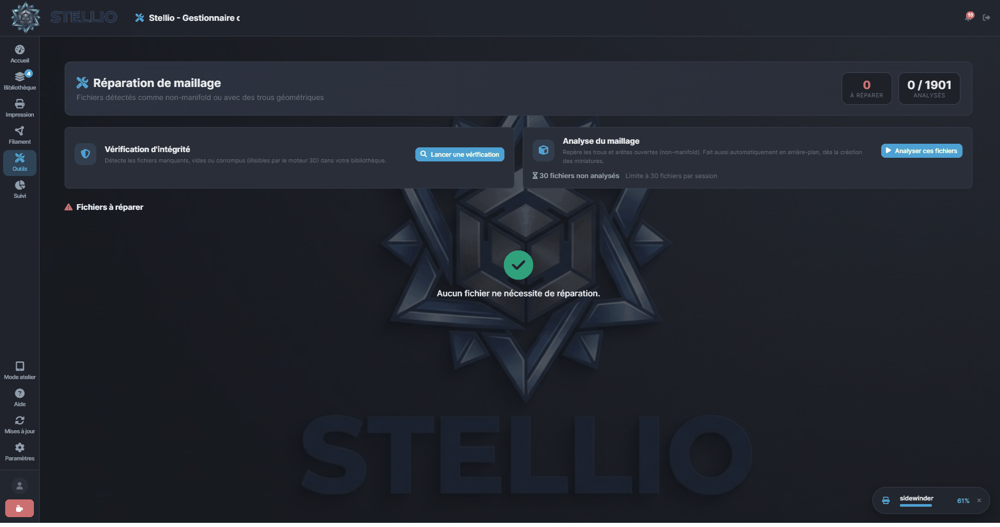<br>修复</a></td>
    <td align="center"><a href="../screenshots/06-converter.png">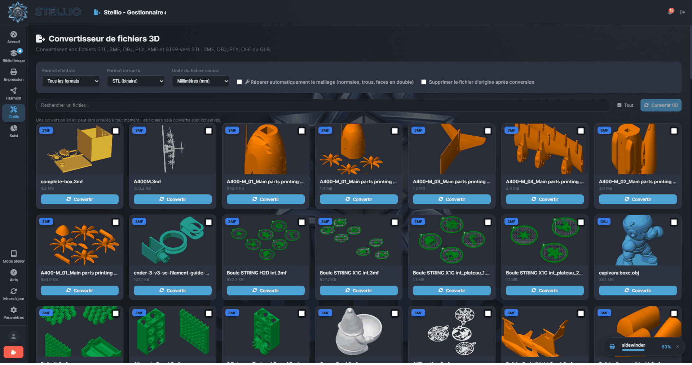<br>转换器</a></td>
  </tr>
</table>


<p align="center">
  <a href="../../README.md">🇬🇧 English</a> |
  <a href="README_fr.md">🇫🇷 Français</a> |
  <a href="README_de.md">🇩🇪 Deutsch</a> |
  <a href="README_es.md">🇪🇸 Español</a> |
  <a href="README_it.md">🇮🇹 Italiano</a> |
  <a href="README_pt.md">🇵🇹 Português</a> |
  <a href="README_ja.md">🇯🇵 日本語</a> |
  🇨🇳 <strong>中文</strong>
</p>

<p align="center">
  <a href="#-安装">🚀 安装</a> •
  <a href="#-功能">✨ 功能</a> •
  <a href="#-文档">📖 文档</a> •
  <a href="#-贡献">🤝 贡献</a> •
  <a href="#-许可证">📜 许可证</a>
</p>

---

## 🎯 概述

**Stellio** 是一款现代化的桌面应用程序，可集中管理您的整个3D文件库（STL、3MF、OBJ、STEP、PLY、AMF），自动化重复性任务，并与您的3D打印工作流程无缝集成。

无论您是新手创客还是管理多台打印机的资深用户，Stellio 都能借助**本地AI**（Ollama）、**智能打印机管理**以及**专为效率而设计的界面**，为您节省宝贵的时间。

> 💡 **理念**：您的数据始终掌握在您手中。一切均在本地运行。在树莓派 / Linux 上，您可以选择使用自己的 API 密钥接入在线 AI（见下文）；默认情况下，任何数据都不会离开您的设备。

---

## ✨ 功能

### 🏠 仪表盘与效率
- 📊 **启动仪表盘**：进行中的打印、耗材低库存、最近的打印和最近的文件一目了然
- 🧱 **完全可自定义**：通过拖放重新排列和隐藏小组件（共20个：进行中的打印、低库存、最新 S.O.S Print、建议、Stellio 实例等）
- 🖼️ **更多小组件**：“已完成的项目”、“图库”（轮播图库照片，悬停暂停，点击放大）和“报价单”（最近创建的 5 份报价单）；所有小组件大小一致，内容在组件内部滚动
- ✅ 面向新用户的**“新手入门”清单**
- 💡 **“建议”小组件**：发现经常重印但已有一段时间没查看的文件，以及失败率较高的切片配置
- ⌨️ **命令面板（`Ctrl+K`）**：快速导航、执行操作，或即时查找文件、标签、卷轴和切片配置
- 🔔 **通知中心（铃铛）**：打印完成、失败、即将到期的维护、耗材低库存和烘干提醒集中在一处
- 📺 **悬浮小组件**：在所有页面显示当前打印进度
- 🧭 **交互式引导教程**：带您了解主要功能，可在设置中重新开始
- ♿ **无障碍**：高对比度模式、减少动画、处处可见的键盘焦点指示
- 🪟 **系统托盘图标（Windows）**：时钟旁的 Stellio 图标表明应用仍在运行（单击 = 打开，右键 = 打开 / 退出）

### 📚 文件库管理
- 🗂️ **多种来源**：本地文件夹、单个文件、SMB/NFS 共享 — 电脑上检测到的3D文件夹会被推荐，并可一键添加
- 🖼️ **自动生成3D缩略图**：通过 PyRender（高质量渲染）或 numpy CPU 光栅化器（回退方案），带加载效果和**悬停放大预览**
- 🌀 **始终流畅**：使用应用时缩略图生成会自动暂停，停止操作后继续
- ⚙️ **“缩略图性能”设置**（自动 / 节能 / 标准 / 快速），并提供已翻译的进度指示；细节极多的 STL 以及超大或多色 3MF 都能得到清晰的 3D 缩略图，PrusaSlicer 的 3MF 也像 STL 一样以 3D 渲染
- 🏷️ **自定义标签**（带颜色）+ AI自动打标，并支持**一键为多个选中文件打标**
- 🔍 **AI辅助的语义搜索**（例如"我在找一个用于……的支撑件"），并**记住最近的搜索**
- ⭐ **收藏**与高级筛选（类型、大小、重量、打印状态），当耗材库存不足以打印您的收藏时会显示**补货提醒**
- 🧵 **“耗材库存”筛选**：只保留用您实际拥有的卷轴（Spoolman、手动库存、[TigerTag](https://tigersystem.io)）即可打印的文件，按材料区分
- 💾 **已保存的筛选**：保存任意筛选组合，一键重复使用
- 🔀 **记住排序与搜索**：所选排序方式（A → Z、文件夹、大小、日期、标签等）会在重新打开时恢复；资料库自动刷新时，搜索、已启用的筛选和 AI 搜索结果都会保留；清空搜索框会立即停止正在进行的 AI 搜索
- 🖨️ **打印状态筛选**：“已发送到切片软件”、“已打印（成功或失败）”、“已成功”和“已失败”
- 📋 **“稍后打印”队列**：独立于收藏，可拖放排序，并可直接发送到切片软件
- 🖱️ **快速选择**：范围选择（`Shift+点击`）与键盘导航（方向键 + `Enter`）
- ✏️ **批量重命名**（查找/替换、前缀、后缀、编号），应用前可预览
- ↩️ **撤销删除**（`Ctrl+Z`）：借助5分钟的临时回收站实现 — 删除标签、项目或来源同样可以撤销，无需阻塞式确认
- 🔗 **模型来源**：文件详情中显示来源链接、作者、许可证和备注，已下载的文件还会记录下载日期
- 🧩 **项目/组装件**：将多个文件归为同一个对象，支持多板 3MF（在预览器中切换打印板）
- 🧱 **项目中的多打印板 3MF**：将多打印板 3MF 添加到项目时，会自动按打印板拆分为每板一个 3MF 文件（6 个打印板 = 6 个待打印文件），存放在隐藏文件夹中，不会弄乱资料库，缩略图立即显示，并可直接从项目发送到切片软件；文件“⋯”菜单中的 **“拆分打印板”** 可为每个打印板生成单独的 STL 或 3MF 文件
- 🔎 **项目卡片**：点击缩略图即可在 3D 查看器中打开文件；“全部 / 进行中 / 已完成”筛选会在不同会话间保留；将打印评为“成功”后，已打印的零件会添加到包含该文件的项目中，并从“稍后打印”中移除
- 💰 **项目成本**：项目卡片上的按钮会按与单个零件成本相同的设置（切片软件精确估算、耗材盘、电费、损耗、固定费用、利润率、数量）计算所有文件的成本，并可导出 PDF 报价单
- 🔁 **重复文件检测**（完全相同及几何相似）
- 🗜️ **压缩包支持**：直接浏览并提取压缩包中的模型
- 🖱️ 从文件资源管理器**拖放3D文件** — 桌面应用中可用，通过浏览器（Raspberry Pi、手机、远程访问）也同样可用
- 📊 **详细统计**（格式、平台、配置文件可靠性）

### 🤖 人工智能（本地 Ollama）
> ⚠️ AI 并非 100% 可靠，可能会出错（标签、描述、S.O.S Print 诊断等）。请把它的回答当作需要核实的线索，而不是定论。

- 🏷️ 智能**自动打标**文件
- 📝 模型的**自动描述**
- 🔎 自然语言**语义搜索**
- 📐 **可打印性分析**（悬垂检测）与**推荐摆放方向**（悬垂更少，并显示与热床的接触率）
- 🎯 基于几何形状与打印成功历史的**切片配置推荐**
- ⏱️ 切片前的**打印时间预估**
- 🩺 **S.O.S Print**：自适应、逐步进行的打印失败诊断——Stellio 每次只问一个问题，根据您的回答逐步缩小假设列表（不限问题数量：会补充新的假设，回答“仍未解决”后继续排查），最终给出诊断结果；随时支持照片分析，对话会被保存（可重新打开、标记为已解决） ⚠️ AI 并非 100% 可靠，可能出错：其假设只是需要核实的线索。 从**第 3 个问题**起，“**结束并给出解决方案**”按钮会给出最可能的原因，并询问“此诊断解决问题了吗？”（**是的，已解决** / **没有，继续诊断**）。“**停止诊断**”按钮可随时放弃。

### 🖨️ 打印机管理
- 🔌 支持 **OctoPrint**、**Klipper/Moonraker**、**Bambu Lab**（MQTT）、**Creality**（WebSocket）、**FlashForge**、**Elegoo**（SDCP）和 **PrusaLink**
- 📡 **自动网络发现**：Stellio 会扫描您的局域网（Bambu Lab 使用 SSDP，Elegoo/Centauri/FlashForge 使用 UDP 广播，Klipper/OctoPrint/PrusaLink/Creality 使用定向探测），并让您一键添加检测到的打印机
- 📡 实时监控（温度、进度、摄像头）
- 🖼️ **卡片显示当前打印**：当正在打印的文件位于资料库中时，显示其缩略图和文件名（对于在 Stellio 之外启动的 Klipper/Moonraker 打印，显示 G-code 缩略图）；可为每台打印机设置打印平台尺寸（X、Y、Z），零件过大时会在发送前给出警告
- 🔧 **预测性维护**，按品牌提供任务跟踪和建议（Bambu、Prusa、Creality 等）
- 🔩 **易损件与耗材**：喷嘴、打印板、皮带等的库存及预警，并与维护任务关联（每次保养自动扣减一个部件）
- ⏱️ 自动打印时长计数器
- 📤 直接发送到切片软件，可在发送对话框中直接通过卷轴选择器分配正确的耗材，或上传至打印机
- 👀 在发送到切片软件的窗口中，确认前即可**快速预览**（重量、预估打印时间）
- 🛡️ **增强的打印前检查**：如果分配的卷轴需要烘干、耗材具有磨蚀性（建议使用硬化钢喷嘴），或该打印机尚无校准数据，都会发出警告
- 🔁 **按上次设置重新打印**：在历史记录中一键重新打开发送窗口，沿用相同的打印机、配置和卷轴
- 🎛️ **校准数据**：按耗材和打印机保存 flow、pressure advance、温度等，并在发送到切片软件的窗口中调用
- 👥 **轻量协作模式**：可看到其他已连接设备是否正在查看某个文件，并通过提醒避免误将同一文件两次发送到切片软件
- 🛡️ **管理插件与被监督实例**：一个页面管理访客账户与角色、团队、会话、审计日志和已配对实例。主实例可在**所有者接受后**监督另一实例：账户、角色和权限随后由主实例管理，本地内容默认保持私有，所有者可随时退出监督。未连接的实例保持完全控制。

### 🧵 材料：耗材与树脂
- **树脂库存**：侧边栏分类现为**材料**（耗材 + 树脂）。手动添加树脂瓶（品牌、类型、颜色、容量、剩余量、价格、存放位置），按 ml 扣除用量，并享有与耗材相同的**“待补货”**提醒（低库存阈值、手动勾选、商店搜索链接、“已订购”），同样显示在仪表盘小组件中。自 1.1.8 起，为每台树脂打印机选择**当前树脂瓶**，打印结束时会**自动扣除**已用树脂（用量取自 `.sl1` 文件，否则按模型估算并标注；没有可靠用量时不扣除；每次扣除都可撤销）
- 🏭 **辅助生产（1.1.8）**：在文件菜单中，Stellio 会推荐打印机和切片配置，检查文件、打印机和耗材，然后**等待您确认**再发送文件（不会远程启动打印）。打印结束会被记录，已采纳的建议及其结果会修正 Intelligence 的排序。
- 🔗 **Spoolman** 集成（卷轴管理服务器），支持在局域网中自动发现
- 🟠 支持 **Bambu Lab AMS**（插槽读取）
- 🟢 支持 **Creality CFS**
- 🐯 [**TigerTag**](https://tigersystem.io) 集成（NFC/RFID 卷轴识别）：登录后可在库存中查看您的 TigerTag 卷轴，或让 Stellio 自动获取已有的 TigerTag Studio 会话 — 只读，绝不会修改您的 TigerTag 库存
- ⚪ 手动卷轴
- 📉 发送到切片软件时自动跟踪耗材消耗，打印前进行兼容性检查（剩余材料是否足够？）
- 🔔 启动时的**低库存提醒**，并提供快速购买链接
- 🛒 **重新购买耗材盘**：Stellio 会先推荐该品牌厂商的官方商店（Arianeplast、Bambu Lab、Polymaker、eSUN、Sunlu 等），再推荐综合商店；网站支持时会自动核实库存
- 💨 **卷轴烘干**：烘干记录、按材料判断的状态（干燥／需烘干）、建议的温度与时长，以及通知中的提醒
- 📈 **卷轴汇总**：在每个卷轴的详情页中显示打印次数、克数、成本以及未追踪的差额

### 📥 从平台下载
- 🟠 **Printables**（GraphQL API）
- 🟢 **MakerWorld**（Bambu Lab 两步登录）
- 🔵 **Thingiverse**（通过 API 密钥）
- 🟣 **Nexprint**（Elegoo 的模型库；使用账户邮箱和密码登录，加密存储）
- 🔷 **Creality Cloud** 和 **Snapmaker Space**（在“设置”中登录，凭据加密保存；不支持 Google 登录）
- 📁 直接下载到您配置的来源
- 🆕 **新版本检测**：Stellio 每天检查已下载的模型（Printables、MakerWorld、Thingiverse）是否有更新
- 🛒 **实用链接**：商店、厂商、3D模型网站和资源，按可折叠分组展示

### 🧩 高级工具
- 🧩 **内置插件 (1.1.7)**：BigPrint、树脂打印机、USB 打印机、延时摄影、文件工具（转换 / 合并 3MF）、打印板工作室、推送通知、Webhook、每周摘要、MQTT 和 Obico 现为随 Stellio 一同发布的插件，仅在启用时加载（插件标签页）。从 1.1.6 升级无感：您已在使用的功能会自动启用，设置保持不变；全新安装则保持精简。 另外内置：**共享与同步**、**Spoolman**、每个 AI 提供商一个插件加 **AI 助手**，以及 **Stellio Pro**（客户、报价、发票、订单、会计、电价、排程、物料需求、零件库存）——仅在启用时才添加各自的页面和按钮。自 1.1.8 起，外部插件会在**安装前接受审计**，目录和插件可使用 **Ed25519 签名**，在 **Linux** 上内核会限制其文件和网络（Windows 和 macOS 上权限仍为声明式）。
- 🗂️ **高级工坊（1.1.7）**：工具按类别放入侧边栏（所有者账户）— **库**（按规则自动整理、可视化 3D 对比含 STEP、按形状查找相似件并带缩略图、带到期通知的许可证、零件档案）、**打印**（模型 ↔ 打印机兼容性、带建议朝向的打印前检查、每次打印的 G-code 归档）、**材料**（对照库存的材料需求）、**工具**（按真实几何嵌套的多模型打印板、制造助手）和**管理**（任务、数据库、审计日志、团队、会话）。每个条目都可在 设置 › 导航项 中关闭。
- 🔑 **公共 API 与 Webhook**：限定范围的令牌、带 OpenAPI 文档的 `/api/v1` 路由、Python 和 JavaScript SDK；带重试和日志的签名出站 Webhook（HMAC-SHA256）。
- 👥 **团队与安全**：角色（管理员、经理、操作员、普通用户、访客）、按文件夹、项目和打印机的权限、共享工作区、可撤销的活动会话、登录日志、可分页并导出 CSV 的审计日志。
- 🧠 **Stellio Intelligence**（统计）：根据您已评分的打印，给出每种材料 / 打印机推荐的切片配置和可能的失败原因（统计而非 AI 模型）。生产排程还新增了按打印机的盈利能力和人工时间。
- 🪶 **超大 STL 文件**：流式分析、简化的缩略图和查看器、随可用内存调整的加载阈值，以及**创建轻量版本**（在原文件旁生成简化副本，原文件绝不修改）。大文件的缩略图在独立进程中绘制，崩溃不再拖垮应用。
- 🎨 **自动排版嵌套**（rectpack 或通过 shapely 计算真实轮廓）
- 🧩 **合并为 3MF**：选择多个模型（STL、3MF、OBJ 等），Stellio 会生成一个 3MF 文件——全部放得下则为单个盘，否则生成多盘文件（结构兼容 Bambu Studio / OrcaSlicer；PrusaSlicer 会把所有零件一起显示）。可自选文件名和保存文件夹（支持网络共享，可新建文件夹），完成后 Stellio 会询问是删除还是保留原始文件。
- 🖌️ **耗材盘颜色传给切片软件**：发送时，所选耗材盘的颜色和材料会应用到 OrcaSlicer、Bambu Studio 或 PrusaSlicer 加载的耗材配置（需要已导入并关联到打印机的耗材配置；批量发送时仅当所有耗材盘相同才应用颜色）。
- 🔧 **网格修复**（trimesh + pymeshfix），提供**修复前后对比**（水密性、三角面数、顶点数、大小）
- 🔄 **格式转换器**（STL ↔ 3MF ↔ OBJ）
- 📏 **BigPrint（工具）**：将模型放大到等身大小（如 1.8 米）；自动切成适合打印平台的部件、掏空、添加销钉并编号，提供分解式 3D 预览和耗材/成本估算；把 STL 部件、3MF 项目和报告保存到本地或网络文件夹。基于开源引擎 [bigprint](https://github.com/PooterTF/bigprint)（AGPL-3.0）。
- 📅 **生产计划**（**打印**菜单）：每台打印机的预计完成日期、可用产能与需求负载对比、过载和预计延误提醒、按时交付率。
- 🧬 **打印可追溯性**（**打印**菜单）：每次打印关联到确切的模型版本和切片配置，并给出每个模型的最佳组合。
- 🛡️ **完整性检查**（损坏/缺失文件）
- 💰 **打印成本计算**：材料、电费、机器损耗（按小时）、固定费用、利润率（%）和数量 — 单价与总价精确到分
- 🏷️ **利润率与售价**：在 设置 → 打印价格 中一次性设置默认利润率（%）；历史记录会在成本旁显示售价（成本 + 利润率），统计仍按实际成本计算
- 🧾 **PDF 报价单**：由成本计算生成，可自定义客户、品名和备注；可配置报价单抬头（姓名/公司、标志、地址、电话、邮箱、网站、税号）以及页脚的法律声明
- 🗃️ **报价单历史**：每份生成的报价单都会保留（PDF 副本），可在仪表盘的“报价单”小组件中查看、重新下载和删除
- 🌱 **环境影响估算**：您打印作业的 CO₂ 足迹（材料 + 电力）
- 📸 **打印照片库**（成功/失败）
- 🕒 带成功/失败评分的**历史记录**（用于训练AI），每行都有**“查看文件”**和**“重新打印”**按钮（可检测已移动/已删除的文件），并支持按平台、结果（成功/失败/部分/未评分）和日期范围筛选

### 📈 报告与可靠性
- 🧮 **打印可靠性**：按切片配置、材料、打印机或卷轴排名的成功率和失败成本
- 🗓️ **月度报告**：当月的打印数、成功率、耗材、成本、失败次数和 CO₂，并与上月对比，可导出为 PDF

### 🔔 通知
- 🪟 **Windows 原生通知**
- 🌐 可为 Raspberry Pi 或移动端访问启用的**浏览器通知**
- 📣 **推送通知**（ntfy、Telegram、Discord 或 Webhook）：即使窗口已关闭也能检测到打印完成和失败，并推送维护与库存提醒

### 🌐 移动与远程访问
- 📱 **二维码**，方便从移动设备访问您的文件库（可安装的 PWA）
- 📲 **Android 配套应用**：在移动访问设置中提供专属二维码，可直接下载并安装 Stellio 配套 APK，并支持直接从某次打印中拍照
- 🌍 通过 Cloudflare Tunnel 实现**远程访问**（免费，随机或固定网址），或使用**自定义地址**（域名、DynDNS、VPN、Tailscale 等）以摆脱 Cloudflare，并可一键切换回 Cloudflare
- 🔗 临时**分享链接**（24小时有效，仅限使用一次）

### 👥 账户与多实例
- 🔐 带恢复码和密保问题的**本地账户**：100% 本地重置密码，无需邮箱或网络
- 🙋 **会话确认**：使用已保存的会话打开应用时，Stellio 会请你确认账户（是 / 否）；在手机上，只要会话有效，返回应用时不会再次要求输入凭据
- 👤 **只读访客账户**：放心地与他人共享您的文件库、打印机和库存
- 🔄 **Stellio 实例**：自动发现局域网内的其他安装并一键添加（只需输入对方的本地密钥）
- 📨 **向另一个实例发送文件**：可选择目标实例上的目标文件夹，接收到的文件会立即出现在其文件库中
- ✅ 仪表盘上的**实例状态小组件**（每个已保存的实例以绿色对勾或红色叉号显示是否可用）

### 🎨 个性化设置
- 🌓 主题：深色 / 浅色 / 跟随系统
- 🎨 品牌主题：Stellio、Bambu、Prusa、Voron、Creality
- 🎯 自定义强调色
- 🌍 **支持8种语言**：法语、英语、德语、西班牙语、意大利语、葡萄牙语、日语、中文
- 🧲 拖放方式重新排列导航
- ↩️ **撤销设置**：还原您最近一次的配置更改

### 💾 备份与更新
- 📦 完整备份的导出/导入（.zip）
- 🔄 从 GitHub 自动更新（`.zip` 补丁 — Windows 与 Raspberry Pi/Linux 使用相同机制）
- 🧰 **模块检查**：每个版本首次启动时，会自动下载缺失的模块（PDF 报价单、表格导入、通知等）
- 🔁 更新后或启用调试模式后，在 Windows 和 Raspberry Pi/Linux 上都能可靠重启
- 📋 导出诊断日志（隐藏敏感信息）
- 💬 **直接在应用内提交建议与问题**：无需离开 Stellio 即可发送建议或错误报告——系统会为您创建一个 GitHub issue（通过专用的 GitHub App 匿名提交），并提供该 issue 的链接，收到回复时会显示“新回复”徽章

---

## 🖼️ 截图

| | |
|---|---|
| 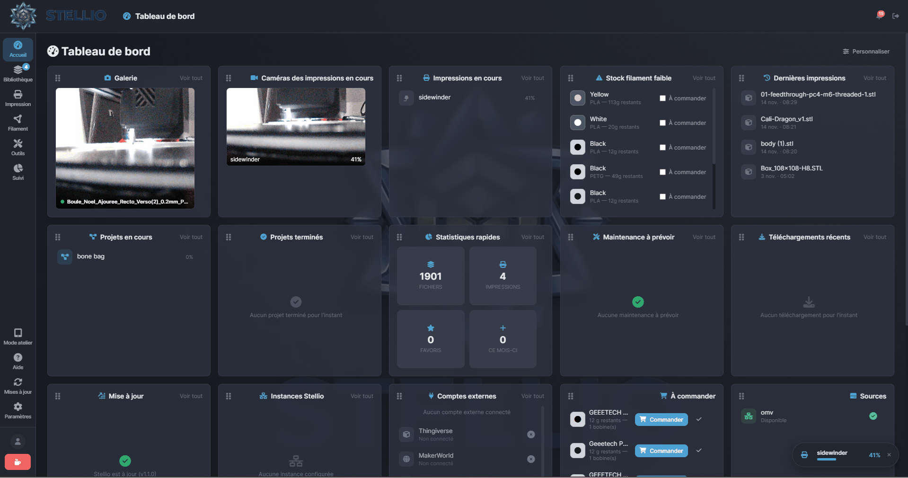 *可自定义的仪表盘* | 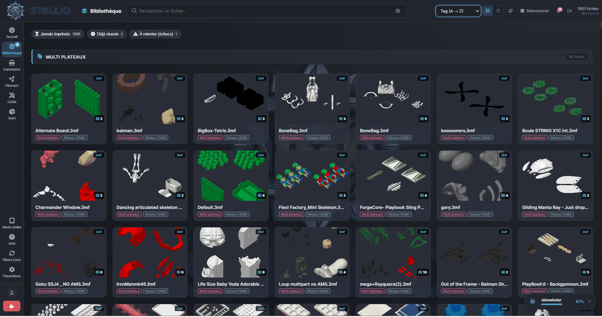 *带标签和收藏的文件库* |
| 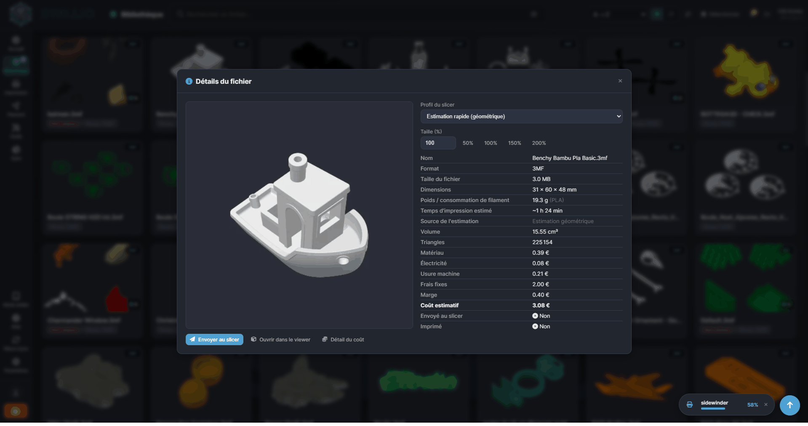 *文件详情：重量、打印时间和成本* | 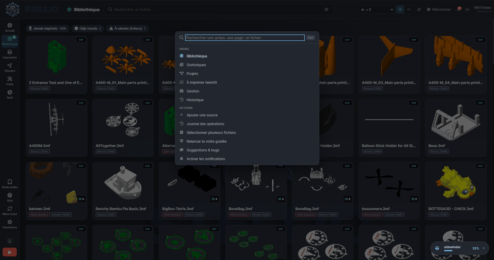 *命令面板 (Ctrl+K)* |
| 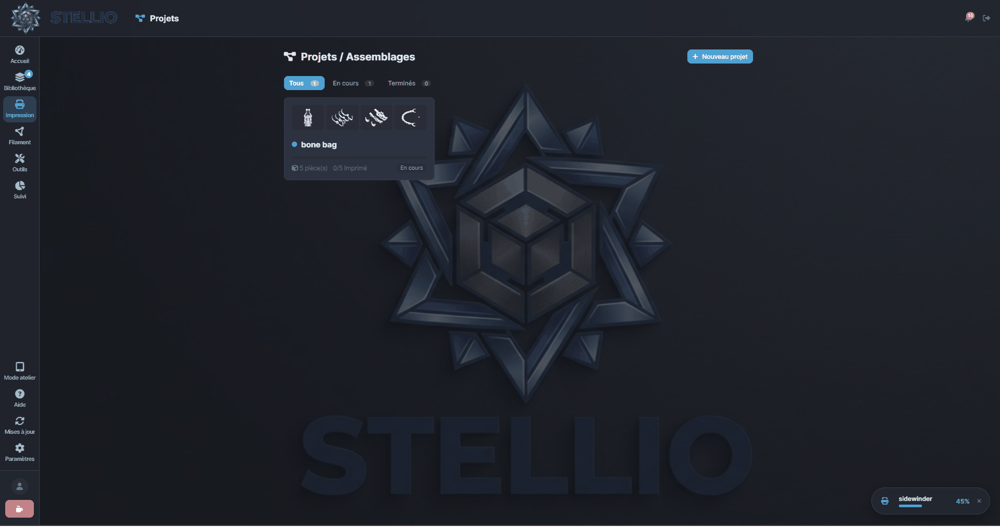 *项目 / 装配体* | 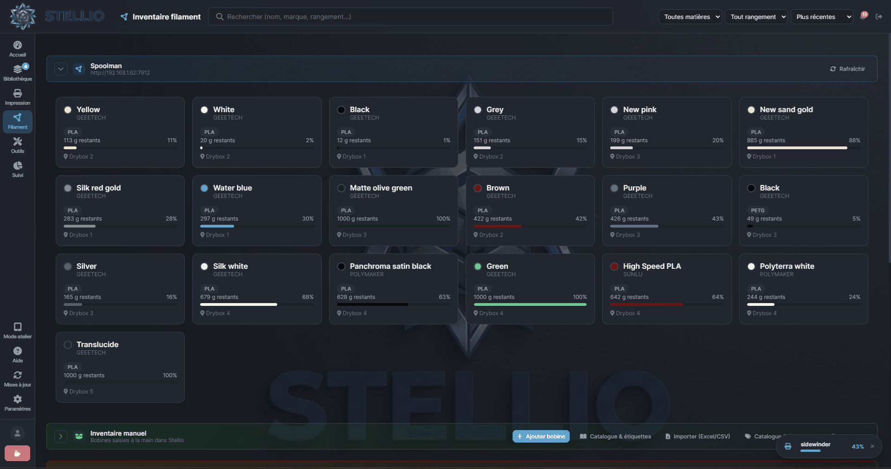 *耗材库存* |
| 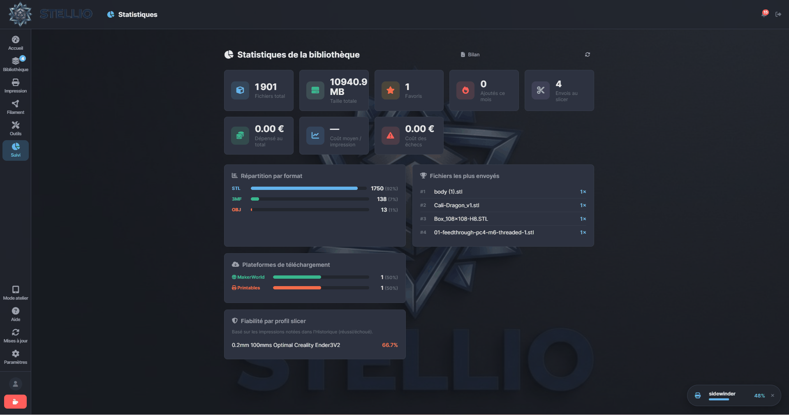 *文件库统计* | 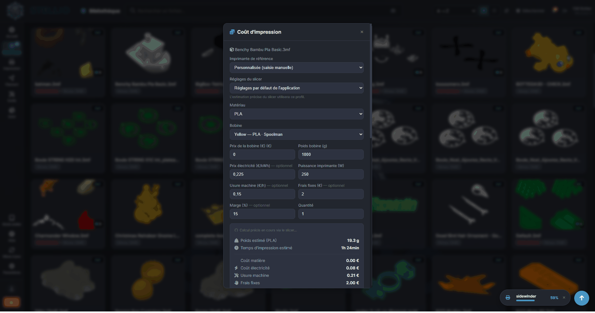 *打印价格：电费、损耗、利润率* |
|  *带缩略图的文件库* | 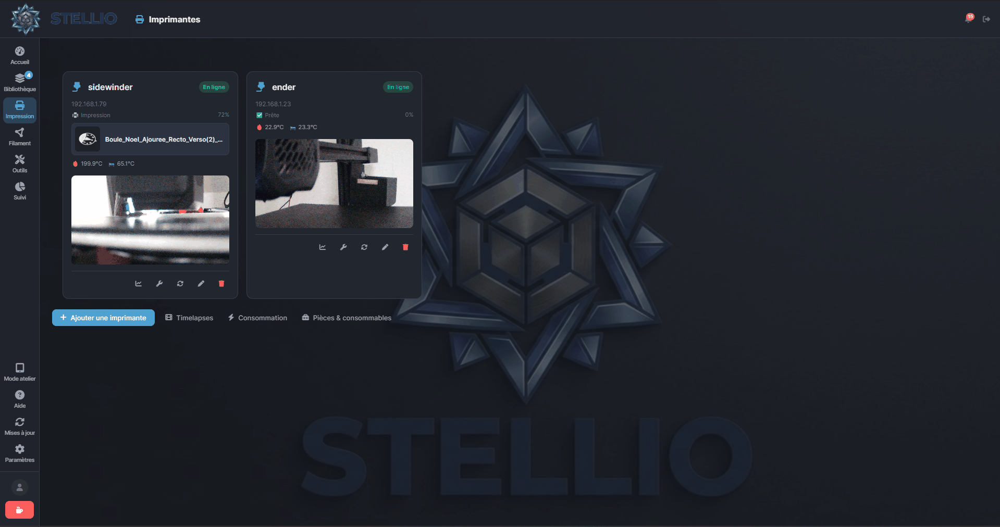 *打印机监控* |
| 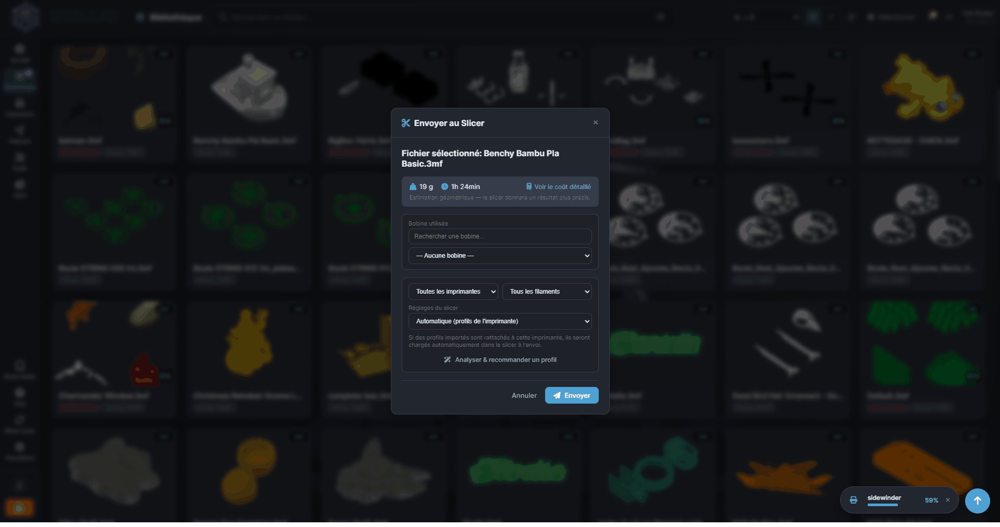 *AI配置推荐* | 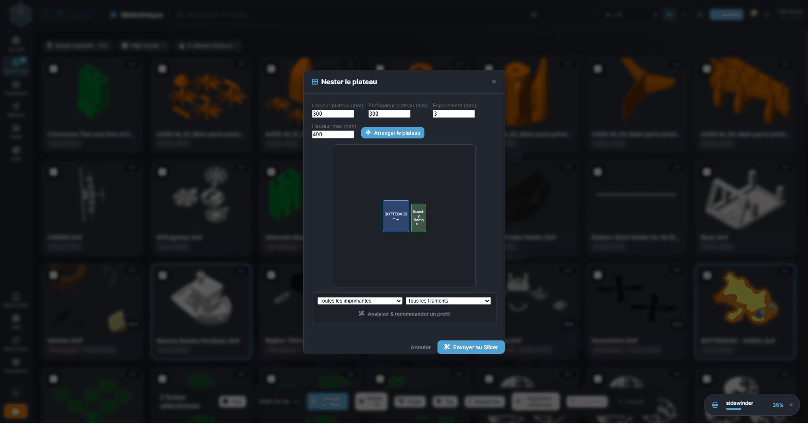 *自动嵌套排版* |
| 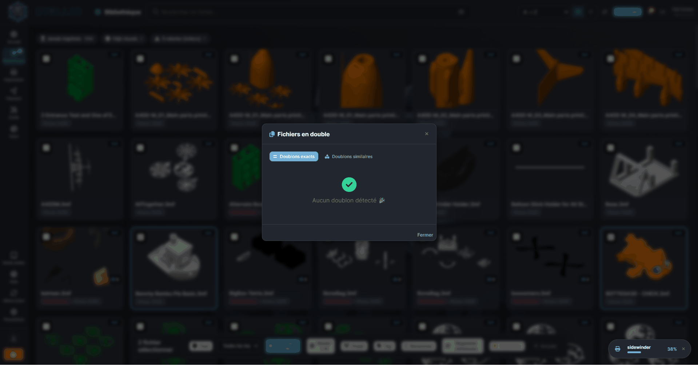 *重复文件检测* |  *高级筛选* |
| 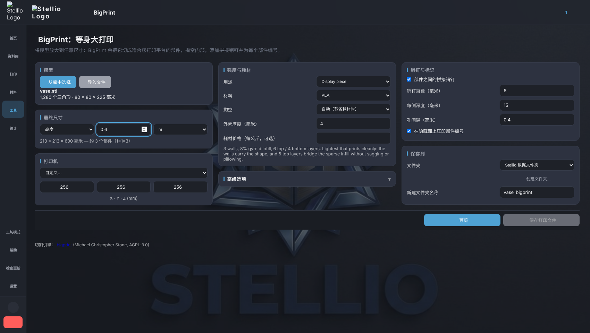 *BigPrint：放大到等身大小并切分为部件* | 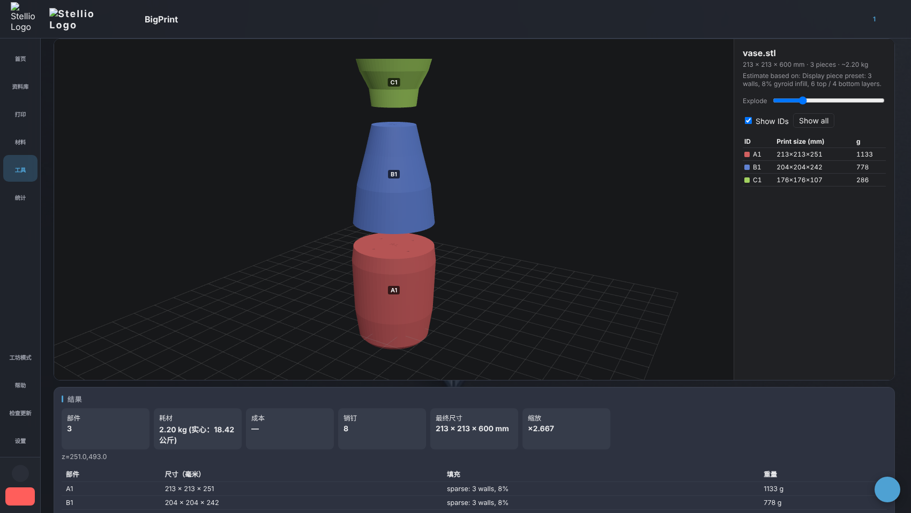 *BigPrint：分解预览、耗材与部件列表* |
| 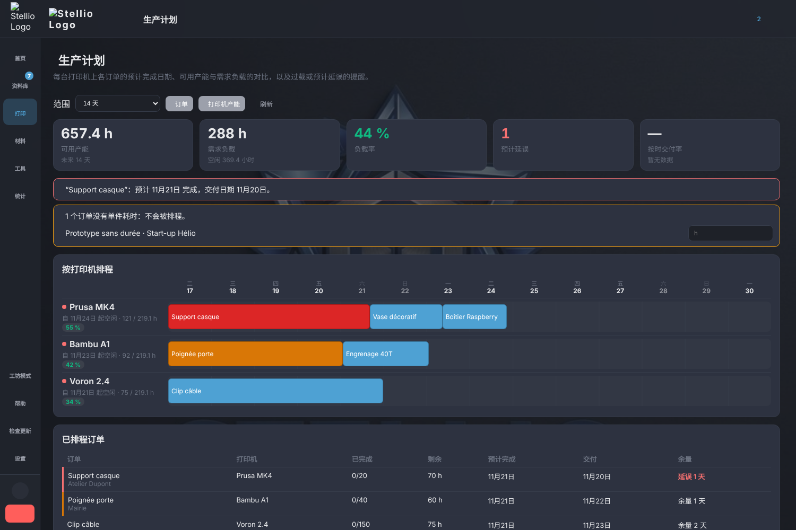 *生产计划：各打印机完成日期、产能与提醒* | |
| 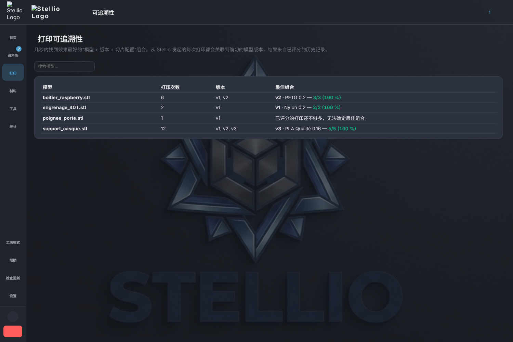 *可追溯性：每个模型的最佳版本 + 配置组合* | 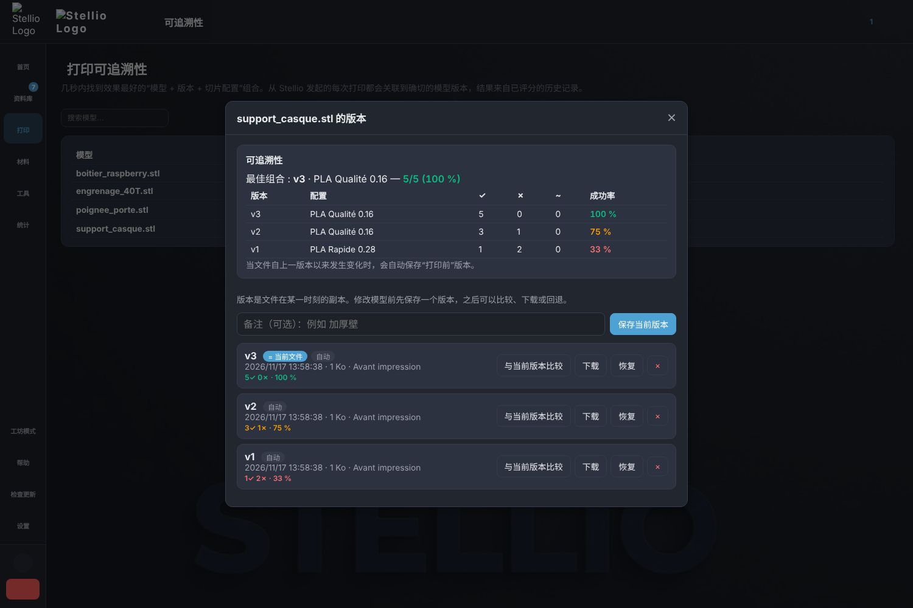 *模型版本：各版本与各配置的成功率* |

---

## 🚀 安装

### 🪟 Windows（推荐）

1. 从 [Releases](https://github.com/stellio-app/stellio/releases) 下载最新安装程序
2. 运行 `Stellio-Setup-<version>.exe`
3. 大功告成！🎉

> 💼 **便携版（免安装）**：从 Releases 下载 `Stellio-v<版本>-portable-win64.zip`，解压到任意位置（硬盘、U 盘），然后运行 `Stellio.exe`。您的数据保存在可执行文件旁边的 `data` 文件夹中（请保留 `portable.flag` 文件）。

### 🍎 macOS

1. 从 [Releases](https://github.com/stellio-app/stellio/releases) 下载适合您 Mac 的 `.dmg`：`Stellio-v<version>-macOS-arm64.dmg`（Apple 芯片：M1、M2、M3…）或 `Stellio-v<version>-macOS-x86_64.dmg`（Intel）。
2. 打开 `.dmg`，将 **Stellio** 拖入**应用程序**。
3. 首次启动：右键（或按住 Control 点击）**Stellio → 打开**，然后确认。🎉

> ⚠️ macOS 版本**尚未经过公证**，因此首次启动时 Gatekeeper 会弹出警告（右键 → 打开即可绕过）。每个文件都附带 `.sha256` 校验和，可自行验证。
>
> 💡 **窗口空白？** 5000 端口常被 macOS 的“AirPlay 接收器”占用：此时 Stellio 会自动选择另一个空闲端口（5001–5030）。您的数据保存在 `~/.stellio`。

### 🐧 Raspberry Pi / Linux

以**无图形界面的服务器模式**运行：Stellio 在后台运行，可通过浏览器访问，既可以在 Pi 本机访问，也可以在局域网内的任何设备上访问。

**系统要求**：推荐使用 Raspberry Pi 4 或 5，**64位** Raspberry Pi OS。

```bash
curl -O https://raw.githubusercontent.com/stellio-app/stellio/main/install-pi.sh
chmod +x install-pi.sh
./install-pi.sh
```

该脚本会自动安装：
- 系统依赖项（`ffmpeg`、`unrar`、3D渲染库）
- 专用的 Python 虚拟环境
- 一个 **systemd 服务**（`stellio.service`），会在开机时启动 Stellio，并在崩溃时自动重启

安装完成后，可通过 `http://<pi的IP>:5000` 访问 Stellio。

```bash
sudo systemctl status stellio     # 查看服务状态
sudo systemctl restart stellio    # 重启服务
sudo journalctl -u stellio -f     # 实时查看日志
```

> 💡 **与 Windows 相同的更新方式**：每个版本发布的 `.zip` 补丁在两个平台上是完全相同的（纯源代码，无需编译）。Stellio 会自动检测并应用补丁，然后重启服务 — 无需手动重新安装。
>
> 🎥 除原生桌面窗口（替换为浏览器访问）以及本地 Ollama AI（需要性能较好的模型才能在 Pi 上顺畅运行，如有需要可在设置中将 `ollama_url` 指向远程 Ollama 服务器）外，其余功能与 Windows 版本相同。

### 🖥️ Proxmox VE（一条命令创建 LXC 容器）

在 **Proxmox VE** 服务器上，脚本会为您创建并配置好整个容器。打开 **Proxmox 主机的 Shell**（Datacenter → 您的节点 → Shell），粘贴：

```bash
bash -c "$(curl -fsSL https://raw.githubusercontent.com/stellio-app/stellio/main/stellio-lxc.sh)"
```

脚本提供默认或高级设置（CTID、CPU 核心、内存、磁盘、网桥、VLAN、DHCP 或静态 IP、存储、要挂载的主机文件夹），然后：
- 创建一个**非特权 Debian 12** 容器（默认 2 核、2 GB 内存、32 GB 磁盘、开机自启）；
- 使用 `install-pi.sh` 在其中安装 Stellio（依赖项、Python 环境、**systemd 服务**）；
- 显示访问地址 `http://<容器IP>:5000` 和生成的 root 密码。

> 🔒 **来源**：在此容器中，Stellio 会**隐藏添加本地文件夹和文件**的选项，只提供 **SMB** 和 **NFS** 网络来源。如果使用 `var_mount=/主机路径:/mnt/models` 挂载主机文件夹，则额外允许“本地文件夹”。该设置位于 `/etc/systemd/system/stellio.service.d/sources.conf`（变量 `STELLIO_ALLOWED_SOURCE_TYPES`）。

```bash
pct exec <CTID> -- update-stellio                 # 更新 Stellio（在 Proxmox 主机上执行）
pct exec <CTID> -- journalctl -u stellio -f       # 实时查看日志
```

无菜单模式：所有选项都可以通过环境变量设置，例如 `var_mode=default var_cpu=4 var_ram=4096 var_disk=16 var_ip=192.168.1.50/24 var_gw=192.168.1.1`（完整列表见脚本开头）。

💾 **存储选择**：在第一个菜单中选择“默认设置 + 选择存储”（或设置 `var_choose_storage=1`），即可选择容器磁盘（`var_storage`，如 `local-zfs`）和模板（`var_template_storage`，如 `local`）的存放位置。脚本会检查存储是否存在以及剩余空间是否足够。

🌍 **语言**：脚本文字跟随 Proxmox 语言（fr、en、de、es、pt、it、zh、ja）；可用 `var_lang=zh` 强制指定（默认英语）。

### 🧰 服务器版专属（树莓派 / Linux）

> Windows 版不受影响：这些功能只会出现在树莓派、虚拟机、LXC、Docker 和 Linux 上。

- 🧱 **1.1.7 中仅限服务器版**：外部推送通知、定期摘要、MQTT / Home Assistant、出站 Webhook、公共 API、实例间同步和移动访问在 Windows 上隐藏并停用。
- ☁️ **在线 AI（可选）**：可用您自己的 API 密钥以 Claude（Anthropic）、ChatGPT（OpenAI）或 Gemini（Google）代替 Ollama（设置 → 人工智能）。密钥在服务器上加密存储，绝不会回传给浏览器；默认仍为 100% 本地的 Ollama。请求（文件名、标签、描述、S.O.S Print 照片）会发送给所选提供商，并按您的密钥计费。
- 📥 **切片软件配置文件**：Stellio 看不到您电脑上的切片软件，也不会连接切片软件的云（Orca Cloud、Bambu Cloud 等）。请先在切片软件中导出配置文件（OrcaSlicer：文件 → 导出 → 导出预设包），再在 设置 → 我的切片软件配置文件 中导入；对于 Orca Cloud，也可以粘贴配置文件的“Copy raw JSON”。还可以指定一个 Stellio 会自动重新读取的**监视配置文件夹**（Syncthing、网络共享、scp 等）。
- 🐯 [**TigerTag**](https://tigersystem.io)：在 设置 → 耗材库存 → TigerTag 中使用邮箱和密码官方登录（不会保存密码，只保存加密的会话令牌）。账户是用 Google 创建的？请先在 TigerTag 应用中通过“忘记密码”设置密码。备用方法：把 TigerTag Studio 的数据文件夹（Windows：`%APPDATA%` 中的“TigerTag…”文件夹，至少包含 `Local Storage` 和 `IndexedDB`）复制到服务器并填写其路径。

### 支持的切片软件

Stellio 可自动检测：
- ✅ OrcaSlicer
- ✅ Bambu Studio
- ✅ PrusaSlicer / SuperSlicer
- ✅ Ultimaker Cura
- ✅ Creality Print
- ✅ Elegoo Slicer
- ✅ Qidi Studio
- ✅ Anycubic Slicer Next
- ✅ Anycubic Slicer
- ✅ Simplify3D
- ✅ ideaMaker
- ✅ FlashPrint
- ✅ Lychee Slicer
- ✅ CHITUBOX / CHITUBOX Pro / Anycubic Photon Workshop / PreForm / Voxeldance Tango
- ✅ CraftWare
- ✅ MatterControl
- ✅ MakerBot Print
- ✅ Voxelizer
- ✅ Slic3r
- ✅ KISSlicer

### 支持的打印机

| 品牌 | 型号 | 连接与功能 |
|---|---|---|
| **Bambu Lab** | X1 / X1C / X1E · X2D · P1P / P1S · P2S · A1 / A1 mini · H2D / H2S / H2C | MQTT（局域网 + 云端）：实时监控、AMS、摄像头、SSDP 自动发现 |
| **Prusa** | MK4 · MK3.9 · MK3.5 · MINI+ · XL · CORE One | PrusaLink（HTTP）：监控、上传、摄像头 |
| **Creality** | K1 / K2 系列 · Ender-3 V3 · Hi | WebSocket：监控、CFS、UDP 自动发现 |
| **Elegoo** | Centauri Carbon 1 和 2 · 光固化 Saturn / Mars 系列 | SDCP（WebSocket）：监控、UDP 自动发现 |
| **FlashForge** | Adventurer 5M / 5M Pro · AD5X | 专有 API：监控、UDP 自动发现 |
| **Klipper / Moonraker** | 任何运行 Klipper 的机器（Voron 等） | HTTP：监控、上传、摄像头、精确打印时长 |
| **OctoPrint** | 任何由 OctoPrint 控制的打印机 | HTTP：监控、上传、摄像头 |
| **Duet / RepRapFirmware** | 任何 Duet 2/3 主板 | HTTP：监控、上传 |
| **Repetier-Server** | 任何由 Repetier-Server 管理的打印机 | HTTP：监控、上传 |
| **树脂** | Formlabs（Web API）· Anycubic Photon Wi-Fi · Chitubox / Phrozen / Uniformation (SDCP) | 仅监控 · 维护（FEP、料盒、LCD…） |
| **USB 打印机** | 连接到 Stellio 所在电脑的 Marlin、Prusa、Creality、Klipper 主板等 | 串口检测（从不打开端口）：已插上 / 未连接，无状态和温度 |

> 所列型号是 Stellio「添加打印机」表单中提供的型号。使用相同协议的其他型号通常也能工作，但并未全部测试——如果您的打印机能用或不能用，请[在 GitHub 上告诉我们](https://github.com/stellio-app/stellio/issues)。

---

## 🛠️ 技术栈

| 组件 | 技术 |
|---|---|
| 后端 | Python 3.8+、Flask、Waitress |
| 前端 | HTML5、CSS3、原生 JavaScript |
| 数据库 | SQLite（WAL 模式） |
| 桌面端 | pywebview（Windows、macOS）／无图形界面浏览器模式（Raspberry Pi、Linux） |
| 3D渲染 | PyRender、numpy CPU 光栅化器、Three.js |
| 网格与嵌套排版 | trimesh、pymeshfix、shapely、rectpack |
| AI | Ollama（本地） |
| 网络 | paho-mqtt、smbclient、requests |
| 加密 | cryptography（AES，每次调用随机生成IV） |
| 压缩包 | zipfile、rarfile、py7zr、tarfile |

---

## 📖 文档

### 键盘快捷键

| 快捷键 | 操作 |
|---|---|
| `Ctrl+K` | 命令面板 |
| `Ctrl+F` | 搜索 |
| `Ctrl+N` | 新建下载 |
| `Ctrl+,` | 设置 |
| `Ctrl+Z` | 撤销上一次删除（5分钟回收站） |
| `Alt+1-8` | 快速导航 |
| `Shift+点击` | 选择文件范围 |
| `↑ ↓ ← →` + `Enter` | 在文件库中导航并打开文件 |
| `F` | 切换收藏 |
| `T` | 标签管理器 |
| `?` | 快捷键帮助 |
| `Esc` | 关闭弹窗／清空搜索 |

### 项目结构

```
stellio/
├── main.py             # Flask + 桌面端后端
├── interface/              # index.html, script.js, style.css (UI)
├── packaging/              # launcher.py, installer (.iss), macOS entitlements
├── release-notes/          # notes.txt (release text, replaced at each release)
├── tests/  tools/          # pytest tests, maintenance tools (incl. stellio_manager.bat)
├── check_deps.py       # 自我修复式依赖检查工具
├── modules/            # 从 main.py 拆分出的核心模块 (print_session, share_link, plugin_host, print_events…)
├── bundled_plugins/    # 内置插件 (BigPrint, MQTT, Webhook, 延时摄影…)，仅在启用时加载
├── worker.py           # 未使用的 3MF 工作进程骨架（占位）
├── assets/             # 标志、图标
├── languages/          # 翻译文件（JSON）
├── apk/                # Android 配套应用安装包
├── docs/               # 文档、隐私政策、多语言 README
├── requirements.txt    # Python 依赖项
├── install-pi.sh       # Raspberry Pi / Linux 安装脚本（systemd 服务）
└── stellio-lxc.sh      # Proxmox VE 的 LXC 安装脚本
```

有想法？[提交一个 issue](https://github.com/stellio-app/stellio/issues)！

---

## 🤝 贡献


欢迎贡献代码！🎉

1. **Fork** 本项目
2. 创建您的分支（`git checkout -b feature/AmazingFeature`）
3. 提交您的更改（`git commit -m 'Add AmazingFeature'`）
4. 推送分支（`git push origin feature/AmazingFeature`）
5. 提交一个 **Pull Request**

### 贡献指南
- 遵循现有的代码风格
- 使用法语或英语添加注释
- 尽可能在 Windows 上测试您的更改
- 如有需要，请更新相关文档

### 报告问题

最简单的方式是直接在应用内提交：打开侧边栏中的 **建议与问题** 并描述问题——它会作为 GitHub issue 自动为您提交。您也可以自行在 GitHub 上创建 issue。

请使用错误报告模板，并包含以下信息：
- Stellio 版本
- 操作系统
- 复现步骤
- 错误日志（可在 设置 → 诊断 中导出）

---

## 📜 许可证

本项目采用 **GNU Affero 通用公共许可证 v3.0** — 详情请参阅 [LICENSE](../../LICENSE) 文件。

> 💡 **简而言之**：您可以自由复制、修改和分发本软件。如果您修改了 Stellio，或将其用于提供网络托管服务，则必须以相同的 AGPLv3 许可证发布完整源代码。

---

## 🔒 隐私

Stellio 采用本地优先架构：您的数据保留在您的设备上，默认情况下不会向外部服务器收集或发送任何数据。完整详情请参阅我们的[隐私政策](../privacy/PRIVACY.md)。唯一的例外（且仅在您自己启用时）：服务器版的在线 AI（Claude、ChatGPT、Gemini）会把您的 AI 请求发送给所选的提供商。

---

## 🔏 代码签名政策

发布在 [Releases](https://github.com/stellio-app/stellio/releases) 中的 Windows 安装程序和 Linux AppImage **目前尚未进行代码签名**，因此 Windows SmartScreen 可能会显示警告。macOS 版本也未经过公证。每个发布文件都附带 SHA-256 校验和（`.sha256`），您可以自行验证，内置更新程序在安装前也会检查它。有关当前状态、如何验证下载文件以及我们的签名计划，请参阅 [CODE_SIGNING_POLICY.md](../../CODE_SIGNING_POLICY.md)。

---

## 🤝 合作伙伴

<p align="center">
  <a href="https://tigersystem.io"></a>
</p>

Stellio 是 NFC/RFID 耗材识别系统 [**TigerTag**](https://tigersystem.io) 的集成合作伙伴：您的料盘可直接显示在 Stellio 的耗材库存中。

- 🌐 [官方网站](https://tigersystem.io) — [tigertag.io](https://tigertag.io)
- 🖥️ [Studio Manager（桌面应用）](https://github.com/TigerTag-Project/TigerTag-Studio-Manager)
- 📘 [RFID 指南与文档](https://github.com/TigerTag-Project/TigerTag-RFID-Guide)
- 📱 [iOS 应用](https://apps.apple.com/fr/app/tigertag-rfid-connect/id6745437963)

---

## 🙏 致谢

- [Ollama](https://ollama.com/) 提供本地AI支持
- [Flask](https://flask.palletsprojects.com/) 提供后端支持
- [Three.js](https://threejs.org/) 提供网页端3D渲染
- [trimesh](https://github.com/mikedh/trimesh) 提供网格处理支持
- [Spoolman](https://github.com/Donkie/Spoolman) 提供耗材卷轴管理
- [TigerTag](https://tigersystem.io) 提供 NFC/RFID 耗材识别
- [Open Filament Database](https://openfilamentdatabase.org)（Open Filament Collective）提供耗材目录（MIT 许可证）
- [bigprint](https://github.com/PooterTF/bigprint)（Michael Christopher Stone / PooterTF）提供 BigPrint 工具（等身大模型切割，AGPL-3.0）
- [OpenPrintTag](https://specs.openprinttag.org/) 提供耗材卷轴 NFC 标签标准（Prusa Research，MIT 许可证）
- 感谢创客社区的反馈与建议
- 感谢所有贡献者 ❤️

---

## 📞 联系与支持

- 🐛 **报告问题**：[GitHub Issues](https://github.com/stellio-app/stellio/issues)，或直接在应用内提交（**建议与问题**）
- 💡 **功能建议**：[GitHub Discussions](https://github.com/stellio-app/stellio/discussions)
- 📧 **邮箱**：contact@stellio-app.com
- 🌐 **官网**：[stellio-app.com](https://stellio-app.com)
- 📖 **文档** : [stellio-app.com/docs](https://stellio-app.com/docs/)
- 💬 **Discord**: [加入 Discord 社区](https://discord.gg/ySxpHvS6bd)

---

## ⭐ 支持本项目

如果 Stellio 对您有帮助，欢迎：
- 在 GitHub 上点亮一颗**星标** ⭐
- 与身边的人分享这个项目
- [贡献代码](#-贡献) 或参与翻译
- 报告问题以帮助改进应用
- 在 Ko-fi 上小额打赏，支持开发 ☕

<p align="center">
  <a href="https://ko-fi.com/E6J828RYVD">
    
  </a>
</p>

---

<p align="center"><strong>用 ❤️ 为创客社区打造</strong></p>

<p align="center">
  <a href="https://github.com/stellio-app/stellio">⭐ 为本仓库点星</a> •
  <a href="https://github.com/stellio-app/stellio/issues">🐛 报告问题</a> •
  <a href="https://github.com/stellio-app/stellio/discussions">💡 建议新功能</a> •
  <a href="https://discord.gg/ySxpHvS6bd">💬 加入 Discord</a>
</p>
